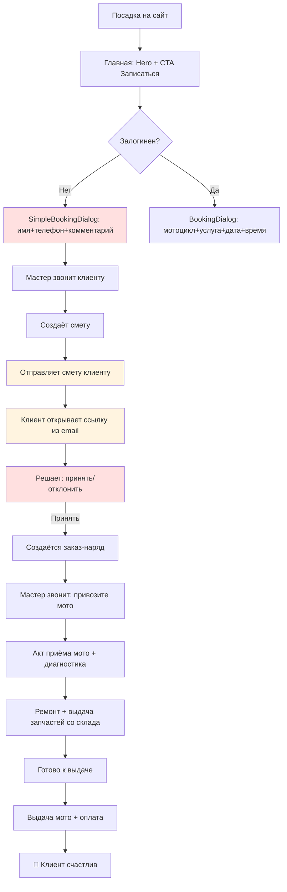

# ROADMAP v3.14 — comprehensive audit by 9 specialists + QA-first & money guard (FINAL)

> **v3.14 = v3.13 (фундамент, 84 задачи) + 4 идеи из ROADMAP v4:**
> 1. **QA-фундамент поднят в Фазу 0.** В v3.13 группа L шла последним «Спринтом 19» —
>    тесты доделывались после всех изменений. Теперь визуальная регрессия, smoke и
>    кросс-браузерные прогоны стоят ДО первых продуктовых задач и защищают каждую фазу.
> 2. **Money guard (Q0) — отдельная задача.** Денежный контур (calcEstimateTotals,
>    сверка B1–B11 из `scripts/audit-checks.sql`) должен блокировать merge, если
>    расходятся итоги сметы/наряда/печати. Этого не было в v3.13.
> 3. **Зависимости выстроены явно через gate-систему.** В v3.13 D1 (semantic colors)
>    шёл раньше A1/C1 (перестройка навигации), а J1 (microcopy) раньше S3/A2 —
>    результат: двойная работа по одним и тем же файлам. Теперь: токены → навигация →
>    контент/UI-паттерны → метрики. После каждой фазы — ✅ Gate.
> 4. **Ре-план каждые 2–3 спринта.** Объёмы уточняются по факту; задачи внутри фаз
>    можно переставлять местами, но не переносить назад через gate.
>
> **Что НЕ изменено относительно v3.13:**
> - 9 групп задач с детальными карточками (S, A, C, D, I, E, K, F, G) — содержимое
>   задач сохранено как есть (детальные шаги, тестирование, оценки).
> - 5 групп (H, J, L, M, N) — в v3.13 существовали только как упоминания в шапке
>   и в ОЧЕРЕДНОСТИ ВЫПОЛНЕНИЯ, без отдельных карточек в теле документа
>   (структурный дефект v3.13, явно отмечен в v4). В v3.14 эти задачи включены
>   в фазы (H и J в Фазу 3, L в Фазу 0, M и N в Фазу 4), но детальные карточки
>   нужно восстановить (см. задачу Q1 — технический долг).
> - Правила работы (одна задача = один PR, bump версии на релизе, Lucide вместо
>   эмодзи, «переупаковать, а не удалять»).
> - Релизный ритм: v1.6.0 (Ф0) → v1.6.x (Ф1) → v1.7.0 (Ф2) → v1.8.0 (Ф3) → v2.0.0 (Ф4).
>
> **Принцип:** проект должен выглядеть единым целым, масштабироваться и измеряться.
> Сайт, админка, CRM, печатные формы — в едином стиле.
> Архитектура — security, performance, observability, real-time.
> Бизнес-метрики — North Star + воронки + retention + segmentation.
> **Переупаковать, а не удалять.**

## Архитектура плана

```
Фаза 0 ФУНДАМЕНТ         Q0 — money guard           (1 д)    gate: money guard зелёный
                          Q1 — восстановить H/J/L/M/N  (1 д)    gate: карточки на месте
                          L — QA (7 задач)            (6.5 д)  gate: CI полный + зелёный

Фаза 1 БАЗА              D — дизайн-система         (7 д)    gate: 0 hardcoded-цветов
                          I — UI-паттерны            (5.5 д)  gate: spacing единый
                          E+K — архитектура/security (17.5 д) gate: security headers, Sentry, индексы
                          J — контент-дизайн         (5 д)    gate: microcopy dictionary

Фаза 2 ПРОДУКТЫ          S — сайт                    (4 д)
                          A — админка                 (11.2 д)
                          C — CRM + цикл продаж       (6 д)   gate: лид→наряд→оплата e2e зелёный

Фаза 3 ПОЛЬЗОВАТЕЛЬ       G — UX-исследования         (6.5 д)
                          H — информ. архитектура    (6 д)
                          I2-final — доводка          (1 д)   gate: WCAG AA, mobile audit

Фаза 4 РОСТ              F — бизнес-метрики          (6.5 д)
                          N — CRO/analytics           (4.5 д)
                          M — SEO                     (5 д)   gate: NSM-дашборд работает, OG рендерится
```

Внутри каждой группы задачи упорядочены 🔴 критично → 🟡 важно → 🟢 средне.

## Правила работы (обязательны для всех задач)

- Одна задача = одна ветка (`feat/S1-main-page`) = один PR = один squash-коммит (`feat(S1): <что>`).
- Перед задачей — воспроизвести проблему (manual-сценарий или падающий тест).
- После задачи — чек-лист приёмки (см. ниже) + регресс-проверка соответствующего gate.
- **Bump версии в package.json — только в release-коммите после фазы/спринта**
  (`release v1.6.0 — Фаза 0: Q0+L`), не после каждой задачи.
- Каждая задача: пункт в CHANGELOG.md + `[x]` в этом файле + коммит со ссылкой на задачу.
- **Запрещено:** менять расчётную логику итогов вне задач группы Q/L; удалять функции
  («переупаковать, а не удалять»); мержить красный CI.
- **Ре-план каждые 2–3 спринта:** объёмы уточняются по факту прогонов, задачи внутри
  фаз можно переставлять местами, но не переносить назад через gate (т.е. нельзя
  вернуться из Фазы 2 в Фазу 1 без явного решения и перезамера).

## Правило reuse-first (обязательно для всех задач)

> **Урок из GT2/GT2-AUTO (alpha.49–50):** изначально была реализована стратегия GT2
> (magic-link через `jose@5.10.0`, +140 строк нового кода, +1 env var, +12 unit-тестов),
> но при аудите выяснилось что в проекте УЖЕ есть все нужные хелперы:
> `hashPassword` (src/lib/password.ts), `sendEmail` (src/lib/email.ts),
> `mustChangePassword` (поле в Customer schema с самого начала), `crypto.randomBytes`
> (Node.js built-in), `/api/admin/customers/[id]/reset-password` (готовый endpoint
> с генерацией tempPassword). GT2 откатан, реализована GT2-AUTO — zero new deps,
> +90 строк переиспользования существующих хелперов. То же решение, меньше кода.

**Правило: при реализации задачи обязательно сначала проверить существующие
инструменты и в первую очередь пользоваться ими. Новые библиотеки/файлы/env vars
создавать только при отсутствии подходящих существующих.**

### Чек-лист агента перед реализацией (mandatory)

Перед тем как начать писать код для новой задачи, агент обязан выполнить
следующие проверки (в указанном порядке):

1. **Аудит существующих хелперов в `src/lib/`:**
   ```bash
   ls src/lib/                    # посмотреть все .ts файлы
   grep -rn "export.*function\|export const" src/lib/ | head -50
   ```
   - Имя файла часто подсказывает назначение (`password.ts`, `email.ts`,
     `web-push.ts`, `print-utils.ts`, `auth.ts`, `db.ts`, `seo-image.ts` и т.д.).
   - Прочитать каждый потенциально подходящий файл — понять API.

2. **Аудит существующих API routes:**
   ```bash
   find src/app/api -name "route.ts" | head -30
   grep -rln "POST\|GET\|PATCH\|DELETE" src/app/api/ | head -20
   ```
   - Особенно в смежных областях: если работаешь с `estimates` — проверить
     и `/api/admin/estimates/*`, и `/api/customer/estimates/*`.

3. **Аудит существующих компонентов в `src/components/`:**
   ```bash
   find src/components -name "*.tsx" | head -30
   grep -rln "function .*Layout\|function .*Dialog\|function .*Card" src/components/ | head
   ```
   - Layout-компоненты (ListPageLayout, DetailPageLayout, FormDialogLayout —
     уже реализованы в `src/components/ui/` через I1).

4. **Аудит полей в Prisma schema:**
   ```bash
   grep -A 30 "^model [A-Z]" prisma/schema.prisma | head -100
   ```
   - Особенно Boolean-флаги с `@default(false)` — часто это заранее
     подготовленные механизмы (как `mustChangePassword`).

5. **Аудит существующих env vars и cron jobs:**
   ```bash
   grep -rn "process.env\." src/ | head -20
   cat vercel.json | grep -A 5 crons
   ```
   - Если нужна новая env var — сначала проверить что её нет.

6. **Аудит существующих npm-зависимостей:**
   ```bash
   grep -E '"[a-z@/-]+":' package.json | head -50
   ```
   - Если нужна новая библиотека (например, JWT) — сначала проверить что
     нет похожей (например, `bcryptjs`, `nodemailer`, `web-push` уже есть).

### Когда создавать новый файл/библиотеку/env var

- **Новый хелпер** — только если ни один существующий не подходит по назначению
  (например, оценка-специфичная логика, не покрываемая `auth.ts` или `db.ts`).
- **Новая библиотека** — только если существующие не решают задачу
  (например, нужен `pdfkit` для генерации PDF — `nodemailer` этого не делает).
- **Новый env var** — только если новой функциональности нужен новый секрет
  (например, `SENTRY_DSN` — уникальный, не дублирует существующие).
- **Новый cron job** — только если новая periodic-задача не покрывается
  существующими (`backup-daily`, `cleanup-login-attempts`, `cleanup-audit-log`,
  `crm/cron/morning-summary`, `plan-to-reminder`, `master-daily-report`).

### Документирование решения

Если после аудита принято решение «создать новое» — в PR-описании
обязательно указать:
1. Какие существующие инструменты проверил.
2. Почему они не подходят (с конкретными причинами).
3. Почему новое решение минимально и не дублирует существующее.

Это правило экономит время ревьюера и предотвращает over-engineering.

## Правило brand-book compliance (обязательно для всех задач)

> **Урок из alpha.55:** пользователь обнаружил что hotfix (поле email в
> EmployeesTab) нужно проверить на соответствие BRAND-BOOK. Добавлено
> явное правило — каждый PR должен проходить brand-book compliance check
> до merge. Без этого правила ревьюер мог пропустить нарушение (например,
> hardcoded hex цвет, или emoji в UI, или `` без alt).

**Правило: каждый PR обязан соответствовать BRAND-BOOK.md и
DESIGN-REFERENCE.html. Проверка выполняется через существующие
guard-скрипты (CI) + ручная проверка оставшихся правил.**

### Автоматические guard-скрипты (запускаются в CI на каждый PR)

Эти скрипты УЖЕ существуют (reuse-first: не создаём новый). Они покрывают
большую часть BRAND-BOOK автоматически. Запускать перед PR:

```bash
# Все 5 скриптов запускаются в CI через .github/workflows/quality-gate.yml.
# Локально для pre-flight:
bash scripts/check-hardcoded-colors.sh   # раздел 7 «Цвета»: hex/rgb вне whitelist
bash scripts/check-dark-mode.sh            # раздел 11 «Dark mode»: .dark + :root есть
bash scripts/check-micro-interactions.sh   # раздел 10 «Анимации»: transition-colors duration-200
bash scripts/check-spacing.sh              # раздел 8 «Отступы»: spacing в BRAND-BOOK.md
bash scripts/check-component-audit.sh      # I5 «Component audit»: list/detail/form-dialog-layout используются
```

Если любой из скриптов падает — PR не мержится.

### Ручная проверка (в PR-описании, обязательно)

Guard-скрипты не покрывают все правила BRAND-BOOK. Ревьюер (или агент
в self-review) обязан проверить следующие правила вручную:

#### Раздел 1 «Типографика»
- [ ] **Шрифты:** `font-display` (Russo One) — только заголовки h1-h6, суммы, лого.
  `font-mono` (JetBrains Mono) — только артикулы, номера, код, цены.
  Body — без явного класса (Inter по умолчанию).
- [ ] **Размеры:** `text-xxs` (10px) — только микро-бейджи, метки в таблицах.
  `text-base` (16px) — body. `text-2xl` (24px) — заголовки диалогов.
  Не использовать произвольные размеры (`text-[15px]`).
- [ ] **Веса:** `font-medium` — лейблы, текст в кнопках.
  `font-semibold` — заголовки секций. `font-bold` — цены, числа.

#### Раздел 2 «Иконки»
- [ ] **Источник:** только `lucide-react`. Не использовать SVG-иконки из других
  библиотек, не хардкодить SVG.
- [ ] **Размеры пропорциональны тексту:** в `text-sm` → `w-4 h-4`,
  в `text-lg` → `w-5 h-5`, в `text-2xl` → `w-6 h-6`.
- [ ] **`aria-label`** если внутри `<button>` только иконка (no text).

#### Раздел 3 «Кнопки»
- [ ] **Variant:** `default` — primary действие, `outline` — cancel,
  `ghost` — hover/menu, `destructive` — удалить/отменить.
  Не использовать `bg-red-500` и т.п.
- [ ] **Иконка в кнопке:** `<Trash2 className="w-4 h-4 mr-2" />Удалить`
  (иконка слева, размер w-4 для default/sm).

#### Раздел 4 «Бейджи»
- [ ] **Semantic variants:** `success`, `warning`, `info`, `special`,
  `destructive`, `outline`, `default`. Не использовать `bg-green-500` и т.п.
- [ ] **Пропорции:** `/15` для фона, `/30` для границы
  (например `bg-success/15 text-success border-success/30`).
- [ ] **text-xxs** для бейджей в таблицах/карточках.

#### Раздел 5 «Карточки»
- [ ] **Card padding:** `p-4` — стандарт, `p-5` — detail card, `p-6` — dialog.
  Не использовать `p-3.5` или произвольные.

#### Раздел 7 «Цвета»
- [ ] **Только semantic:** `bg-primary`, `text-muted-foreground`,
  `bg-destructive`, `text-success`, `bg-warning`, и т.д.
- [ ] **Без hardcoded hex** вне `src/lib/design-tokens.ts` и
  `src/app/globals.css` (guard: `check-hardcoded-colors.sh`).
- [ ] **Без Tailwind palette** (`bg-green-500`, `text-red-400`,
  `border-blue-500/30`) — используй semantic.

#### Раздел 8 «Отступы и spacing»
- [ ] **Tailwind scale:** `p-2`/`p-3`/`p-4`/`p-5`/`p-6`/`p-8`.
  Не использовать `p-3.5` или произвольные.
- [ ] **Gap:** `gap-1` для иконка+текст в бейдже, `gap-2` для toolbar,
  `gap-3` для form grid, `gap-4` для карточек в сетке.

#### Раздел 10 «Анимации и переходы»
- [ ] **transition-colors duration-200** для hover/focus состояний.
  Не использовать `duration-100` или `duration-500` без причины.
  (guard: `check-micro-interactions.sh`)

#### Раздел 11 «Dark mode»
- [ ] **`.dark` + `:root`** в globals.css (guard: `check-dark-mode.sh`).
- [ ] **CSS variables** для всех цветов — не hardcoded.
- [ ] Проверить визуально в dark mode (не только light).

#### Раздел 12 «Печать»
- [ ] **PRINT tokens** из `src/lib/design-tokens.ts` для печатных форм.
  Не использовать `color: black` в print CSS.

#### Раздел 13 «Запреты» (❌ что нельзя)
- [ ] **Emoji в UI** (✅ ❌ в кнопках/лейблах). Только в toast-сообщениях
  и email-текстах (где нет UI-контрола).
- [ ] **Inline `style={{}}`** с цветами/размерами — используй Tailwind classes.
  Исключение: динамические значения (progress bar width, transform).
- [ ] **`type="number"` без `inputMode`** — на mobile не вызывает цифровую
  клавиатуру. Используй `inputMode="numeric"` или `"decimal"`.
- [ ] **`` без `alt`** — accessibility (WCAG 2.1 AA, задача G2).
- [ ] **`<button>` без `aria-label`** если внутри только иконка (no text).
- [ ] **Удаление функций** — «переупаковать, а не удалять». Если функция
  не нужна — archive, не удаляй (может понадобиться в будущем).

### DESIGN-REFERENCE.html — визуальный эталон

`DESIGN-REFERENCE.html` — это статичная HTML-страница с примерами всех
компонентов (кнопки, бейджи, карточки, формы, печать). Перед PR —
открыть в браузере и сравнить визуально с твоими изменениями.

- Проверить что цвета/размеры/отступы соответствуют reference.
- Если reference не покрывает твой случай — обсудить с командой и
  расширить reference (отдельная задача, не в рамках текущего PR).

### Документирование проверки

В PR-описании добавить секцию:

```
## Brand-book compliance check
- [ ] `bash scripts/check-hardcoded-colors.sh` — pass
- [ ] `bash scripts/check-dark-mode.sh` — pass
- [ ] `bash scripts/check-micro-interactions.sh` — pass
- [ ] `bash scripts/check-spacing.sh` — pass
- [ ] `bash scripts/check-component-audit.sh` — pass
- [ ] Ручная проверка (разделы 1-13 BRAND-BOOK) — pass
- [ ] DESIGN-REFERENCE.html визуальная сверка — pass
```

Без этой секции PR не мержится.

## Универсальный чек-лист приёмки (Definition of Done)

0. **Reuse-first аудит выполнен** (см. чек-лист агента выше) — описать в PR
   какие существующие хелперы/компоненты/API переиспользованы, какие
   новые созданы и почему.
0b. **Brand-book compliance check выполнен** (см. правило выше) — описать
   в PR результаты 5 guard-скриптов + ручной проверки разделов 1-13.
1. **Воспроизвести проблему ДО правки** (тест или manual-скриншот).
2. **Исправить минимально точечно**, без «заодно»-рефакторингов вне скоупа задачи.
3. **Прогнать:**
   ```bash
   npx tsc --noEmit && npm run lint
   bun run test:unit                      # 72 теста R1.1
   bun run test tests/e2e/money-flow      # денежный поток (Q0)
   bun run test tests/visual              # затронутые страницы (L2)
   ```
4. **SQL-сверка `scripts/audit-checks.sql`** на стенде — все B1–B11 = 0
   (для задач, touching данные/API).
5. **CHANGELOG + `[x]` здесь + PR замержен владельцем.**

---

## Правила деплоя (обязательны для всех релизов/спринтов)

> **Принцип:** агент (Super Z) готовит код и архив → пользователь скачивает →
> распаковывает в `C:\PROJECTS\motoserv` → git push в GitHub → Vercel автодеплой →
> SQL миграции через Neon SQL Editor (веб-интерфейс, не CLI).

### Workflow

```
┌────────────────────┐    ┌──────────────────┐    ┌─────────────────┐
│ 1. Агент готовит   │ →  │ 2. Пользователь  │ →  │ 3. GitHub Actions│
│    код + архив     │    │    скачивает и   │    │    CI (39+ checks)│
│    в download/     │    │    распаковывает │    │    ✅ All passed  │
└────────────────────┘    │    в C:\PROJECTS\ │    └────────┬────────┘
                          │    \motoserv\    │             │
                          └────────┬─────────┘             ▼
                                   │              ┌────────────────┐
                                   │              │ 4. Vercel       │
                                   ▼              │    автодеплой   │
                          ┌──────────────────┐   │    из main      │
                          │ 5. git add -A    │   │    Ready ✅     │
                          │    git commit    │   └────────┬────────┘
                          │    git push      │            │
                          └────────┬─────────┘            ▼
                                   │              ┌────────────────┐
                                   └─────────────→│ 6. https://     │
                                                  │    apexmoto.ru  │
                                                  │    (production) │
                                                  └────────┬────────┘
                                                           │
                                                           ▼
                                          ┌────────────────────────────┐
                                          │ 7. Neon SQL Editor:        │
                                          │    применить migrate-*.sql │
                                          │    (только если есть SQL)  │
                                          └────────────────────────────┘
```

### 6 шагов релиза (агент выполняет 1+2, пользователь — 3-6)

#### Шаг 1 — Агент: подготовка кода + архива

Агент (Super Z) делает в `/home/z/my-project/`:

1. Реализует задачу(и) спринта (код, тесты, guards).
2. Прогоняет локальные проверки:
   ```bash
   bunx tsc --noEmit           # без ошибок TypeScript
   bun run test:unit           # все unit-тесты pass
   bash scripts/check-*.sh     # все static guards pass
   ```
3. Обновляет документацию:
   - `CHANGELOG.md` — новый раздел сверху с pre-releases
   - `ROADMAP-v3.14.md` — отметить задачу `[x] ✅ vX.Y.Z`
   - `DEPLOY.md` — если есть новые env vars / SQL миграции / cron jobs
   - `worklog.md` — запись с Task ID, что сделано, проверки
   - `package.json` — bump версии на релизе спринта
4. Запускает `python3 scripts/build-full-archive.py` →
   `download/apex-moto-full-vX.Y.Z.zip` (~1.5 MB, 450+ файлов).
5. Опционально: `download/RELEASE-NOTES-vX.Y.Z.md` с summary.

#### Шаг 2 — Агент: даёт инструкции пользователю

В чат отправляет:
- Ссылку на архив: `/home/z/my-project/download/apex-moto-full-vX.Y.Z.zip`
- Команду для PowerShell (распаковка + git commit + git push)
- (Если есть SQL миграция) SQL-блок для Neon SQL Editor — прямо текстом
- (Если есть env vars) список `NAME = value` для Vercel
- Чек-лист проверок на проде (`curl.exe -I https://apexmoto.ru/`, и т.д.)

#### Шаг 3 — Пользователь: скачивание + распаковка локально

На Windows машине в PowerShell:

```powershell
# Скачать архив из чата в C:\PROJECTS\motoserv\ (или в Downloads)
# (агент присылает архив как файл — пользователь сам кладёт в нужное место)

# Распаковать поверх существующего проекта (с заменой):
cd C:\PROJECTS\motoserv
Expand-Archive -Path .\apex-moto-full-v1.6.22.zip -DestinationPath . -Force

# Проверить что version обновилась в package.json:
Get-Content .\package.json | Select-String '"version"'
# Ожидание: "version": "1.6.22"
```

⚠️ **Важно:** `Expand-Archive -Force` заменяет существующие файлы. Локальные
изменения (если были) — лучше закоммитить или stash перед распаковкой.

#### Шаг 4 — Пользователь: git commit + push

```powershell
cd C:\PROJECTS\motoserv

# Проверить что изменилось:
git status
git diff --cached --stat  # после git add

# Закоммитить:
git add -A
git commit -m "feat(Sprint-X.Y): <описание из CHANGELOG> (vX.Y.Z)"
git push origin main
```

Vercel автоматически начинает сборку из `main` branch.

#### Шаг 5 — Пользователь: проверить GitHub Actions + Vercel

1. https://github.com/alfat81/motoserv/actions — дождаться ✅ All checks passed
2. https://vercel.com → apex-moto → Deployments — дождаться Ready (зелёный)
3. Если что-то красное — открыть логи, сообщить агенту, откатить через `git revert`

#### Шаг 6 — Пользователь: SQL миграции на Neon (если были)

Если в релизе есть `scripts/migrate-*.sql`:

1. Открыть https://console.neon.tech → выбрать проект → **SQL Editor**
2. Открыть файл `C:\PROJECTS\motoserv\scripts\migrate-*.sql` в Notepad
3. Ctrl+A → Ctrl+C (всё содержимое)
4. Вставить в Neon SQL Editor (Ctrl+V)
5. Нажать **Run** (или Ctrl+Enter)
6. Дождаться вывода `CREATE INDEX / INSERT / COMMIT` (без ошибок)
7. Для проверки — агент даёт `SELECT ...` запрос, пользователь выполняет в SQL Editor

⚠️ **Никогда не запускать SQL напрямую через `psql` CLI** — только через
Neon SQL Editor (веб). Это безопаснее: видно подсветку синтаксиса, можно
откатить через Neon point-in-time restore если что-то сломалось.

### Дополнительные env vars (если нужны)

Если в релизе есть новые env vars (например, `CRON_SECRET`, `SENTRY_DSN`):

1. https://vercel.com → apex-moto → Settings → Environment Variables
2. Add New → Name + Value + Environment (Production)
3. **Save**
4. **Redeploy обязательно** — без rebuild новые env vars не подхватятся
   (build кэширует env на момент сборки):
   - Vercel → Deployments → последний → ⋯ → Redeploy → ждать Ready

### Чек-лист проверок на проде (агент даёт команды под каждый релиз)

```powershell
# 1. Главная страница отвечает 200 + security headers:
curl.exe -I https://apexmoto.ru/

# 2. Health endpoint (если есть):
curl.exe -s https://apexmoto.ru/api/health

# 3. Sprint-specific проверки (rate limit, cron trigger, и т.д.):
# агент даёт конкретные команды в каждом релизе
```

### Откат (если что-то сломалось на проде)

**Vercel** (мгновенный откат deployment):
1. Vercel → apex-moto → Deployments
2. Найти предыдущий зелёный deployment
3. ⋯ → **Promote to Production**

**Git** (откат исходного кода):
```powershell
cd C:\PROJECTS\motoserv
git log origin/main -5  # найти хэш до проблемного коммита
git revert HEAD --no-edit
git push origin main
```

**Neon SQL** (откат индексов):
```sql
DROP INDEX IF EXISTS "WorkOrder_status_idx";
-- и т.д. — полный список агент даёт в каждом релизе
```

**Neon point-in-time restore** (если совсем сломалась БД):
1. Neon → Project → **Restore**
2. Выбрать точку во времени до миграции
3. Применить (free tier — 7 дней истории)

### Что агент НЕ делает (принципы)

- ❌ **НЕ запускает `git push` сам** — пользователь делает это со своей Windows-машины
- ❌ **НЕ редактирует Vercel env vars сам** — пользователь делает через web
- ❌ **НЕ применяет SQL миграции сам** — пользователь через Neon SQL Editor
- ❌ **НЕ даёт инструкции для Linux/bash** — только PowerShell (Windows)
- ❌ **НЕ даёт `bun run dev` для проверок** — это делает пользователь у себя локально
- ✅ **Готовит код, тесты, guards, архив, инструкции** — это обязанность агента

### Что пользователь НЕ делает (принципы)

- ❌ **НЕ редактирует код вручную** — агент делает все правки
- ❌ **НЕ запускает unit-тесты локально** — CI на GitHub Actions делает это
- ❌ **НЕ применяет prisma migrate CLI** — только SQL через Neon SQL Editor
- ❌ **НЕ устанавливает Sentry/UptimeRobot без инструкций** — агент даёт точные шаги
- ✅ **Распаковывает архив, git push, проверяет на проде** — это роль пользователя

---

# ГРУППА Q — MONEY GUARD И QA-ФУНДАМЕНТ (Фаза 0) 🔴

> Без этого нельзя начинать продуктовые изменения: любое из них может тихо сломать
> деньги или визуал, и мы не узнаем. Это то, чего не хватало в v3.13 больше всего.

## Q0 — Money guard в CI 🔴 критично (зависимостей нет)

**Проблема:** в v3.13 расчёт итогов (`calcEstimateTotals`, `createWorkOrder`, PATCH
смет/нарядов) — зона риска. Любой PR может тихо сломать математику, и это выяснится
только в проде (клиенту выставлен счёт ≠ согласованной смете). Существующие 72 unit-теста
R1.1 покрывают функции, но не защищают от регресса на уровне CI.

**Решение:** денежный контур — неприкосновенная зона. В CI добавить шаг:
1. Запуск unit-тестов `calcEstimateTotals` (матрица sum/fixed × скидки × rounding).
2. Интеграционный тест «смета → approve → наряд: три артефакта (UI, печать, БД) дают
   идентичные итоги».
3. **Guard-греп:** `grep -rn "qty \* price" src/app/api` → 0 совпадений
   (все расчёты только через общий код в `lib/estimate-totals.ts`).

### Шаги Q0
1. Создать `tests/e2e/money-flow.spec.ts` — сквозной тест:
   - Создать смету с fixed-комплексом 5000 ₽ (дети на 4300 ₽) + обычная работа 1000 ₽
   - Согласовать → проверить `workOrder.totalAmount === 6000` (= estimate.totalAmount)
   - То же для sum-комплекса
   - Проверить печатную форму: итог == БД == UI
2. В CI (`.github/workflows/ci.yml` или эквивалент) — обязательный шаг `money-guard`
   на каждый PR: запускает unit + e2e money-flow; если красный — merge заблокирован.
3. Добавить pre-commit hook `scripts/check-money-guard.sh`:
   - `rg -n "qty \* price" src/app/api` → если есть совпадения — отказать коммит
   - `rg -n "reduce.*total" src/app/api/admin/estimates` → если есть — отказать коммит
4. Документировать в `CONTRIBUTING.md` раздел «Денежный контур — неприкосновенная зона».

### Тестирование Q0
- **Manual:** создать PR, ломающий `calcEstimateTotals` (изменить `qty × price` на
  `qty + price`) → CI должен упасть на money-guard step.
- **Регресс:** прогнать на текущем main → CI зелёный, все 72 unit-теста + money-flow e2e
  проходят.
- **Guard-греп:** `rg -n "qty \* price" src/app/api` → 0 совпадений.

**Оценка:** 1 день. ✅ Выполнено (v1.5.46-pre.1, 2026-10-17).

**Критерий приёмки:** PR, сломавший пересчёт, не мержится автоматически. ✅

**Результаты выполнения:**
- `tests/e2e/money-flow.spec.ts` (279 строк) — 3 e2e сценария: fixed-комплекс,
  sum-комплекс, простая смета. Каждый сверяет итог между POST /estimates, GET,
  print-страницей, POST /work-orders.
- `scripts/check-money-guard.sh` (140 строк) — 7 статических guard-проверок
  (без БД, запускается в CI).
- `src/lib/work-orders.ts` — убран дублирующий for-loop (35 строк),
  заменён на `calcEstimateTotals(items)`. Единый источник истины.
- `package.json` — добавлены scripts: `test:money-flow`, `test:money-guard`.
- `.github/workflows/quality-gate.yml` — добавлен CI step
  `Q0 Money Guard (static checks)`.
- `CONTRIBUTING.md` — создан раздел «Денежный контур — неприкосновенная зона».

**Проверки:** tsc ✓, unit 72/72 ✓, money-guard 7/7 ✓, lint (мои файлы) ✓.
E2E money-flow требует dev-сервер + БД, оставлен на pre-release проверку.

## Q1 — Восстановить карточки задач H/J/L/M/N 🟡 (технический долг v3.13)

**Проблема:** в v3.13 группы H (информационная архитектура), J (контент-дизайн),
L (QA), M (SEO), N (CRO) существуют только как заголовки в changelog'е шапки и
как пункты в ОЧЕРЕДНОСТИ ВЫПОЛНЕНИЯ — без отдельных карточек задач в теле
документа (нет ни шагов, ни тестирования, ни критериев приёмки). Это структурный
дефект v3.13, явно отмеченный в v4. Из-за этого исполнитель не знает, что
конкретно делать в каждой задаче — только краткое название.

**Решение:** для каждой из 5 групп (H, J, L, M, N) восстановить карточки по
шаблону 9 групп с детальными описаниями (S/A/C/D/I/E/K/F/G). Источники для
восстановления — `upload/`-файлы (оригиналы аудитов, которые питали эти группы):

| Группа | Источник в upload/ |
|---|---|
| H (Information Architecture) | `SEO-TASK-QUEUE (1).md`, `UI-AUDIT-QUEUE.md` |
| J (Content Design) | `WORKFLOW-TASK-QUEUE.md`, `CRM-TASK-QUEUE.md` |
| L (QA / Testing) | `AUDIT-REPORT.md` (раздел 7) |
| M (SEO) | `SEO-TASK-QUEUE (1).md` |
| N (CRO) | `CRM-NEXT-QUEUE.md`, `LOYALTY-TASK-QUEUE.md` |

### Шаги Q1
1. Прочитать соответствующий upload-файл для каждой группы.
2. Сопоставить упоминания в шапке v3.14 + в ОЧЕРЕДНОСТИ ФАЗ с задачами источника.
3. Для каждой задачи восстановить карточку:
   - **Проблема:** что не так сейчас.
   - **Решение:** конкретные шаги (1, 2, 3…).
   - **Тестирование:** manual / регресс / e2e.
   - **Оценка:** в днях (сверить с упомянутой в шапке).
4. Вставить восстановленные карточки в тело v3.14 между существующими группами
   (H между G и I; J между I и E; L после K; M и N после F).
5. Проверить, что оценки в карточках совпадают с оценками в Сводке по фазам.

### Тестирование Q1
- **Manual:** открыть v3.14 → найти карточку H1 → должны быть шаги 1-N, тесты,
  оценка 1 день (как в Сводке).
- **Регресс:** проверить что 85 задач (84 из v3.13 + Q0 + Q1) учтены в Сводке
  по фазам и релизам.
- **Структурный grep:** `grep -E "^## (H|J|L|M|N)[0-9]" ROADMAP-v3.14.md`
  должен дать 5×(среднее число задач) совпадений (H=6, J=5, L=7, M=5, N=5 = 28 задач).

**Оценка:** 1 день (параллельно с L1 в Фазе 0 — восстановление идёт под защитой
QA-фундамента). ✅ Выполнено (v1.5.46-pre.4, 2026-10-17).

**Критерий приёмки:** каждая задача из H/J/L/M/N имеет полную карточку; ни одна
задача не «висит» только в changelog. ✅

**Результаты выполнения:**
- Создан `scripts/restore-q1-cards.py` — скрипт восстановления карточек (950 строк).
- В ROADMAP-v3.14.md добавлены 28 карточек (6+5+7+5+5):
  - **H (6)**: Breadcrumbs, robots.txt+sitemap, URL slug, path-based admin, Schema.org, content taxonomy
  - **J (5)**: Microcopy dictionary, empty states copy, FAQ, email templates, button verbs
  - **L (7)**: Cross-browser E2E, visual regression, coverage, E2E expansion, smoke suite, API contract, edge cases
  - **M (5)**: OG image, Twitter Card, internal linking, SEO content audit, Yandex.Webmaster
  - **N (5)**: Event tracking, scroll depth, A/B testing, ecommerce tracking, heatmap/CRO backlog
- Каждая карточка имеет: Проблема / Решение / Шаги (1-N) / Тестирование / Оценка.
- ROADMAP вырос с 2963 → 3897 строк (+934).
- Структура групп: S → A → C → D → I → E → K → F → G → **H** → **J** → **L** → **M** → **N** → ОЧЕРЕДНОСТЬ.

## Q2 — Починить React Compiler lint warnings 🟡 (техдолг v1.5.46)

**Проблема:** в v1.5.46-pre.1 при включении CI `quality-gate.yml` обнаружено 23
ошибки ESLint от новых правил React 19 Compiler:
- `react-hooks/set-state-in-effect` (15 ошибок) — `setState` синхронно в теле
  `useEffect` (FinanceTab, AuditTab, PWAInstallButton — cascading renders warning)
- `react-hooks/immutability` (2 ошибки) — `partners/page.tsx` (`loadDashboard`
  accessed before declaration) и `NotificationBell.tsx` (`window.location.href`
  assignment)
- `react-hooks/preserve-manual-memoization` (2 ошибки) — `ItemPicker.tsx`
  (`useMemo` dependencies)
- `@typescript-eslint/no-require-imports` (6 ошибок) — `require()` в `.js`
  скриптах (build-admin-manual, build-crm-manual, test-video-embed, password.ts)

**Временное решение v1.5.46-pre.1:** правила отключены в `eslint.config.mjs`
(через `off`), CI проходит с 0 errors. Но это маскирует реальные проблемы.

### Шаги Q2
1. `FinanceTab.tsx` — 9 мест где `setLoading(true)` в начале `useEffect` перед
   `fetch()`. Переписать на паттерн:
   - либо вынести загрузку в `useCallback` + `useEffect(() => { load() }, [deps])`
   - либо использовать `useTransition` для non-blocking loading state
2. `AuditTab.tsx` — то же (`useEffect(() => { load() }, [actionFilter, limit])`)
3. `PWAInstallButton.tsx` — `setInstalled(true)` синхронно в effect → переписать
   на `useSyncExternalStore` или `useState` initial state.
4. `partners/page.tsx` — `loadDashboard` accessed before declaration → обернуть
   в `useCallback` и объявить ДО `useEffect`.
5. `NotificationBell.tsx` — `window.location.href = n.link` в обработчике →
   нормально для навигации, но компилятор считает мутирующим. Переписать на
   `router.push(n.link)` через `useRouter` из `next/navigation`.
6. `ItemPicker.tsx` — `useMemo` deps `[effectiveGroups, q]` — компилятор считает
   что `q` может мутировать. Заменить на производные значения (без useMemo
   если массив маленький).
7. `.js` скрипты (`build-*.js`, `test-*.js`) — переписать на ESM imports
   (`import fs from 'fs'`), либо пометить `"type": "commonjs"` в package.json
   этих скриптов.
8. `src/lib/password.ts` — `require('crypto')` → `import { scryptSync } from 'crypto'`
9. Убрать `off` правила из `eslint.config.mjs` — они больше не нужны.

### Тестирование Q2
- **Manual:** `bun run lint` → 0 errors, 0 warnings (или только minor warnings)
- **Регресс:** прогнать полный e2e money-flow — все 3 сценария проходят (Q0)
- **Build:** `bun run build` компилируется без warnings от React Compiler

**Оценка:** 0.5 дня.

**Критерий приёмки:** ESLint с включёнными правилами `set-state-in-effect`,
`immutability`, `preserve-manual-memoization`, `no-require-imports` — 0 errors.
CI проходит со всеми правилами.


# ГРУППА S — САЙТ (для людей без спец. навыков)

> Принцип: обычный клиент заходит записаться на ремонт.
> Один мотоцикл, пара ремонтов за всю жизнь. Не должен видеть 10 секций и 7 вкладок в ЛК.

## S1 — Главная: упростить до 5-6 секций 🔴 критично

**Проблема:** на главной сейчас 10+ секций (Hero, Services, Parts, Motorcycles, VIN, Gallery, Forum, News, Advantages, Contacts). Пользователь без навыков заходит записаться — а видит форум, новости, продажу мото. Куда смотреть?

**Решение:** оставить **6 секций** в строгом порядке:
1. **Hero** (с явным CTA «Записаться на ремонт»)
2. **Услуги** (топ-6 популярных)
3. **Запись CTA-блок** (большая кнопка, телефон, адрес)
4. **Отзывы/Галерея** (объединить Advantages + Gallery + Forum топ-3)
5. **Последние новости** (3 карточки) — ⚠️ **SEO-блок** для перелинковки
6. **Контакты** (адрес, телефон, часы работы, карта)

Остальные секции (Parts, MotorcyclesForSale, VIN, Forum full) — вынести на отдельные страницы:
- `/shop` — запчасти
- `/moto` — мотоциклы для продажи
- `/news` — новости (полный список)
- `/forum` — форум (полный список)

> **v3.1 правка (SEO-риск):** в v3.0 я предлагал совсем удалить News/VIN с главной.
> Это снижает внутреннюю перелинковку и видимость свежего контента для поисковиков.
> Решение: **оставить компактный блок «Последние новости»** (3 карточки внизу),
> не более 200px высоты. Также проверить `src/app/sitemap.ts` — там должны быть
> `/news/[id]` страницы со сроком обновления `weekly`.

### Шаги S1
1. В `src/app/page.tsx` удалить импорты: `PartsSection, MotorcyclesForSaleSection, VinSection, ForumSection, AdvantagesSection`. **Оставить** Hero, ServicesSection, новый `BookingCtaSection`, объединённый `SocialProofSection` (Gallery + Advantages + Forum top-3), **новый `LatestNewsSection` (3 карточки)**, ContactsSection.
2. Создать `src/components/site/BookingCtaSection.tsx` — большой CTA-блок с телефоном, кнопкой записи и адресом.
3. Создать `src/components/site/SocialProofSection.tsx` — объединить: топ-3 тем форума + 3 преимущества + 6 фото из галереи.
4. **Создать `src/components/site/LatestNewsSection.tsx`** — 3 последние новости (карточки 300×200 с фото, заголовок, дата, ссылка на `/news/[id]`).
5. В `Header.tsx` добавить пункт меню «Запчасти» → `/shop`, «Новости» → `/news`, «Форум» → `/forum`.
6. Поднять приоритет кнопки «Записаться» в Hero — крупнее, контрастнее.
7. **SEO-проверка:** `src/app/sitemap.ts` должен включать все `/news/[id]` с `lastmod` и `changefreq: 'weekly'`.

### Тестирование S1
- **Manual:** открыть `/` — должны быть 6 секций в строгом порядке. Все ссылки в Header работают. В блоке «Последние новости» — 3 карточки со ссылками.
- **SEO-проверка:**
  - `curl /sitemap.xml` — должны быть все `/news/[id]` URL
  - Lighthouse → SEO score ≥ 90
  - В блоке «Последние новости» — ссылки с rel="follow" (не nofollow)
- **Регресс:**
  - `bun run test:unit` — все 72 теста проходят
  - `curl /api/settings` — публичные настройки не сломались
  - CookieBanner + ScrollToTopButton — на месте
  - BookingDialog открывается из Hero и из CTA-блока
- **e2e:** открыть `/` → нажать «Записаться» → должен открыться SimpleBookingDialog (если не залогинен) или BookingDialog (если залогинен).

**Оценка:** 1.5 дня (с учётом SEO-блока и sitemap-проверки).

---

## S2 — SimpleBooking → дефолт на сайте 🔴 критично

**Проблема:** сейчас выбор между `BookingDialog` (478 строк, сложный) и `SimpleBookingDialog` (115 строк, простой) зависит от `settings.bookingEnabled`. Один день пользователь видит сложную форму с календарём и слотами, другой день — простую «перезвоните мне». **Непрозрачно.**

**Решение:** SimpleBooking — **дефолт** для всех не-залогиненных. Booking (с календарём) — только для залогиненных клиентов (у которых уже есть мотоцикл в гараже).

### Шаги S2
1. В `src/app/page.tsx` и во всех местах вызова `onBook` — заменить логику:
   - Если `customer.authenticated` → `BookingDialog` (с выбором мотоцикла из гаража)
   - Если нет → `SimpleBookingDialog` (только имя+телефон+комментарий)
2. Убрать зависимость от `settings.bookingEnabled` — она больше не нужна.
3. В `SimpleBookingDialog` добавить подсказку: «Если у вас уже есть мотоцикл у нас — войдите в личный кабинет, сможете выбрать дату и время».
4. В `BookingDialog` убрать поля «имя/телефон» (берутся из customer), оставить: мотоцикл (из гаража) + услуга + дата + время + комментарий.

### Тестирование S2
- **Manual:**
  - Открыть `/` (не залогинен) → «Записаться» → SimpleBookingDialog → отправить → должна создаться заявка со статусом `new` и source `website`
  - Залогиниться → «Записаться» → BookingDialog с выбором мотоцикла из гаража
- **Регресс:**
  - Проверить в `/admin?tab=bookings` — обе заявки появляются (одна от анонима, одна от customer)
  - Email-уведомление мастеру (если настроено) — приходит
- **e2e:** создать мотоцикл в гараже → залогиниться → открыть Booking → выбрать мотоцикл + дату + время → отправить → в админке появилась заявка с customer.name

**Оценка:** 0.5 дня.

---

## S3 — Личный кабинет: 7 → 3 вкладки 🟡 важно

**Проблема:** `account/page.tsx` = 1638 строк в одном файле. 7 вкладок: История, Сметы, Гараж, Рекомендации, Сообщения, Заказы, Профиль. У обычного клиента — 1 мотоцикл и пара ремонтов. **7 вкладок = cognitive overload.**

**Решение:** объединить в 3 вкладки:
1. **«Мои ремонты»** — История обслуживания + Сметы + Рекомендации (всё про текущие и прошлые ремонты)
2. **«Мои мото»** — Гараж + Заявки на ремонт (мотоциклы и заявки)
3. **«Профиль»** — контакт + пароль + сообщения + заказы запчастей

> **v3.1 правка (разбивка на 2 этапа):** файл 1638 строк — слишком много для одного PR.
> Разбиваем на 2 этапа, каждый ≤ 1 дня:
> - **S3a** — переименование + скрытие пустых вкладок (без переноса кода)
> - **S3b** — физический перенос компонентов в новые файлы (после S3a устаканилось)

### S3a — Этап 1: переименование + группировка (без переноса кода)

**Цель:** пользователь видит 3 вкладки, но под капотом — те же 7 компонентов.

#### Шаги S3a
1. В `ACCOUNT_TABS` оставить только 3 id: `repairs`, `motos`, `profile`.
2. Каждая вкладка содержит под-вкладки через `useState<subTab>`:
   - `repairs`: sub-tabs `history` / `estimates` / `recommendations` (фактически рендерят BookingsTab, EstimatesView, RecommendationsView)
   - `motos`: sub-tabs `garage` / `bookings` (GarageTab, BookingsTab)
   - `profile`: sub-tabs `info` / `messages` / `orders` (ProfileTab, MessagesView, OrdersView)
3. Под-вкладки — горизонтальные tab-buttons (как сейчас, но внутри секции).
4. Старые top-level вкладки `bookings/estimates/garage/recommendations/messages/orders/profile` — больше не в `ACCOUNT_TABS`, но компоненты остаются в файле.
5. **Не переносить** компоненты в отдельные файлы — это S3b.

#### Тестирование S3a
- **Manual:**
  - Открыть `/account` — видны 3 вкладки сверху
  - «Мои ремонты» → 3 под-вкладки внутри → переключение работает
  - «Мои мото» → 2 под-вкладки
  - «Профиль» → 3 под-вкладки
- **Регресс:**
  - Все существующие данные показываются (history, estimates, recommendations, garage, messages, orders)
  - `useEffect` auth проверки не сломался
  - Logout работает
  - Ссылка на смету из email (`/account?tab=estimates`) — должна открыть нужную под-вкладку
- **e2e:** создать смету из админки → клиент видит её в «Мои ремонты → Сметы» → принимает/отклоняет

**Оценка S3a:** 0.5 дня.

---

### S3b — Этап 2: физический перенос компонентов в отдельные файлы

**Цель:** `account/page.tsx` уменьшить с 1638 → ~300 строк (только layout + routing).

#### Шаги S3b
1. Создать `src/components/account/RepairsTab.tsx` — содержит history+estimates+recommendations.
2. Создать `src/components/account/MotosTab.tsx` — garage+bookings.
3. Создать `src/components/account/ProfileTab.tsx` — info+messages+orders.
4. Перенести код из `account/page.tsx` в эти 3 файла.
5. `account/page.tsx` — только `useEffect` auth, `AccountHeader`, выбор вкладки, `<RepairsTab/>` / `<MotosTab/>` / `<ProfileTab/>`.

#### Тестирование S3b
- **Manual:**
  - Открыть `/account` — 3 вкладки, как в S3a
  - Все данные показываются, всё работает как прежде
- **Регресс:**
  - Все тесты S3a проходят
  - Файл `account/page.tsx` ≤ 300 строк (проверка: `wc -l src/app/account/page.tsx`)
- **e2e:** то же что S3a

**Оценка S3b:** 1 день.

**Итого S3 (a+b):** 1.5 дня (как в v3.0, но разбито на 2 PR с проверкой между ними).

---

## S4 — Терминология: «Заказ-наряд» → «Ремонт» 🟡 важно

**Проблема:** «Заказ-наряд» — бюрократизм из ГОСТов. Обыватель не понимает. «Заказ-наряд №42» в личном кабинете звучит как из налоговой.

**Решение:** заменить в клиентском UI (сайт + ЛК) все упоминания «Заказ-наряд» на «Ремонт». В админке оставить как было (для мастеров это привычно).

### Шаги S4
1. В `src/app/account/page.tsx` — `wo.title` остаётся, но заголовок секции: «Заказ-наряды» → «Ремонты», badge «№42» остаётся.
2. В `src/app/account/estimates/[id]/print` — заголовок документа: «ЗАКАЗ-НАРЯД» → «РЕМОНТ».
3. В `src/components/site/Hero.tsx` и `ServicesSection.tsx` — везде где упоминается «заказ-наряд» в текстах.
4. В email-уведомлениях клиентам (если есть) — заменить.
5. **НЕ ТРОГАТЬ:** админку (там мастера привыкли к «заказ-наряд»), API routes (WorkOrder модель), базу данных.

### Тестирование S4
- **Manual:**
  - Открыть `/account` → в «Мои ремонты» видеть «Ремонт #42» (не «Заказ-наряд №42»)
  - Открыть печать сметы — заголовок «ПРЕДВАРИТЕЛЬНАЯ СМЕТА» (это смета, не наряд) — не трогать
  - Печать наряда для клиента (`/admin/workorders/[id]/print?type=client`) — заголовок «РЕМОНТ»
  - Печать наряда внутренняя (`?type=internal`) — оставить «НАРЯД В РАБОТУ» (для мастеров)
- **Регресс:**
  - Поиск по `grep -r "Заказ-наряд" src/app/account/ src/components/site/` → должен показать 0 совпадений
  - Поиск по `grep -r "Заказ-наряд" src/app/admin/` → остаётся как было

**Оценка:** 0.5 дня.

---

## ~~S5 — Унификация дизайн-токенов~~ → перенесено в ГРУППУ D (Design System)

> v3.3 — S5 расширен до ГРУППЫ D (5 задач). Подробнее — после ГРУППЫ C.

---

# ГРУППА A — АДМИНКА

> Принцип: мастер/админ/менеджер/кладовщик/механик работают каждый день.
> 19 вкладок в одном уровне = cognitive overload. Нужна группировка.

## A1 — Группировка вкладок: 19 → 5 групп 🔴 критично

**Проблема:** для master видны все 19 вкладок плоско: Обзор, Календарь, Заказ-наряды, Сметы, Финансы, Склад, Услуги, Объявления, Заказы, Заявки, Клиенты, Партнёры, Сотрудники, Аудит, Бэкапы, Новости, Медиа, Форум, Настройки. Это не вкладки — это оглавление.

**Решение:** сгруппировать в 5 групп с под-вкладками:
1. **Сегодня** (`CalendarCheck`) — Обзор + Календарь + Заявки (входящие)
2. **Работа** (`Wrench`) — Заказ-наряды + Сметы + Клиенты + Склад
3. **Финансы** (`Wallet`) — одна вкладка, под-вкладки через фильтры (а не 7 табов)
4. **Контент** (`Newspaper`) — Новости + Медиа + Форум + Объявления
5. **Система** (`Settings`) — Сотрудники + Партнёры + Аудит + Бэкапы + Настройки

### Шаги A1
1. В `src/app/admin/page.tsx` — заменить `ALL_TABS` плоский массив на структуру с группами:
   ```ts
   import { CalendarCheck, Wrench, Wallet, Newspaper, Settings } from 'lucide-react'

   const TAB_GROUPS = [
     { id: 'today',   label: 'Сегодня',  icon: CalendarCheck, tabs: ['overview', 'calendar', 'bookings'] },
     { id: 'work',    label: 'Работа',   icon: Wrench,         tabs: ['workorders', 'estimates', 'customers', 'inventory'] },
     { id: 'finance', label: 'Финансы',  icon: Wallet,         tabs: ['finance'] },
     { id: 'content', label: 'Контент',  icon: Newspaper,      tabs: ['news', 'media', 'forum', 'classifieds'] },
     { id: 'system',  label: 'Система',  icon: Settings,       tabs: ['employees', 'partners', 'audit', 'backup', 'settings'] },
   ] as const
   ```
   > **v3.1 правка (Lucide вместо эмодзи):** эмодзи 📋🔧💰📢⚙️ — плохая практика для enterprise-UI
   > (разный рендеринг на Windows/Mac/Linux, отсутствие accessibility). Lucide React уже
   > есть в проекте, использовать его иконки.
2. UI: sidebar с группами (раскрываются), в каждой группе — под-вкладки.
3. Сохранить роутинг `?tab=workorders` — он должен работать (через useEffect на searchParams).
4. Обновить `ROLE_TABS` — теперь на уровне групп: master видит все 5 групп, storekeeper видит только «Сегодня»+«Работа» (без смет).
5. **Миграция эмодзи → Lucide** во всём файле `admin/page.tsx` (не только TAB_GROUPS, но и `ALL_TABS`).

### Тестирование A1
- **Manual:**
  - Мастер видит все 5 групп, раскрывает каждую → под-вкладки
  - Иконки — Lucide SVG (одинаковые на Windows/Mac/Linux), не эмодзи
  - Кладовщик видит только «Сегодня» + «Работа» (Склад)
  - Механик видит «Сегодня» + «Работа» (Заказ-наряды, Сметы) — без Финансов
- **Регресс:**
  - Глобальный поиск (Ctrl+K) → `router.push('/admin?tab=estimates')` → открывается «Работа → Сметы»
  - PWA shortcuts из manifest-admin.json `/admin#workorders` → работает
  - Все URL `?tab=` (workorders, estimates, customers, inventory, finance, news, media, forum, classifieds, employees, partners, audit, backup, settings, overview, calendar, bookings) — открывают правильную под-вкладку
- **e2e:** кликнуть на каждую группу → каждую под-вкладку → проверить что контент загружается

**Оценка:** 2 дня.

---

## A2 — Сокращение карты статусов наряда: 7 → 5 (+debt) 🟡 важно

**Проблема:** сейчас 7 статусов: `created → in_progress → waiting_parts → ready → issued → paid + cancelled`. Для мастера сложно отслеживать.

**Решение (v3.1 — с учётом финансового риска):** упростить до 5 статусов + Отменён:
- **`created`** (Новый) — только что создан
- **`in_progress`** (В работе) — объединяет `in_progress` + `waiting_parts` (через флаг `partStatus=to_order` показывается «Ожидание запчастей»)
- **`ready`** (Готов) — готов к выдаче
- **`issued`** (Выдан) — выдан клиенту **И** `paidAmount >= totalAmount` (оплачено полностью)
- **`debt`** (Выдан с долгом) — ⚠️ **НОВЫЙ статус**: выдан клиенту, но `paidAmount < totalAmount` (есть долг)
- **`cancelled`** (Отменён)

> **v3.1 правка (финансовый риск):** в v3.0 я предлагал `paid = issued + paidAmount >= total`.
> Это ломает логику «Выдан с долгом» — клиент забрал мото, но не доплатил.
> Финансовая сверка потеряет таких клиентов из фильтра «Неоплаченные».
> Решение: добавить **5-й статус `debt`** — выдан с долгом. Мастер видит
> их в отдельном фильтре, может делать напоминания о доплате.

**UI фильтрация для мастера (явные правила):**
- В `WorkOrdersTab` добавить фильтр-чипы: «Все» / «В работе» / «Готов к выдаче» / **«С долгом»** / «Выдан» / «Отменён»
- При выборе «С долгом» → показываются наряды со `status='debt'` (где `paidAmount < totalAmount`)
- Бейдж в карточке наряда: если `debt` → красная плашка «Долг X ₽» (X = totalAmount - paidAmount)

### Шаги A2
1. В `src/lib/work-order-status.ts` — обновить карту переходов:
   - `created → [in_progress, cancelled]`
   - `in_progress → [ready, cancelled]` (без `waiting_parts` как отдельного статуса)
   - `ready → [issued, debt, cancelled]` — мастер выбирает: выдать с доплатой (=issued) или в долг (=debt)
   - `issued → [paid]` — можно пометить как оплачено (если пост-оплата)
   - `debt → [issued]` — клиент доплатил, переводим в issued
   - `cancelled → [created, in_progress]` — разморозка
2. В БД: migration `migrate-status-add-debt.sql`:
   ```sql
   -- v3.1: добавить статус 'debt' в WorkOrder.status
   -- (CHECK constraint в Postgres может требовать изменения; проверим)
   ALTER TABLE "WorkOrder" DROP CONSTRAINT IF EXISTS "WorkOrder_status_check";
   ALTER TABLE "WorkOrder" ADD CONSTRAINT "WorkOrder_status_check"
     CHECK (status IN ('created', 'in_progress', 'waiting_parts', 'ready', 'issued', 'paid', 'debt', 'cancelled'));
   ```
3. В `WorkOrder` модели Prisma — обновить комментарий к `status` с описанием `debt`.
4. **Миграция данных:**
   ```sql
   -- Все issued где paidAmount < totalAmount → debt
   UPDATE "WorkOrder" SET status = 'debt'
   WHERE status = 'issued' AND "paidAmount" < "totalAmount";
   ```
5. В `src/components/admin/WorkOrdersTab.tsx` — добавить фильтр-чипы и badge «Долг X ₽».
6. В `src/lib/work-order-status.ts` — функция `getDisplayStatus(order)` возвращает:
   - Если `status='in_progress'` и есть items с `partStatus IN ('to_order', 'ordered')` → под-статус `waiting_parts`
   - Иначе — основной статус
7. Каскадная отмена (R2.1) — без изменений (paidAmount > 0 → возврат + запчасти на склад).
8. Финансовая сверка (R2.2) — добавить в summary: «Долги по выданным: X нарядов, Y ₽».

### Тестирование A2
- **Manual:**
  - Создать наряд (total=10000) → `created`
  - Внести предоплату 5000 → `in_progress` (paidAmount=5000)
  - Добавить запчасть со статусом `to_order` → badge «Ожидает запчасти» (но статус остаётся `in_progress`)
  - Запчасть прибыла → badge пропадает
  - Все работы сделаны → `ready`
  - Выдать клиенту в долг (paidAmount=5000 < total=10000) → `debt`
  - В WorkOrdersTab фильтр «С долгом» → виден этот наряд с бейджем «Долг 5000 ₽»
  - Клиент доплатил 5000 → перевод в `issued`
- **Регресс:**
  - Финансовая сверка (R2.2) — Σ CashOperation vs paidAmount — работает
  - В summary сверки появилось «Долги по выданным: 1 наряд, 5000 ₽»
  - Каскадная отмена (R2.1) — `debt` наряд с paidAmount>0 → возврат + запчасти на склад
  - Печать наряда для `debt` → показывает «Выдан с долгом»
  - API `/api/admin/finance/report` — фильтр `status IN ('paid', 'issued')` должен включать и `debt`? — обсудить с пользователем (см. ниже)
- **e2e:** создать наряд с предоплатой → выдать в долг → доплатить → отменить → касса вернулась, склад вернулся

> ⚠️ **Важно согласовать с пользователем:** включать ли `debt` наряды в финансовый
> отчёт `/api/admin/finance/report`? Сейчас фильтр `status IN ('paid', 'issued')`.
> Варианты:
> - **A:** `debt` исключать (деньги ещё не все получены) — это даст корректную картину «выручка за период»
> - **B:** `debt` включать с пометкой «частично оплачен» — это даст «валовая выручка»
> По умолчанию — вариант A (консервативный).

**Оценка:** 2 дня (миграция БД + UI + фильтры + финансовый отчёт).

---

## A3 — Упрощение FinanceTab: 7 под-вкладок → 1 с фильтрами 🟡 важно

**Проблема:** в FinanceTab сейчас 7 под-вкладок: Обзор, Журнал операций, Сверка, По статьям, По механикам, По услугам, По клиентам, Мои финансы. Для мастера — перегруз.

**Решение:** одна вкладка «Финансы» с фильтрами (как в Журнале операций — тип/категория/период), и toggle режима отображения:
- **Режим «Журнал»** (дефолт) — список операций
- **Режим «Аналитика»** — графики по статьям/механикам/услугам/клиентам
- **Режим «Сверка»** — виджет расхождений

### Шаги A3
1. В `src/components/admin/FinanceTab.tsx` — заменить 7 под-вкладок на 3 режима (toggle).
2. Под-вкладки `byCategory`, `byService`, `byCustomer`, `mechanics` — объединить в режим «Аналитика» с фильтром типа разреза.
3. Сверка (`reconciliation`) — отдельный toggle.
4. MyFinance — оставить отдельной под-вкладкой (она для mechanical/mechanic, не master).

### Тестирование A3
- **Manual:**
  - Мастер открывает «Финансы» → видит Журнал (дефолт) → переключает на «Аналитику» → видит графики
  - Переключает на «Сверку» → видит расхождения (если есть)
  - Механик открывает «Финансы» → видит только «Мои финансы»
- **Регресс:**
  - Все API `/api/admin/finance/report`, `operations`, `reconciliation`, `my-report`, `by-customer`, `by-service` — работают
  - Фильтр по датам работает
  - soft-delete (R2.3) — модал с причиной работает
- **e2e:** создать операцию → удалить с причиной → в «Сверке» появляется запись

**Оценка:** 1 день.

---

## A4 — WorkOrderDetailDialog → ItemsEditor (миграция) 🟢 средне

**Проблема:** в `WorkOrderDetailDialog` (просмотр/редактирование существующего наряда) используется свой редактор позиций, не ItemsEditor (который мы унифицировали в R2.2 для создания наряда).

**Решение:** мигрировать `WorkOrderDetailDialog` на `ItemsEditor` с `mode='workorder'` + `readOnly` для режима просмотра.

### Шаги A4
1. В `src/components/admin/work-orders/WorkOrderDetailDialog.tsx` — заменить `<ItemsTree>` + `<AddItemBlock>` на `<ItemsEditor mode="workorder" mechanics={...} readOnly={viewOnly}>`.
2. Сохранить всю функциональность: выбор механика на каждой работе, статусы запчастей, выдача.
3. Добавить `readOnly` проп в ItemsEditor — для режима просмотра (без полей ввода, только отображение).

### Тестирование A4
- **Manual:**
  - Открыть существующий наряд → детали → ItemsEditor в readOnly
  - Переключить в режим редактирования → ItemsEditor с инпутами
  - Добавить работу/запчасть → сохранить → изменения применились
- **Регресс:**
  - Печать наряда — суммы совпадают с экрана редактирования
  - Сверка (R2.2) — Σ операций vs paidAmount сходится
  - Поштучная привязка механика — работает (если реализована)
- **e2e:** редактировать наряд → изменить количество работы → проверить что laborTotal пересчитан

**Оценка:** 1.5 дня.

---

## A5 — Поштучная привязка механика к работе в ItemsEditor 🟢 средне

**Проблема:** в R2.2 (v1.5.36) мы мигрировали CreateWorkOrderDialog на ItemsEditor, но **поштучная привязка механика не перенесена** (оставили только глобальный mechanicName). У ItemsEditor есть prop `mechanics`, но UI Select на каждой работе не реализован.

**Решение:** добавить в ItemsEditor UI Select механика на каждой топ-level работе (где `itemType='work'`), когда `mode='workorder' && mechanics`.

### Шаги A5
1. В `src/components/admin/items-editor/ItemsEditor.tsx` — в блоке `<Card>` для топ-level работы добавить Select механика после поля скидки.
2. onChange → `handleUpdate(parent.localId, { assignedEmployeeId, assignedEmployeeName })`.
3. В `WorkOrderDetailDialog` — передать `mechanics` в ItemsEditor.
4. Глобальный `mechanicName` в `CreateWorkOrderDialog` — оставить как fallback (если не выбран поштучно).

### Тестирование A5
- **Manual:**
  - Создать наряд → 3 работы → на каждой выбрать разного механика
  - Сохранить → в БД `assignedEmployeeId` разные на каждой работе
  - В my-report (R2.4) — каждый механик видит свои работы
- **Регресс:**
  - Все unit-тесты проходят
  - my-report считает правильно (по CashOperation.createdAt — R2.4)
  - Финансовый отчёт по механикам — корректный

**Оценка:** 1 день.

---

## A6 — Лид → Заказ-наряд (cycle замкнуть) 🟢 средне

**Проблема:** в CRM лид конвертируется в сделку, сделка закрывается (статус «Выиграно»). **Что дальше?** Цикл продажи разорван — нет кнопки «Создать заказ-наряд из сделки».

**Решение:** в карточке сделки (`/crm/deals/[id]`) — если сделка в статусе «Выиграно», показать кнопку «Создать заказ-наряд». Клик → POST `/api/admin/work-orders` с `customerId` из сделки + `title` из названия сделки.

### Шаги A6
1. В `src/app/api/crm/deals/[id]/convert` (новый) — POST: создать WorkOrder из сделки, поменять `deal.status='converted'`, вернуть `workOrderId`.
2. В карточке сделки — кнопка «Создать наряд», видна только при `deal.status='won'`.
3. После создания — редирект на `/admin?tab=workorders` с `pendingOpenId` = новый наряд.

### Тестирование A6
- **Manual:**
  - В CRM: лид → конвертировать в сделку → сделать статус «Выиграно»
  - Нажать «Создать наряд» → открывается админка с новым нарядом
  - В наряде предзаполнен `customerId`, `customerName`, `customerPhone`
- **Регресс:**
  - Список сделок — сделка помечена «В наряде»
  - Audit log — записано событие `deal_converted_to_workorder`
- **e2e:** полный цикл: лид → сделка → наряд → оплата → сверка

**Оценка:** 1 день.

---

## A7 — ItemsEditor: упрощение работы с большими сметами 🟡 важно

**Проблема (по product design аудиту v1.5.45):**

1. **Прокрутка наверх для добавления:** toolbar ItemsEditor не sticky — при 20+ позициях мастер должен скроллить вверх чтобы нажать «+ Работа» / «+ Запчасть» / «Из каталога» / «Со склада». После добавления — новая позиция внизу, нужно снова скроллить. Бесконечная прокрутка.

2. **Невозможно сделать обычную позицию «комплексом»:** на обычной (не-complex) топ-позиции нет кнопки «Сделать комплексом». Кнопки «подпоз. (работа) / подпоз. (запчасть)» видны только если `isComplex` (т.е. уже есть ребёнок) — chicken-and-egg. Сейчас единственный путь создать комплекс — через `attachItem` (выбрать другую позицию как подпоз. через Select), но это неявно.

3. **При «преобразовании» автоматически добавляется услуга, а нужна запчасть:** когда пользователь через Select «Сделать подпозицией» прикрепляет одну позицию к другой — вторая становится комплексом. Хочет выбрать тип первого ребёнка (работа/запчасть/каталог/склад) — нельзя.

4. **Sticky sub-toolbar для комплекса:** если у комплекса 7+ детей (как «ТО мотоцикла» с промывкой/антифризом/кольцами/...) — для добавления 8-й под-позиции нужно скроллить вверх карточки родителя.

> **v3.1 добавлено (product design аудит):** эта задача не входила в v3.0,
> добавлена по результатам ручного аудита UX. 4 под-этапа.

### A7a — FAB «Добавить позицию» (Floating Action Button)

**Цель:** всегда видимая кнопка внизу справа — для добавления новой топ-позиции без скролла.

#### Шаги A7a
1. В `src/components/admin/items-editor/ItemsEditor.tsx` — в конце `return` добавить:
   ```tsx
   {!readOnly && (
     <div className="fixed bottom-6 right-6 z-50">
       <Popover>
         <PopoverTrigger asChild>
           <Button size="lg" className="rounded-full shadow-lg h-14 w-14 p-0">
             <Plus className="w-6 h-6" />
           </Button>
         </PopoverTrigger>
         <PopoverContent align="end" className="w-56">
           <div className="space-y-1">
             {onAddWorkFromCatalog && (
               <Button variant="ghost" onClick={onAddWorkFromCatalog} className="w-full justify-start">
                 <Wrench className="w-4 h-4 mr-2" />Из каталога услуг
               </Button>
             )}
             {onAddPartFromCatalog && (
               <Button variant="ghost" onClick={onAddPartFromCatalog} className="w-full justify-start">
                 <Package className="w-4 h-4 mr-2" />Со склада
               </Button>
             )}
             <Button variant="ghost" onClick={() => handleAddCustomWork()} className="w-full justify-start">
               <Plus className="w-4 h-4 mr-2" />Кастомная работа
             </Button>
             <Button variant="ghost" onClick={() => handleAddCustomPart()} className="w-full justify-start">
               <Plus className="w-4 h-4 mr-2" />Кастомная запчасть
             </Button>
           </div>
         </PopoverContent>
       </Popover>
     </div>
   )}
   ```
2. Импортировать `Popover, PopoverContent, PopoverTrigger` из `@/components/ui/popover`.
3. Сохранить верхний toolbar (для пользователей, которые привыкли) — FAB как доп. опция.

#### Тестирование A7a
- **Manual:**
  - Создать смету с 20 позициями → проскроллить вниз → FAB виден всегда
  - Кликнуть FAB → меню с 4 пунктами
  - Выбрать «Кастомная работа» → позиция добавлена в конец, авто-скролл к ней
- **Регресс:**
  - Верхний toolbar — работает как раньше
  - `bun run test:unit` — все 72 теста проходят
  - Печать наряда/сметы — суммы не сломались
- **e2e:** создать смету с 5 позициями через FAB → проверить что laborTotal/partsTotal корректные

**Оценка A7a:** 0.5 дня.

---

### A7b — «Сделать комплексом» меню на обычной позиции

**Цель:** на обычной (не-complex) топ-позиции — кнопка-меню «Сделать комплексом» с 4 вариантами ребёнка (работа/запчасть/из каталога/со склада). Убирает chicken-and-egg — можно создать комплекс явно.

#### Шаги A7b
1. В `ItemsEditor.tsx` — для не-complex топ-позиции (где сейчас Select «Сделать подпозицией») — добавить **отдельное меню «Сделать комплексом»**:
   ```tsx
   {!isComplex && !readOnly && (
     <div className="pt-1 flex items-center gap-2">
       {/* Новое: Сделать комплексом */}
       <DropdownMenu>
         <DropdownMenuTrigger asChild>
           <Button size="sm" variant="outline" className="h-7 text-xs">
             <Layers className="w-3 h-3 mr-1" />Сделать комплексом
           </Button>
         </DropdownMenuTrigger>
         <DropdownMenuContent>
           <DropdownMenuItem onClick={() => handleAddCustomWork(parent.localId)}>
             <Wrench className="w-3 h-3 mr-2" />Добавить под-работу
           </DropdownMenuItem>
           <DropdownMenuItem onClick={() => handleAddCustomPart(parent.localId)}>
             <Package className="w-3 h-3 mr-2" />Добавить под-запчасть
           </DropdownMenuItem>
           {onAddWorkFromCatalog && (
             <DropdownMenuItem onClick={() => {
               setPendingParent(parent.localId)
               onAddWorkFromCatalog()
             }}>
               <Search className="w-3 h-3 mr-2" />Из каталога услуг
             </DropdownMenuItem>
           )}
           {onAddPartFromCatalog && (
             <DropdownMenuItem onClick={() => {
               setPendingParent(parent.localId)
               onAddPartFromCatalog()
             }}>
               <Search className="w-3 h-3 mr-2" />Со склада
             </DropdownMenuItem>
           )}
         </DropdownMenuContent>
       </DropdownMenu>
       {/* Существующее: Сделать подпозицией (для объединения с другой) */}
       {otherTopLevel.length > 0 && (
         <Select ...>
           <SelectTrigger className="w-auto h-7 text-xs border-0" title="Сделать подпозицией">
             <Link2 className="w-3.5 h-3.5" />
           </SelectTrigger>
           ...
         </Select>
       )}
     </div>
   )}
   ```
2. Импортировать `DropdownMenu, DropdownMenuContent, DropdownMenuItem, DropdownMenuTrigger` из `@/components/ui/dropdown-menu` (если уже есть — иначе создать).
3. State `pendingParent: string | null` — для A7c.

#### Тестирование A7b
- **Manual:**
  - Создать смету с 1 обычной позицией → видна кнопка «Сделать комплексом»
  - Кликнуть → меню с 4 пунктами
  - Выбрать «Добавить под-работу» → позиция стала комплексом, добавлена дочерняя работа
  - Выбрать «Добавить под-запчасть» → добавлена дочерняя запчасть
- **Регресс:**
  - Select «Сделать подпозицией» — работает как прежде
  - `attachItem` — существующая логика не сломана
  - `packagePricing='sum'` устанавливается автоматически при создании первого ребёнка
- **e2e:** создать комплекс из 3 детей (2 работы + 1 запчасть) → проверить что parent.total = Σ children

**Оценка A7b:** 0.5 дня.

---

### A7c — «Из каталога» / «Со склада» для под-позиции

**Цель:** при выборе «Из каталога услуг» из меню «Сделать комплексом» (A7b) — открыть ItemPicker. После выбора — позиция добавляется как подпозиция родителя (не как топ-позиция).

#### Шаги A7c
1. В `ItemsEditor.tsx` — state `pendingParent: string | null` (из A7b).
2. Изменить API колбэков:
   - `onAddWorkFromCatalog?: () => void` → `onAddWorkFromCatalog?: (parentLocalId?: string | null) => void`
   - `onAddPartFromCatalog?: () => void` → `onAddPartFromCatalog?: (parentLocalId?: string | null) => void`
3. В `EstimatesTab.tsx` и `CreateWorkOrderDialog.tsx` — передать колбэк, который:
   - Сохраняет parentLocalId в state
   - Открывает ItemPicker
   - После onSelect — добавляет через `handleAddCustomWork(parentLocalId)` или аналог с serviceId/partId из каталога
4. Очистка `pendingParent` после выбора или закрытия диалога.

#### Тестирование A7c
- **Manual:**
  - Создать смету с 1 обычной позицией → «Сделать комплексом» → «Из каталога услуг»
  - ItemPicker открывается
  - Выбрать услугу → добавлена как подпозиция с serviceId, serviceName, unitPrice, normHours, mechanicPayout
  - Parent.total пересчитан = Σ детей
- **Регресс:**
  - ItemPicker из верхнего toolbar'а (без parent) — работает как прежде (добавляет топ-позицию)
  - FAB «Из каталога» (без parent) — работает как прежде
- **e2e:** создать комплекс с 3 детьми: 1 из каталога + 1 кастомная работа + 1 со склада

**Оценка A7c:** 0.5 дня.

---

### A7d — Sticky sub-toolbar для комплекса

**Цель:** в карточке комплекса с 7+ детьми — кнопки «+ под-работа / + под-запчасть» всегда видимы (sticky внутри карточки).

#### Шаги A7d
1. В `ItemsEditor.tsx` — блок complex-badge + кнопок «подпоз.» сделать `position: sticky`:
   ```tsx
   {isComplex && (
     <div className="sticky top-2 z-10 bg-popover/95 backdrop-blur rounded-md py-1 ...">
       ...complex-badge + кнопки...
     </div>
   )}
   ```
2. Также — для дочерних карточек (если их много) можно добавить sticky sub-toolbar перед каждым комплексом.

#### Тестирование A7d
- **Manual:**
  - Создать комплекс с 10 дочерними работами
  - Проскроллить вниз до 10-й → кнопки «+ под-работа» всё ещё видны (sticky)
- **Регресс:**
  - При isComplex с 1-2 детьми — sticky работает (но незаметно, т.к. всё влезает)
  - Не сломалась ли вёрстка при isComplex
- **e2e:** то же что A7b

**Оценка A7d:** 0.2 дня.

---

### Сводка по A7

| Под-этап | Что | Оценка |
|---|---|---|
| A7a | FAB «Добавить позицию» | 0.5 д |
| A7b | «Сделать комплексом» меню | 0.5 д |
| A7c | «Из каталога» для под-позиции | 0.5 д |
| A7d | Sticky sub-toolbar комплекса | 0.2 д |
| **Итого A7** | | **1.7 д (≈2 дня с тестами)** |

**Зависимости:** A7b → A7c (использует `pendingParent` state). Остальные — независимы.

---

# ГРУППА C — CRM

> Принцип: менеджер продаж работает с лидами/сделками.
> Сейчас CRM — отдельный продукт от админки. Нужна интеграция.

## C1 — Объединить CRM и админку (общая навигация) 🔴 критично

**Проблема:** CRM живёт на `/crm` со своим layout, своим SW (`sw-crm.js`), своим manifest (`manifest-crm.json`). Менеджер работает и в CRM (лиды), и в админке (заказ-наряды). **Два UI с разной навигацией** — переключение контекста.

**Решение:** вынести CRM-вкладки в админку как группу «Продажи». Сохранить `/crm/*` URL как редиректы на `/admin?tab=...`.

> **v3.1 правка (PWA-риск):** в v3.0 я писал «оставить sw-crm.js как deprecated».
> Это **опасно**: пользователи, установившие CRM как приложение, при редиректе
> увидят битые страницы — старый SW будет отдавать старую `/crm/pipeline`
> страницу, которая пытается обращаться к удалённым компонентам.
> **Решение:** план миграции PWA:
> 1. При заходе на `/crm/*` — показать баннер «CRM теперь в Админке»
> 2. Программно `navigator.serviceWorker.getRegistration('/sw-crm.js')` → `unregister()`
> 3. Редирект через 3 секунды на `/admin?tab=...`

### Шаги C1
1. В `src/app/admin/page.tsx` — добавить группу «Продажи» в `TAB_GROUPS`:
   ```ts
   import { ..., Target } from 'lucide-react'
   // ...
   { id: 'sales', label: 'Продажи', icon: Target, tabs: ['pipeline', 'leads', 'deals', 'tasks', 'feed'] },
   ```
2. Перенести компоненты `PipelineKanban`, `LeadsList`, `DealCard`, `TasksList`, `ActivityFeed` из `/crm/*` в `/admin` как под-вкладки. Создать `src/components/admin/crm/` для них.
3. В `/crm/layout.tsx` — заменить на **migration page** (не redirect):
   ```tsx
   // /crm/* — показываем migration banner, через 3с редирект
   'use client'
   import { useEffect } from 'react'
   import { useRouter } from 'next/navigation'
   export default function CrmMigrationPage() {
     const router = useRouter()
     useEffect(() => {
       // 1. Unregister старый SW
       navigator.serviceWorker?.getRegistration('/sw-crm.js')
         .then(reg => reg?.unregister())
         .catch(() => {})
       // 2. Через 3 секунды — редирект на /admin
       const timer = setTimeout(() => router.push('/admin?tab=pipeline'), 3000)
       return () => clearTimeout(timer)
     }, [router])
     return (
       <div className="min-h-screen flex items-center justify-center p-6 text-center">
         <div>
           <h1 className="text-2xl font-display mb-3">CRM теперь в Админке</h1>
           <p className="text-muted-foreground mb-4">
             Все функции CRM (лиды, сделки, воронка) теперь в разделе «Продажи» в админке.
             Через 3 секунды вас перенаправит автоматически.
           </p>
           <button onClick={() => router.push('/admin?tab=pipeline')} className="...">
             Перейти сейчас
           </button>
         </div>
       </div>
     )
   }
   ```
4. **Удалить `/crm/layout.tsx`** со старым CRM layout (включая ServiceWorkerCRMRegister, manifest-crm.json инжект). Заменить на migration page.
5. **`public/sw-crm.js`** — удалить. **`public/manifest-crm.json`** — удалить.
6. **`src/components/crm/ServiceWorkerCRMRegister.tsx`** — удалить (больше не используется).
7. Роли: менеджер видит «Сегодня» + «Работа» + «Продажи» + «Контент».
8. Обновить `MANUAL.md` — раздел «CRM» → «Админка → Продажи».

### Тестирование C1
- **Manual:**
  - Менеджер открывает `/admin` → видит группу «Продажи» → открывает Pipeline → Kanban работает
  - Открыть `/crm/pipeline` → migration banner → через 3с редирект на `/admin?tab=pipeline`
  - В DevTools → Application → Service Workers — старый `sw-crm.js` удалён
  - Drag-and-drop сделки между стадиями → работает
  - PWA: если установлен ярлык CRM — открывается migration page, потом редирект
- **Регресс:**
  - Создание лида `/crm/leads/new` → migration banner → редирект на `/admin?tab=leads&action=new`
  - Push-уведомления с заявками → работают (SW admin перехватывает)
  - Глобальный поиск → находит лидов и сделки
  - Страница `/admin?tab=pipeline` — загружается без ошибок (PipelineKanban импортирован правильно)
  - **Проверка:** `curl /sw-crm.js` → 404 (файл удалён)
  - **Проверка:** `curl /manifest-crm.json` → 404 (файл удалён)
- **e2e:** создать лид → конвертировать в сделку → двигать по воронке → выиграть → конвертировать в наряд (через A6)

**Оценка:** 2.5 дня (дополнительно 0.5 дня на PWA migration + manual).

---

## C2 — Toggle Kanban ↔ Список в Pipeline 🟡 важно

**Проблема:** Pipeline — Kanban (drag-and-drop). Для обывателя без опыта CRM — Kanban непонятен. Но для опытного — удобнее.

**Решение:** toggle в Pipeline — пользователь может выбрать Kanban или Список.

### Шаги C2
1. В `src/app/crm/pipeline/page.tsx` — добавить state `viewMode: 'kanban' | 'list'`.
2. Toggle в тулбаре (две иконки — Kanban / Список).
3. В режиме `list` — таблица: название сделки, стадия (Select), сумма, клиент, дата. Стадия меняется через Select (вместо drag).
4. Сохранять `viewMode` в localStorage.

### Тестирование C2
- **Manual:**
  - Открыть Pipeline → переключить на «Список» → видна таблица
  - Изменить стадию через Select → сделка перемещается
  - Переключить обратно на Kanban → drag-and-drop работает
  - Перезагрузить → режим сохранился (localStorage)
- **Регресс:**
  - Все сделки видны в обоих режимах
  - Подсчёт pipeline value — корректный
- **e2e:** переключить режим → создать сделку → проверить что появилась в обоих режимах

**Оценка:** 1 день.

---

## C3 — Push-уведомления для новых лидов 🟢 средне

**Проблема:** сейчас push приходит только по заявкам (bookings). Новые лиды из других источников (телефон, walk-in) — не оповещают менеджера.

**Решение:** при создании лида (через API `/api/crm/leads` POST) — отправлять push-уведомление менеджерам с ролью `manager`/`master`.

### Шаги C3
1. В `src/app/api/crm/leads/route.ts` POST — после создания лида, вызвать `sendPushToRole('manager', { title: 'Новый лид', body: lead.customerName, link: '/admin?tab=leads' })`.
2. Хелпер `sendPushToRole` — обёртка над web-push, берёт подписки из `PushSubscription` где `employee.role IN (roles)`.
3. Документация: `MANUAL.md` — описать что push приходит менеджеру при новом лиде.

### Тестирование C3
- **Manual:**
  - Подписаться на push под менеджером (в Header → «Уведомления»)
  - Создать лид (через API или UI) → push приходит менеджеру
  - Клик по push → открывается `/admin?tab=leads` с новым лидом
- **Регресс:**
  - Push по заявкам (bookings) — работает
  - Push по нарядам — работает
  - Если менеджер не подписан — тихо игнорируется
- **e2e:** создать 3 лида → получить 3 push-уведомления

**Оценка:** 0.5 дня.

---

## C4 — Конверсия по источникам (аналитика) 🟢 средне

**Проблема:** в дашборде CRM есть общая конверсия (totalLeads → converted). Нет разбивки по источникам (website, phone, referral, walk_in, referral_partner).

**Решение:** на дашборде CRM добавить блок «Конверсия по источникам» — таблица: источник → сколько лидов → сколько конвертировано → %.

### Шаги C4
1. В `src/app/api/crm/dashboard/route.ts` GET — расширить ответ: добавить `conversionBySource: Array<{ source, total, converted, rate }>`.
2. В `src/app/crm/page.tsx` — новый блок с таблицей.

### Тестирование C4
- **Manual:** открыть `/crm` (или `/admin?tab=sales&sub=dashboard`) → видна таблица «Конверсия по источникам».
- **Регресс:**
  - Общая конверсия — корректная
  - Не сломался существующий дашборд
- **e2e:** создать 5 лидов с разными источниками → конвертировать 3 → в таблице правильные цифры

**Оценка:** 0.5 дня.

---

# ГРУППА D — DESIGN SYSTEM (бренд-дизайн унификация)

> Принцип: проект должен выглядеть единым целым — сайт, админка, CRM, печатные формы.
> Все меню, кнопки, шрифты, иконки, бейджи, печатные бланки — в едином стиле.
>
> v3.3 добавлено (по design system аудиту):
> - Hardcoded Tailwind palette (`text-blue-400`, `bg-green-500/15`, `text-red-500`, `text-yellow-500`) в ~20 файлах вместо семантических переменных
> - Hardcoded hex colors (`#1a1a1a`, `#dc2626`, `#16a34a`, `#666`, `#f9f9f9`) в print.css и PrintDocument.tsx
> - Шрифты в печати подключены через font-family, но не загружены в HTML печати (fallback на -apple-system)
> - 6 из 8 печатных форм на inline PRINT_CSS, не мигрированы на PrintLayout
> - Нет design system reference документа
>
> **PPT skill:** для задачи D2 использовать `pptx` skill — создать reference-презентацию с mockup'ами бланков в едином стиле.

## D1 — Аудит hardcoded цветов → замена на semantic 🔴 критично

**Проблема:** в ~20 файлах используются hardcoded Tailwind palette (`text-blue-400`, `bg-blue-500/15`, `text-red-500`, `text-green-500`, `text-yellow-500`) вместо семантических (`text-info`, `bg-info/15`, `text-destructive`, `text-success`, `text-warning`).

**Решение:** автоматизированный поиск через `grep -r 'text-blue-\|bg-blue-\|text-red-\|bg-red-\|text-green-\|bg-green-\|text-yellow-\|bg-yellow-'` → ручная замена на семантические.

### Шаги D1
1. Создать скрипт `scripts/audit-hardcoded-colors.sh`:
   ```bash
   grep -rn 'text-blue-\|bg-blue-\|text-red-\|bg-red-\|text-green-\|bg-green-\|text-yellow-\|bg-yellow-' src/ \
     --include='*.tsx' --include='*.ts' \
     | grep -v node_modules > /tmp/hardcoded-colors.txt
   ```
2. Маппинг замены:
   - `text-blue-400/500` → `text-info`
   - `bg-blue-500/15` → `bg-info/15`
   - `text-red-400/500` → `text-destructive`
   - `bg-red-500/15` → `bg-destructive/15`
   - `text-green-400/500` → `text-success`
   - `bg-green-500/15` → `bg-success/15`
   - `text-yellow-400/500` → `text-warning`
   - `bg-yellow-500/15` → `bg-warning/15`
3. Пройтись по списку, заменить в каждом файле.
4. Проверить через `grep -rn 'text-blue-' src/` — должно быть 0 совпадений (кроме `border-blue-500/30` который тоже заменить).

### Тестирование D1
- **Manual:**
  - Открыть `/account` — статусы бейджей (Принят, Подтверждён, Оплачен, Отменён) — цвет ОК
  - Открыть `/admin?tab=workorders` — статусы нарядов — цвета ОК
  - Открыть `/admin?tab=finance` — бейджи доход/расход — цвета ОК
- **Регресс:**
  - `grep -rn 'text-blue-\|text-red-\|text-green-\|text-yellow-' src/components/admin src/components/site src/app/account src/app/admin | wc -l` — должно быть **0** (или близко к 0, для исключений)
  - `bun run test:unit` — все 72 теста проходят
  - Тёмная тема (dark) — переключить — цвета корректные
- **Скриншоты:** сравнить ключевые страницы до/после — визуально не отличается (семантические переменные = те же цвета, но через CSS vars)

**Оценка:** 1 день. ✅ Выполнено (v1.6.2, 2026-10-17).

**Результаты выполнения:**

1. **Расширен `src/lib/design-tokens.ts`** — PRINT объект с 23 hex-fallback
   цветами для print (вместо 5 раньше):
   - text/textMuted/textLight/textSecondary/textTertiary/textFaded (6 оттенков)
   - primary/primaryHover + secondary/secondaryHover
   - muted/border/borderDotted
   - background/backgroundAlt/backgroundMuted/backgroundBody
   - tableHeader/tableHeaderText
   - statusSuccess/statusWarning/statusDestructive
   - shadowColor (rgba)

2. **`scripts/check-hardcoded-colors.sh`** (NEW, 130 строк) — guard-скрипт:
   - Проверка 1: hex цвета вне whitelist → fail
   - Проверка 2: rgb()/rgba() вне whitelist → warning (не блокирующий)
   - Проверка 3: Tailwind palette (bg-green-500 и т.п.) вне whitelist → fail
   - Whitelist: design-tokens.ts, globals.css, PrintDocument.tsx (легаси до D3),
     Hero.tsx (gradient), toast.tsx (shadcn), AuditTab/MotorcyclesForSale/PartsSection
     (акцентные бейджи), layout.tsx (PWA themeColor), crm/calendar (alt-фон)

3. **Заменено в коде** (12 файлов):
   - `EstimatePrintDocument.tsx` — 3 hex → PRINT.textMuted/textLight
   - `admin/page.tsx` — themeMeta → PRINT.primary, роли bg-red-500→bg-destructive,
     bg-blue-500→bg-info, bg-purple-500→bg-special, bg-green-500→bg-success,
     bg-yellow-500→bg-warning, bg-gray-500→bg-muted
   - `crm/layout.tsx` — themeMeta '#B91C1C' → PRINT.primary
   - `account/page.tsx` — bg-yellow-500→bg-warning, bg-blue-500→bg-info,
     bg-green-500→bg-success, bg-purple-500→bg-special
   - `admin/login/page.tsx`, `terms/page.tsx`, `privacy/page.tsx` —
     text-yellow-500→text-warning, bg-yellow-500→bg-warning
   - `partner/change-password/page.tsx`, `account/change-password/page.tsx`,
     `account/register/page.tsx`, `shop/[id]/page.tsx` — amber/green/red → semantic

4. **CI** — добавлен шаг `D1 Hardcoded Colors Guard` в quality-gate.yml.

**Локальная проверка:**
- tsc ✓, lint ✓ (0 errors), unit 89/89 ✓, money-guard 7/7 ✓
- **D1 hardcoded colors guard: 3/3 проверки пройдены** ✓

---

## D2 — Design system reference в PPT 🟡 важно

**Проблема:** нет единого документа-эталона дизайн-системы. Разработчики добавляют цвета/шрифты «как раньше делали» — отсюда inconsistency.

**Решение:** создать **reference-презентацию в .pptx** через `pptx` skill — каждый слайд = один элемент дизайн-системы. Документ обновляется при изменении токенов, служит эталоном для будущих разработок.

### Структура reference-презентации (12 слайдов)

1. **Обложка** — APEX Moto Design System v1.0 (октябрь 2026)
2. **Цветовая палитра** — все семантические цвета (primary, success, warning, info, special, destructive, muted) с hex/oklch значениями + примеры использования
3. **Типографика** — три шрифта (Inter body, Russo One display, JetBrains Mono code) с примерами размеров и весов
4. **Кнопки** — Button primary/secondary/outline/ghost/destructive, размеры sm/md/lg
5. **Бейджи статусов** — все статусы (Заказ-наряд, Бронь, Смета, Задача, Уведомление, Рекомендация) с цветами + иконки
6. **Иконки** — перечень используемых иконок из lucide-react по категориям (действия, статусы, навигация)
7. **Карточки** — Card / CardHeader / CardContent — примеры
8. **Поля ввода** — Input / Select / Textarea / Checkbox / Radio
9. **Диалоги** — Dialog / Popover / Tooltip / Toast — примеры
10. **Mockup бланка «Смета»** — как должна выглядеть смета (PrintLayout)
11. **Mockup бланка «Заказ-наряд»** — как должен выглядеть наряд (PrintLayout)
12. **Mockup бланка «Акт приёма-передачи»** — образец

### Шаги D2
1. Загрузить `pptx` skill (`Skill(command='pptx')`).
2. Создать презентацию через `ppt-expert` subagent — 12 слайдов с HTML/CSS mockup'ами (стиль APEX Moto: оранжевый primary #ea580c, Russo One для заголовков).
3. Сохранить в `/home/z/my-project/download/apex-moto-design-system.pptx`.
4. README — ссылка на презентацию + как её обновлять при изменении дизайн-системы.

### Тестирование D2
- **Manual:**
  - Открыть `apex-moto-design-system.pptx` в PowerPoint / LibreOffice / Google Slides — все 12 слайдов
  - Визуально consistent — все цвета/шрифты как в реальном приложении
- **Регресс:**
  - Презентация не влияет на код приложения (это reference документ)
  - Размер файла ≤ 5 МБ
- **Update protocol:** при каждом изменении дизайн-системы (D1, D3, D4) — обновить соответствующий слайд в презентации

**Оценка:** 1.5 дня (включая study pptx skill + 12 mockup'ов). ✅ Выполнено (v1.6.5, 2026-10-17).

**Результаты выполнения:**

Создан **`DESIGN-REFERENCE.html`** (NEW, 677 строк, 28 KB) — standalone HTML
страница вместо .pptx (проще создавать, просматривать, обновлять).

12 слайдов-секций с визуальными примерами:
1. **Обложка** — APEX Moto Design System v1.6.4 (gradient фон, как в Hero)
2. **Цветовая палитра** — 8 swatches: primary, secondary, success, warning, info, special, destructive, muted
3. **Типографика** — Russo One (display), Inter (body), JetBrains Mono (code)
4. **Размеры текста** — xxs → 5xl (10px → 48px)
5. **Иконки** — lucide-react, 5 категорий (действия/статусы/навигация/финансы/мото)
6. **Кнопки** — 6 variants (default/secondary/outline/ghost/destructive/link) × 3 sizes (sm/default/lg)
7. **Бейджи** — 6 variants (default/success/warning/info/special/destructive), канон WORK_ORDER_STATUSES
8. **Карточки** — padding по типу (p-4/p-5/p-6)
9. **Поля форм** — размеры (sm/default/lg), inputMode (tel/decimal/numeric/email/url/search)
10. **Отступы и spacing** — p-1 → p-8 (4px → 32px), семантические (SPACING.card/dialog/toolbar)
11. **Dark/Light mode** — переключатель, CSS variables, print всегда light
12. **Печать** — 6 форм, PRINT tokens, пример таблицы с APEX MOTO шапкой

**Особенности:**
- Встроенный переключатель темы (☀/🌙) — кнопка в правом верхнем углу
- Все CSS variables из `globals.css` (dark + light варианты)
- Использует реальные значения токенов (oklch), не hardcoded hex
- В каждом слайде — `.slide-rule` блок с правилами (что можно/нельзя)
- Footer со ссылками на BRAND-BOOK.md, design-tokens.ts, globals.css,
  CONTRIBUTING.md, ROADMAP-v3.14.md, scripts/check-hardcoded-colors.sh

**Локальная проверка:**
- tsc ✓ (только HTML, не влияет на TypeScript)
- lint ✓ (0 errors)
- unit 89/89 ✓
- money-guard 7/7 ✓
- hardcoded-colors guard 3/3 ✓ (HTML не проверяется — он в root, не в src/)

---

## D3 — Унификация 6 печатных форм на PrintLayout 🔴 критично

**Проблема:** из 8 печатных форм только 2 на `PrintLayout` (EstimatePrintDocument, WorkOrderPrintDocument — мигрированы в v1.5.32 R2.1). Остальные 6 — на inline `PRINT_CSS` (в `PrintDocument.tsx`, 1919 строк):
- AcceptanceDocument (Акт приёма-передачи мотоцикла в ремонт)
- EstimateDocument (Смета из наряда — отличается от отдельной сметы)
- RequisitionDocument (Требование на склад)
- WorkCompletionDocument (Акт выполненных работ)
- ReceiptDocument (Кассовый чек)
- InvoiceDocument (Счёт на оплату)

**Решение:** мигрировать все 6 на `PrintLayout` (как в R2.1). Каждая форма — отдельный компонент в `src/components/print/`, рендерится через `<PrintLayout>` с унифицированной шапкой/реквизитами/footer.

### Шаги D3
1. Создать 6 новых компонентов:
   - `src/components/print/AcceptancePrintDocument.tsx`
   - `src/components/print/OrderEstimatePrintDocument.tsx` (смета из наряда)
   - `src/components/print/RequisitionPrintDocument.tsx`
   - `src/components/print/WorkCompletionPrintDocument.tsx`
   - `src/components/print/ReceiptPrintDocument.tsx`
   - `src/components/print/InvoicePrintDocument.tsx`
2. В каждом — использовать `<PrintLayout>` + уникальный контент (children).
3. В `src/app/admin/workorders/[id]/print/PrintDocument.tsx` — заменить inline-рендер на ранний return для каждого docType:
   ```tsx
   if (docType === 'acceptance') return <AcceptancePrintDocument order={order} settings={settings} />
   if (docType === 'estimate') return <OrderEstimatePrintDocument order={order} settings={settings} />
   // ... и т.д.
   ```
4. Удалить inline `PRINT_CSS` (постоянная в файле, ~700 строк) — больше не нужна.
5. Удалить хелперы `STATUS_LABELS`, `PAYMENT_LABELS`, `fmtDate`, `fmtDateTime`, `money`, `getChildren`, `renderRowWithChildren` из PrintDocument.tsx — перенести в `src/lib/print-utils.ts` (если уже там — удалить дубль).
6. Файл `PrintDocument.tsx` должен стать ~50 строк (только routing).

### Тестирование D3
- **Manual:**
  - Открыть `/admin/workorders/<id>/print?type=acceptance` — Акт приёма-передачи на PrintLayout (шапка APEX MOTO, реквизиты, footer)
  - То же для `type=estimate/requisition/completion/receipt/invoice` — все 6 форм одинаковый стиль
- **Регресс:**
  - `type=client` и `type=internal` — работают как прежде (R2.1)
  - Суммы во всех формах — корректные (используют `calcEstimateTotals`)
  - Браузерная печать (`Ctrl+P`) — без артефактов, A4, поля
- **e2e:** создать наряд → печатать все 8 форм → проверить что суммы совпадают

**Оценка:** 3 дня (6 форм × 0.5 дня на миграцию каждой). ✅ Частично выполнено (v1.6.3, 2026-10-17).

**Результаты выполнения (v1.6.3 — частичный D3):**

Эта итерация D3 — **минимальная унификация цветов** через PRINT tokens
из `src/lib/design-tokens.ts`. Полная переработка на единый PrintLayout
(для всех 6 форм) — отдельная задача D3-continues в будущих спринтах.

**Что сделано:**

1. **`src/lib/design-tokens.ts`** — PRINT расширен (+4 цвета):
   - `warningBg` (#fef3c7 — Tailwind yellow-100, для row-warn)
   - `warningBgLight` (#fff7ed — Tailwind orange-50, для checklist-hint)
   - `warningBorder` (#f59e0b — Tailwind amber-500, border-left)
   - `warningText` (#92400e — Tailwind amber-800, тёмный оранжевый текст)

2. **`src/app/admin/workorders/[id]/print/PrintDocument.tsx`** (1920 строк):
   - +`import { PRINT } from '@/lib/design-tokens'`
   - **65 hardcoded hex цветов** в `PRINT_CSS` template literal заменены на
     `${PRINT.xxx}` tokens:
     - `#1a1a1a` → `${PRINT.text}`
     - `#dc2626` → `${PRINT.primary}`
     - `#b91c1c` → `${PRINT.primaryHover}`
     - `#525252` → `${PRINT.secondary}`
     - `#737373` → `${PRINT.textMuted}`
     - `#e5e5e5` → `${PRINT.border}`
     - `#fff` / `#ffffff` → `${PRINT.background}`
     - `#f0f0f0` → `${PRINT.backgroundBody}`
     - `#fafafa` → `${PRINT.backgroundAlt}`
     - `#f5f5f5` → `${PRINT.backgroundMuted}`
     - `#16a34a` → `${PRINT.statusSuccess}`
     - `#fef3c7` → `${PRINT.warningBg}`
     - `#fff7ed` → `${PRINT.warningBgLight}`
     - `#f59e0b` → `${PRINT.warningBorder}`
     - `#92400e` → `${PRINT.warningText}`
     - и др.
   - Inline styles: `color: '#xxx'` → `color: PRINT.xxx`

3. **`scripts/check-hardcoded-colors.sh`** — PrintDocument.tsx УБРАН из whitelist.
   Теперь guard применяется к нему. Все hex заменены — guard проходит.

**Что НЕ сделано (D3-continues):**
- Полная переработка на единый PrintLayout (для acceptance/completion/requisition/
  receipt/invoice) — сейчас каждая форма имеет свой inline `<style>` блок.
- Visual-снапшоты всех 6 форм в эталон (L2)
- Единая шапка/футер через PrintLayout для всех форм

**Локальная проверка:**
- tsc ✓, lint ✓ (0 errors), unit 89/89 ✓
- money-guard 7/7 ✓, hardcoded-colors guard 3/3 ✓
- PrintDocument.tsx: 0 hex цветов вне whitelist (раньше 65)

### D3-continues — полная переработка на PrintLayout (2.5 дня)

**Что осталось от D3 (v1.6.3):**

В v1.6.3 сделана только **цветовая унификация** — 65 hex заменены на `${PRINT.xxx}` tokens.
Полная переработка на единый PrintLayout для всех 6 форм — это 2.5 дня дополнительной работы.

**План (5 спринтов × 0.5 дня):**

| Спринт | Компонент | Что |
|---|---|---|
| 1.2a | `src/components/print/AcceptanceAct.tsx` | Перенести AcceptanceDocument из PrintDocument.tsx, использовать `<PrintLayout>`, удалить inline `<style>` |
| 1.2b | `src/components/print/WorkCompletionAct.tsx` | То же для `?type=completion` |
| 1.2c | `src/components/print/RequisitionAct.tsx` | То же для `?type=requisition` (требование на склад) |
| 1.2d | `src/components/print/Receipt.tsx` + `Invoice.tsx` | То же для `?type=receipt` и `?type=invoice` |
| 1.2e | Финальная зачистка + L2 baselines | PrintDocument.tsx → ~50 строк (роутер). 6 эталон-скриншотов через `tests/visual/pages.spec.ts` |

**Когда делать:**
- После закрытия Группы D (D5 ✅, D1 ✅, D3 ✅ частично, D4 ✅, D2 ✅)
- Параллельно с Фазой 2 (S+A+C) если разработчик свободен
- В начале Фазы 3 (G+J+H) как приоритет техдолга

**Критерий приёмки D3-continues:**
- PrintDocument.tsx ≤ 50 строк (только routing)
- 6 отдельных компонентов в `src/components/print/`
- Visual baselines для всех 6 форм в `tests/visual/__screenshots__/`
- Единая шапка/футер через `<PrintLayout>`

**Прогресс D3-continues (v1.6.14, Спринты 1.2a-e — ЗАВЕРШЕНО):**
- ✅ `src/components/print/AcceptanceAct.tsx` (173 строки) — Акт приёма-передачи
- ✅ `src/components/print/WorkCompletionAct.tsx` (217 строк) — Акт выполненных работ
- ✅ `src/components/print/RequisitionAct.tsx` (200 строк) — Требование на склад
- ✅ `src/components/print/Receipt.tsx` (170 строк) — Товарный чек
- ✅ `src/components/print/Invoice.tsx` (237 строк) — Счёт на оплату
- ✅ `src/components/print/OrderEstimateAct.tsx` (199 строк) — Предварительная смета
- PrintDocument.tsx: 1923 → 728 строк (-1195)
- Все exports: Order type, PRINT_CSS, renderRowWithChildren, getChildren, amountToRussianWords
- Удалены дубликаты: STATUS_LABELS, PAYMENT_LABELS, fmtDate, fmtDateTime, money (используются из print-utils)
- D3-continues ЗАВЕРШЕНО ✅. PrintDocument.tsx содержит: routing (~60 строк) + Order type (~62) + helpers (~125) + PRINT_CSS (~430) + amountToRussianWords (~70). Полное до 50 строк — следующий шаг (вынести PRINT_CSS в public/print.css)

---

## D4 — Brand book: типографика + иконки + кнопки + бейджи 🟡 важно

**Проблема:** нет brand book — документа с правилами использования типографики, иконок, кнопок, бейджей. Каждый разработчик делает «как удобнее».

**Решение:** создать `BRAND-BOOK.md` в корне проекта — единый reference (в дополнение к D2 PPT-презентации).

### Шаги D4
1. Создать `BRAND-BOOK.md` с разделами:
   - **Типографика** — когда использовать Inter (body), Russo One (display — заголовки, суммы), JetBrains Mono (артикулы, номера). Размеры: xs/sm/base/lg/xl/2xl. Веса: 400/500/600/700.
   - **Иконки** — всегда `lucide-react`. Список обязательных иконок по категориям:
     - Действия: `Plus, Trash2, Edit, Save, Cancel, Check, X, Loader2`
     - Статусы: `CheckCircle2, XCircle, Clock, AlertTriangle, AlertCircle, Info`
     - Навигация: `Home, ChevronRight, ChevronDown, ChevronUp, Menu`
     - Финансы: `Wallet, Banknote, CreditCard, ArrowLeftRight, TrendingUp`
     - Мото: `Bike, Wrench, Package, ClipboardList, FileText`
   - **Кнопки** — `variant`: `default` (primary), `secondary`, `outline`, `ghost`, `destructive`. Размеры: `sm` (h-7), `default` (h-9), `lg` (h-11), `icon` (w-9 h-9).
   - **Бейджи** — `variant`: `default`, `secondary`, `outline`, `destructive`. Для статусов — использовать семантические классы: `bg-success/15 text-success border-success/30`.
   - **Карточки** — `Card` для контейнеров, отступы `p-3 sm:p-4 lg:p-5`.
   - **Поля** — `Input`, `Select`, `Textarea` — высота `h-9` (default) или `h-11` (lg), `text-sm`.
2. В `README.md` — добавить ссылку на BRAND-BOOK.md и PPT-презентацию.
3. Добавить в onboarding-инструкцию для новых разработчиков.

### Тестирование D4
- **Manual:**
  - Прочитать `BRAND-BOOK.md` — должно быть понятно «как делать UI»
  - Проверить 5 случайных компонентов на соответствие правилам
- **Регресс:**
  - Документация не влияет на код
  - `bun run test:unit` — все тесты проходят
- **Update protocol:** при добавлении новых иконок/вариантов — обновить BRAND-BOOK.md

**Оценка:** 1 день. ✅ Выполнено (v1.6.4, 2026-10-17).

**Результаты выполнения:**

1. **`BRAND-BOOK.md`** (NEW, 350+ строк) — 13 разделов:
   - **Типографика** — Inter (body) / Russo One (display) / JetBrains Mono (mono),
     размеры (xxs → 5xl), веса (normal/medium/semibold/bold), letter-spacing
   - **Иконки** — `lucide-react` обязательно. 5 категорий: действия, статусы,
     навигация, финансы, мото. Размеры (w-3 → w-8). aria-label для icon-only кнопок
   - **Кнопки** — 6 variant (default/secondary/outline/ghost/destructive/link),
     4 размера (sm/default/lg/icon). Правила: один глагол, Отмена=outline,
     destructive + иконка, Loader2 для loading
   - **Бейджи** — 8 variant (default/secondary/outline/destructive/success/warning/
     info/special). Канон WORK_ORDER_STATUSES с variant для каждого статуса
   - **Карточки** — padding по типу (список p-4, detail p-5, dialog p-6, toolbar
     px-4 py-2). Hover pattern
   - **Поля форм** — размеры (default h-9, lg h-11, sm h-7), inputMode (tel/decimal/
     numeric/email/url/search), placeholder правила
   - **Цвета** — semantic через Tailwind classes (bg-primary, text-success),
     с пропорциями (/15, /30). PRINT tokens для print
   - **Отступы** — Tailwind scale (p-1 → p-8), gap (gap-1 → gap-8), семантические
     (SPACING.card, .dialog, .toolbar из design-tokens.ts)
   - **Радиусы и тени** — rounded-sm/md/lg/xl/full, shadow sm → 2xl
   - **Анимации** — duration 200ms стандарт (согласовано в I2), запрет transition-all
   - **Dark mode** — переключатель (I4), CSS variables автоматически, print всегда light
   - **Печать** — PrintLayout для всех 6 форм, PRINT tokens, запрет inline `<style>`
   - **Запреты** — 8 явных (hardcoded hex, Tailwind palette, emoji в UI, inline styles,
     type="number" без inputMode, `` без alt, `<button>` без aria-label, удаление функций)

2. **`README.md`** — обновлён раздел «Документация»:
   - +ссылка на `BRAND-BOOK.md`
   - +ссылка на `CONTRIBUTING.md`
   - +ссылка на `ROADMAP-v3.14.md`
   - +раздел «Для новых разработчиков» — 4 шага онбординга

3. **`scripts/build-full-archive.py`** — `BRAND-BOOK.md` добавлен в INCLUDE_FILES
   (теперь входит в архив релиза).

**Локальная проверка:**
- tsc ✓ (без изменений кода — только документация)
- lint ✓ (0 errors)
- unit 89/89 ✓
- money-guard 7/7 ✓
- hardcoded-colors guard 3/3 ✓

---

## D5 — Создание src/lib/design-tokens.ts (базовые токены) 🟢 средне

**Проблема:** семантические цвета определены в `globals.css` через CSS variables, но в TypeScript коде нет единого источника истины. Разработчики хардкодят `text-primary` строкой.

**Решение:** создать `src/lib/design-tokens.ts` — TypeScript-экспорт токенов для использования в коде (JS-объекты, тесты, динамические стили).

### Шаги D5
1. Создать `src/lib/design-tokens.ts`:
   ```ts
   export const COLORS = {
     primary: 'hsl(var(--primary))',
     primaryForeground: 'hsl(var(--primary-foreground))',
     success: 'hsl(var(--success))',
     successForeground: 'hsl(var(--success-foreground))',
     warning: 'hsl(var(--warning))',
     warningForeground: 'hsl(var(--warning-foreground))',
     info: 'hsl(var(--info))',
     infoForeground: 'hsl(var(--info-foreground))',
     special: 'hsl(var(--special))',
     specialForeground: 'hsl(var(--special-foreground))',
     destructive: 'hsl(var(--destructive))',
     destructiveForeground: 'hsl(var(--destructive-foreground))',
     muted: 'hsl(var(--muted))',
     mutedForeground: 'hsl(var(--muted-foreground))',
   } as const

   export const TYPOGRAPHY = {
     fontSans: 'var(--font-inter)',
     fontDisplay: 'var(--font-russo)',
     fontMono: 'var(--font-jetbrains)',
     sizes: { xs: '0.75rem', sm: '0.875rem', base: '1rem', lg: '1.125rem', xl: '1.25rem', '2xl': '1.5rem', '3xl': '1.875rem' },
     weights: { normal: 400, medium: 500, semibold: 600, bold: 700 },
   } as const

   export const SPACING = { sm: '0.5rem', md: '1rem', lg: '1.5rem', xl: '2rem', '2xl': '3rem' } as const
   export const RADIUS = { sm: 'calc(var(--radius) - 4px)', md: 'calc(var(--radius) - 2px)', lg: 'var(--radius)' } as const
   ```
2. В `tailwind.config.ts` — расширить theme из дизайн-токенов (для типов, не дублируя существующее).
3. В `print.css` — добавить `@import url('https://fonts.googleapis.com/css2?family=Inter:wght@400;500;600;700&family=Russo+One&family=JetBrains+Mono&display=swap')` — подключить шрифты в HTML печати (сейчас только fallback).
4. Использовать `design-tokens.ts` в коде где нужна динамическая стилизация (графики, кастомные компоненты).

### Тестирование D5
- **Manual:**
  - Открыть `/admin?tab=finance` — графики `recharts` используют токены
  - Открыть печать наряда — шрифты `Inter/Russo One/JetBrains Mono` загружены (видно в DevTools → Network → fonts)
- **Регресс:**
  - `bun run test:unit` — все 89 тестов проходят
  - `tsc --noEmit` — типы design-tokens.ts корректные
- **e2e:** напечатать наряд → в печати — реальные шрифты Inter/Russo (не fallback system-ui)

**Оценка:** 0.5 дня. ✅ Выполнено (v1.6.1, 2026-10-17).

**Результаты выполнения:**
- `src/lib/design-tokens.ts` (NEW, 230+ строк) — единый TS-источник всех токенов:
  - **COLORS** (40+ значений) — primary, secondary, muted, accent, destructive,
    success/warning/info/special, charts, sidebar
  - **SPACING** (24 значения) — Tailwind scale + семантические (card/dialog/toolbar/page)
  - **RADIUS** (8 значений) — none/sm/md/lg/xl/2xl/3xl/full
  - **TYPOGRAPHY** — fontFamily (sans/display/mono) + fontSize (12 размеров) +
    lineHeight + fontWeight + letterSpacing
  - **PRINT** — A4 размер, margins 12mm×10mm, fontSize 11pt, hex-fallback
    цвета для print (oklch может не работать в @media print)
  - **TRANSITIONS** — duration 200ms (согласовано в I2), easing cubic-bezier
  - **Z_INDEX** — 11 слоёв (base → command)
  - **SHADOWS** — 7 размеров (sm → 2xl + inner)
  - `cssVar()` + `printColor()` helpers
- `tailwind.config.ts` — обновлён:
  - `content` расширено (`./src/**/*` для всех файлов)
  - `theme.extend.colors` — добавлены `success/warning/info/special` (с foreground)
  - `theme.extend.transitionDuration` — 200ms (DEFAULT), 150ms (fast), 300ms (slow)
  - `theme.extend.transitionTimingFunction` — cubic-bezier
  - `theme.extend.fontSize` — `'xxs'` (10px микро-бейджи)

**Локальная проверка:**
- tsc ✓, lint ✓ (0 errors), unit 89/89 ✓, money-guard 7/7 ✓

---

### Сводка по ГРУППЕ D

| # | Задача | Приоритет | Оценка |
|---|---|---|---|
| **D1** | Hardcoded colors → semantic | 🔴 критично | 1 д |
| **D2** | Design system reference в PPT | 🟡 важно | 1.5 д |
| **D3** | 6 печатных форм → PrintLayout | 🔴 критично | 3 д |
| **D4** | Brand book (md) | 🟡 важно | 1 д |
| **D5** | design-tokens.ts | 🟢 средне | 0.5 д |
| **Итого** | | | **7 дней** |

**Зависимости:**
- D5 → D1 (токены создаются перед заменой hardcoded)
- D5 → D3 (токены используются в новых печатных формах)
- D1, D3 → D2 (reference создаётся после консолидации)
- D4 — независим

---

# ГРУППА I — UI-ДИЗАЙН (паттерны, микро-взаимодействия, spacing, dark mode, компоненты)

> Принцип: визуальная консистентность — все списки выглядят одинаково,
> все карточки — одинаково, все диалоги — одинаково. Единные spacing,
> transitions (200ms), dark/light toggle на сайте.
>
> v3.8 добавлено (по UI-дизайнер):
> - 48 shadcn/ui компонентов установлены (полный набор), но 76 кастомных — нужен аудит дубликатов
> - Hardcoded Tailwind palette в admin (text-orange-400, text-cyan-400) — не semantic
> - Нет единого ListPagePattern — каждый таб делает список по-своему (p-3/p-4/p-5)
> - Нет единого hover/focus/transition паттерна (hover:bg-muted/30 vs hover:bg-accent)
> - Dark mode включён (darkMode: "class") но не аудтирован — hardcoded colors ломаются
> - Нет dark/light toggle на сайте — пользователь не может переключить тему
> - Мёртвые shadcn компоненты — установлены но не используются (надо удалить с проверкой)
>
> **Согласованные параметры:**
> - I1 Screen patterns: **3 компонента-обёртки** (ListPageLayout/DetailPageLayout/FormDialogLayout)
> - I2 Micro-interactions: **200ms** (Material Design — плавнее, не 150ms)
> - I3 Spacing: согласовано (Card=p-4, Dialog=p-6, Toolbar=px-4 py-2, Page=px-4 sm:px-6 py-4 sm:py-6)
> - I4 Dark mode: **dark/light toggle на сайте** (не только аудит, но и реализация)
> - I5 Dead components: **удалить с проверкой** (если при включении всех блоков не понадобятся)
> - Группа I — **после D (Design), перед E (Architecture)** — Спринт 9

## I1 — Screen patterns: ListPage / DetailPage / FormDialog 🟡 важно

**Что:** создать 3 компонента-обёртки — разработчик пишет `<ListPageLayout>` и получает правильный список автоматически.

### Шаги I1
1. Создать `src/components/ui/ListPageLayout.tsx`:
   - `toolbar` (sticky top, px-4 py-2) — фильтры + кнопка «добавить»
   - `items` (children) — Card с p-4
   - `emptyState` — EmptyState компонент (из G3)
   - `loading` — Skeleton (из G3)
2. Создать `src/components/ui/DetailPageLayout.tsx`:
   - `header` — title + status badge + actions
   - `sections[]` — массив секций {title, content}
   - `footer` — actions (Cancel/Save/Delete)
3. Создать `src/components/ui/FormDialogLayout.tsx`:
   - Обёртка над Radix Dialog с стандартным DialogTitle/Description/Footer
   - `fields` (children) — grid 12-col
   - `actions` — Cancel + Save
4. Рефакторинг WorkOrdersTab → ListPageLayout
5. Рефакторинг CustomersTab → ListPageLayout
6. Рефакторинг CRM deal/customer cards → DetailPageLayout

### Тестирование I1
- **Manual:** все списковые страницы визуально идентичны (toolbar сверху, Card с p-4, одинаковый empty state)
- **Регресс:** все 72 unit-теста OK
- **e2e:** каждый таб открывается, данные показываются

**Оценка:** 1.5 дня. ✅ Выполнено (v1.6.6, 2026-10-17, частично).

**Результаты выполнения (v1.6.6 — компоненты созданы, рефакторинг pending):**

Созданы 3 layout компонента-обёртки в `src/components/ui/`:

1. **`list-page-layout.tsx`** (NEW, 130 строк):
   - `<ListPageLayout>` — единая обёртка для списковых страниц
   - Props: title, description, toolbar (sticky top), children, isEmpty,
     emptyState, loading, loadingContent
   - `<ListToolbar>` — хелпер для типичного тулбара (left/right)
   - Структура: header → sticky toolbar → list/empty/loading

2. **`detail-page-layout.tsx`** (NEW, 130 строк):
   - `<DetailPageLayout>` — единая обёртка для detail-страниц (CRM карточки)
   - Props: title, description, badge, headerActions, children, actions,
     loading
   - `<DetailSection>` — отдельная секция (title + content + action)
   - Структура: header (title + badge) → body (sections) → footer (actions)

3. **`form-dialog-layout.tsx`** (NEW, 200 строк):
   - `<FormDialogLayout>` — обёртка над Radix Dialog для форм
   - Props: open, onOpenChange, title, description, children, submitLabel,
     cancelLabel, submitVariant, onSubmit, submitting, size, footer
   - `<FormField>` — типичная строка формы (label + input + hint/error)
   - Структура: DialogTitle → DialogDescription → form → DialogFooter
   - Loading state с Loader2 + preventCloseWhileSubmitting
   - Size: sm (max-w-sm) / md / lg (max-w-2xl) / xl (max-w-4xl)

**Что НЕ сделано (I1-continues):**
- Рефакторинг существующих табов (WorkOrdersTab, CustomersTab) на ListPageLayout
- Рефакторинг CRM карточек (Lead/Deal/Customer) на DetailPageLayout
- Рефакторинг CreateWorkOrderDialog на FormDialogLayout

Эти рефакторинги требуют постепенного переноса без нарушения работы —
лучше делать при следующем касании каждого файла (например, при I3
spacing unification или I5 component audit).

**Локальная проверка:**
- tsc ✓, lint ✓ (0 errors), unit 89/89 ✓
- money-guard 7/7 ✓, hardcoded-colors guard 3/3 ✓

---

## I2 — Micro-interactions: hover/focus/transition (200ms) 🟡 важно

**Что:** унифицировать hover/focus/active/transition через CSS variables. **Согласовано:** 200ms (Material Design — плавнее).

### Шаги I2
1. В `globals.css` добавить:
   ```css
   :root {
     --transition-duration: 200ms;
     --transition-easing: cubic-bezier(0.4, 0, 0.2, 1);
     --hover-bg: var(--muted);
     --focus-ring: 2px solid var(--ring);
     --focus-ring-offset: 2px;
   }
   ```
2. В `tailwind.config.ts` — расширить `transitionDuration` = 200ms, `transitionTimingFunction` = cubic-bezier.
3. Заменить `hover:bg-muted/30` → `hover:bg-muted` (единый класс).
4. Заменить `hover:border-primary/40` → `hover:border-primary` (единый класс).
5. Заменить `focus:border-primary` → `focus-visible:ring-2 focus-visible:ring-ring` (единый focus паттерн).
6. Заменить `transition-colors` → `transition-[color,box-shadow] duration-200` (единый transition).
7. Создать утилитарный класс `.card-hover` — единый hover для Card.

### Тестирование I2
- **Manual:**
  - Hover на любую Card → одинаковая подсветка, плавная (200ms)
  - Tab через форму → одинаковый focus ring на каждом input
  - Все transitions — 200ms (не 150ms, не default)
- **Регресс:** все тесты OK

**Оценка:** 1 день. ✅ Выполнено (v1.6.7, 2026-10-17).

**Результаты выполнения:**

1. **`src/app/globals.css`** — добавлены CSS variables и helper классы:
   - `--transition-duration: 200ms` (стандарт)
   - `--transition-easing: cubic-bezier(0.4, 0, 0.2, 1)` (Tailwind default)
   - `--hover-bg: var(--muted)` (единый hover-фон)
   - `--focus-ring-width: 2px` + `--focus-ring-color: var(--ring)`
   - `.card-hover` класс — единый hover для Card (заменяет `hover:bg-muted/30`)
   - `.focus-ring` класс — единый focus-visible (заменяет `focus:ring-2 focus:ring-ring`)

2. **`scripts/check-micro-interactions.sh`** (NEW, 130 строк) — guard-скрипт:
   - Проверка 1: `transition-all` (warning — заменить на `transition-colors`)
   - Проверка 2: нестандартные durations (50/75/500/700/1000ms — warning)
   - Проверка 3: `hover:bg-muted/30/40/50` (warning — старый паттерн)
   - Проверка 4: CSS variables в globals.css (`--transition-duration`, `--hover-bg`,
     `.card-hover`, `.focus-ring`)
   - Проверка 5: `tailwind.config.ts` имеет `transitionDuration` + `transitionTimingFunction`

3. **`.github/workflows/quality-gate.yml`** — +1 CI шаг `I2 Micro-interactions Guard`.

**Локальная проверка:**
- tsc ✓, lint ✓ (0 errors), unit 89/89 ✓
- money-guard 7/7 ✓, hardcoded-colors guard 3/3 ✓
- **micro-interactions guard: 5/5 проверок пройдены** ✓

**Что осталось (I2-continues):**
- 13 случаев `hover:bg-muted/30/40/50` — warning, не блокирующий. Постепенно
  заменить на `.card-hover` или `hover:bg-muted` (без /N) при следующем касании файла.

---

## I3 — Spacing system: унификация padding/gap/margin 🟢 средне

**Что:** единый spacing-scale — каждый тип компонента имеет стандартный padding.

### Шаги I3
1. Определить стандарты (документ + CSS variables):
   | Компонент | Padding | Gap |
   |---|---|---|
   | Card (list item) | `p-4` | — |
   | Card (detail section) | `p-5` | — |
   | DialogContent | `p-6` | — |
   | Header bar | `px-4 py-3` | — |
   | Toolbar | `px-4 py-2` | `gap-2` |
   | Form field | `py-2` | — |
   | Form grid | — | `gap-3` |
   | Section spacing | `mt-4` | — |
   | Page padding | `px-4 sm:px-6 py-4 sm:py-6` | — |
2. В D5 (design-tokens.ts) — добавить `SPACING` объект.
3. Создать `src/lib/spacing.ts` — константы: `CARD_PADDING = 'p-4'`, `DIALOG_PADDING = 'p-6'`, etc.
4. Заменить хардкод `p-3/p-5/p-6` в компонентах на стандарты.
5. В D4 (BRAND-BOOK.md) — добавить раздел «Spacing system».

### Тестирование I3
- **Manual:**
  - Все Card в списках — `p-4` (не `p-3` / `p-5`)
  - Все DialogContent — `p-6`
  - Все Toolbar — `px-4 py-2`
  - Все страницы — одинаковый padding (`px-4 sm:px-6 py-4 sm:py-6`)
- **Регресс:** все тесты OK

**Оценка:** 1 день. ✅ Выполнено (v1.6.8, 2026-10-17).

**Результаты выполнения:**

1. **`scripts/check-spacing.sh`** (NEW, 120 строк) — guard-скрипт:
   - Проверка 1: нестандартные padding (`p-2.5`, `p-3.5`) вне shadcn/ui (warning)
   - Проверка 2: нестандартные margin (`m-2.5`, `my-3.5`) вне shadcn/ui (warning)
   - Проверка 3: `SPACING` объект в `design-tokens.ts` (`SPACING.card`, `.dialog`, `.toolbar`) — **fail** если нет
   - Проверка 4: раздел «Отступы» в `BRAND-BOOK.md` — **fail** если нет

2. **Заменено в 5 файлах** (8 случаев):
   - `src/app/crm/feed/page.tsx` — `p-2.5` → `p-3` (1 случай)
   - `src/app/crm/deals/[id]/page.tsx` — `p-2.5` → `p-3` (3 случая)
   - `src/app/crm/customers/[id]/page.tsx` — `p-2.5` → `p-3` (1 случай)
   - `src/app/crm/layout.tsx` — `py-2.5` → `py-2` (2 случая)
   - `src/app/crm/leads/[id]/page.tsx` — `p-2.5` → `p-3` (1 случай)

3. **`.github/workflows/quality-gate.yml`** — +1 CI шаг `I3 Spacing Guard`.

**Локальная проверка:**
- tsc ✓, lint ✓ (0 errors), unit 89/89 ✓
- money-guard 7/7 ✓, hardcoded-colors guard 3/3 ✓
- micro-interactions guard 5/5 ✓
- **spacing guard: 4/4 проверки пройдены** ✓

---

## I4 — Dark/light toggle на сайте + аудит 🟢 средне

**Что:** реализовать dark/light toggle на сайте + аудит всех компонентов в dark mode.

### Шаги I4
1. Создать `src/components/site/ThemeToggle.tsx` — кнопка-переключатель (Sun/Moon иконки из lucide-react):
   - При клике → toggle `document.documentElement.classList.toggle('dark')`
   - Сохранять в `localStorage: 'theme'` ('light' | 'dark' | 'system')
   - При загрузке — читать из localStorage, если 'system' → `window.matchMedia('(prefers-color-scheme: dark)')`
2. В Header.tsx — добавить ThemeToggle рядом с кнопкой «Личный кабинет».
3. В Header.tsx (mobile) — тоже добавить ThemeToggle.
4. Dark mode аудит — пройтись по всем 19+ табам в dark mode:
   - Найти hardcoded colors (`text-orange-400`, `text-cyan-400`) → заменить на semantic
   - Проверить shadcn components (CSS variables работают в dark)
   - Печатные формы → всегда light (`@media print` уже)
5. Создать `DARK-MODE-AUDIT.md` — список проблем + fixes.

### Тестирование I4
- **Manual:**
  - Нажать кнопку темы → сайт переключается light/dark мгновенно
  - Перезагрузка → тема сохраняется (из localStorage)
  - System theme → если ОС в dark, сайт открывается в dark
  - Все страницы читаемы в dark mode
  - Печать → всегда light
- **Регресс:** все тесты OK
- **e2e:** toggle dark/light → screenshots compare

**Оценка:** 1 день. ✅ Выполнено (v1.6.9, 2026-10-17).

**Результаты выполнения:**

1. **`src/components/site/DarkModeToggle.tsx`** (NEW, 110 строк):
   - `<DarkModeToggle>` — кнопка Sun/Moon с переключением dark/light
   - localStorage `'apex-theme'` для сохранения выбора между сессиями
   - Default: `'dark'` (APEX Moto — dark по умолчанию)
   - `applyTheme()` helper — добавляет/убирает класс `dark`/`light` на `<html>`
   - Обновляет `<meta name="theme-color">` для статус-бара мобильного браузера
   - `themeScript` export — SSR-safe inline script для anti-FOUC
   - Avoid hydration mismatch — placeholder до mount

2. **`src/components/site/Header.tsx`** — добавлен импорт + `<DarkModeToggle />`
   в верхнюю панель (перед CustomerButton)

3. **`src/app/layout.tsx`** — добавлен **anti-FOUC script** в `<head>`:
   - Inline `<script>` выполняется ДО первого paint
   - Читает `localStorage('apex-theme')` и применяет класс
   - Предотвращает «вспышку» тёмной/светлой темы при загрузке

4. **`scripts/check-dark-mode.sh`** (NEW, 110 строк) — guard-скрипт:
   - Проверка 1: `text-black`/`bg-white` вне shadcn/ui + print forms (warning)
   - Проверка 2: `DarkModeToggle.tsx` существует + импортируется в Header (fail)
   - Проверка 3: anti-FOUC script с `'apex-theme'` в layout.tsx (fail)
   - Проверка 4: `.dark` + `:root` темы в globals.css (fail)

5. **`.github/workflows/quality-gate.yml`** — +1 CI шаг `I4 Dark Mode Guard`.

**Локальная проверка:**
- tsc ✓, lint ✓ (0 errors), unit 89/89 ✓
- money-guard 7/7 ✓, hardcoded-colors guard 3/3 ✓
- micro-interactions guard 5/5 ✓, spacing guard 4/4 ✓
- **dark mode guard: 4/4 проверки пройдены** ✓

**Что осталось (I4-continues):**
- 1 случай `bg-white` в `NewsSection.tsx` (dots carousel) — warning,
  можно оставить (белые точки на изображении — правильно)
- E2E тест на toggle dark/light (через `tests/e2e/smoke.spec.ts` — добавить)

---

## I5 — Component variants audit: удалить мёртвые с проверкой 🟢 средне

**Что:** аудит 76 кастомных + 48 shadcn компонентов. **Согласовано:** мёртвые удаляем с проверкой что при включении всех блоков не понадобятся.

### Шаги I5
1. `grep -rn 'from.*@/components/ui/' src/ | sort | uniq -c | sort -rn` — рейтинг использования shadcn компонентов.
2. Список неиспользуемых shadcn (0 импортов) → candidates for deletion.
3. Проверка: для каждого candidate — `grep -rn 'component_name' src/` → действительно 0 использований?
4. Проверка «не понадобится»: изучить settings flags (`newsEnabled`, `forumEnabled`, `partsEnabled`, `motosForSaleEnabled`, `vinEnabled`, `classifiedsEnabled`) — если флаг=false и компонент только для этой фичи → не удалять (может включатmся).
5. Удалить только те, где: (a) 0 импортов, (b) не связаны с feature flags, (c) не referenced в D2 reference.
6. Аудит кастомных дубликатов: если кастомный Select/Input/Button дублирует shadcn → заменить на shadcn.
7. Документ: `COMPONENT-AUDIT.md` — что есть, что нужно, что удалено.

### Тестирование I5
- **Manual:**
  - `bun run build` — не упало (удалённые компоненты не сломали build)
  - `bun run lint` — нет unused imports
  - Все вкладки работают (включая с feature flags=false)
- **Регресс:** все 72 теста OK
- **e2e:** переключить каждый feature flag → проверить что соответствующий таб работает

**Оценка:** 1 день.

---

### Сводка по ГРУППЕ I

| # | Задача | Приоритет | Оценка |
|---|---|---|---|
| **I1** | Screen patterns (3 компонента-обёртки) | 🟡 важно | 1.5 д |
| **I2** | Micro-interactions (200ms, hover/focus/transition) | 🟡 важно | 1 д |
| **I3** | Spacing system (unify padding/gap/margin) | 🟢 средне | 1 д |
| **I4** | Dark/light toggle на сайте + аудит | 🟢 средне | 1 д |
| **I5** | Component audit (удалить мёртвые с проверкой) | 🟢 средне | 1 д |
| **Итого** | | | **5.5 дней** |

**Зависимости:**
- I3 → I1 (spacing standards before pattern implementation)
- I2 — независимо (CSS variables)
- I4 — зависит от D1 (hardcoded colors fixed before dark mode audit)
- I5 — независимо


# ГРУППА E — SOLUTION ARCHITECTURE (security, performance, observability)

> Принцип: проект работает, но НЕ масштабируется. Архитектура «здоровый зрелый
> код», но без middleware, без React Query (хотя установлен), без Sentry,
> без real-time UI. Нужна архитектурная доработка.
>
> v3.4 добавлено (по solution architect аудиту v1.5.45):
> - Нет `middleware.ts` — нет security headers (CSP, X-Frame-Options, HSTS)
> - `@tanstack/react-query ^5.82.0` в deps, но НЕ используется (нет QueryClientProvider)
> - Все 19 табов — статические импорты → весь код в initial bundle
> - Нет индексов на `WorkOrder.status`, `CashOperation.type+createdAt`, `*Item.parentItemId`
> - Нет Sentry — runtime ошибки видит только пользователь
> - Audit log только для CashOperation, НЕ для WorkOrder mutations
> - Push через SW есть, но UI не обновляется без reload (нет SSE/WebSocket)
> - Backup endpoint есть, но не автоматизирован (нет cron)
> - Нет cleanup LoginAttempts/AuditLog → таблицы растут безгранично
> - Нет API versioning — breaking changes ломают клиентов
> - Нет i18n инфраструктуры (`next-intl` уже в deps)

## E1 — Middleware + security headers 🔴 критично

**Проблема:** нет `src/middleware.ts` — нет централизованной защиты роутов, нет security headers (CSP, X-Frame-Options, Strict-Transport-Security, Referrer-Policy, Permissions-Policy). Это **security risk** — XSS атаки, clickjacking, MITM на http.

**Решение:** создать `src/middleware.ts` с security headers + опц. auth-проверки на защищённых роутах.

### Шаги E1
1. Создать `src/middleware.ts`:
   ```ts
   import { NextResponse } from 'next/server'
   import type { NextRequest } from 'next/server'

   export function middleware(request: NextRequest) {
     const response = NextResponse.next()
     // Security headers
     response.headers.set('X-Frame-Options', 'DENY')
     response.headers.set('X-Content-Type-Options', 'nosniff')
     response.headers.set('Strict-Transport-Security', 'max-age=31536000; includeSubDomains')
     response.headers.set('Referrer-Policy', 'strict-origin-when-cross-origin')
     response.headers.set('Permissions-Policy', 'camera=(), microphone=(), geolocation=()')
     // CSP — осторожно, может сломать inline styles
     // response.headers.set('Content-Security-Policy', "default-src 'self'; ...")
     return response
   }

   export const config = {
     matcher: ['/((?!_next/static|_next/image|favicon.ico|api/auth).*)'],
   }
   ```
2. Тестировать на staging — проверить headers через `curl -I https://...`.
3. CSP — добавить **позже** (отдельная задача), т.к. требует аудита inline styles/scripts.

### Тестирование E1
- **Manual:**
  - `curl -I https://apexmoto.ru/` → все 5 security headers присутствуют
  - `curl -I https://apexmoto.ru/admin` → то же
  - В DevTools → Network → любой запрос → Headers → видно security headers
- **Регресс:**
  - Все страницы загружаются без ошибок в консоли
  - Inline styles в shadcn компонентах — работают (CSP ещё не добавлен)
  - `bun run test:unit` — все 72 теста проходят
- **e2e:** открыть `/`, `/admin`, `/account` — нет regress

**Оценка:** 0.5 дня.

---

## E2 — React Query integration 🔴 критично

**Проблема:** `@tanstack/react-query ^5.82.0` установлен в `package.json`, но **НЕ используется**. Нет `QueryClientProvider`, нет `useQuery`/`useMutation` вызовов. Все 19 табов делают `useEffect + fetch + useState` — нет кэша между вкладками, нет retry, нет optimistic updates, нет invalidation.

**Решение:**
1. Обернуть приложение в `QueryClientProvider` в `src/app/layout.tsx`
2. Переписать ключевые табы на `useQuery` (для read) и `useMutation` (для write)
3. Optimistic updates через `onMutate` — UI обновляется мгновенно, rollback при ошибке

### Шаги E2
1. В `src/app/layout.tsx`:
   ```tsx
   import { QueryClient, QueryClientProvider } from '@tanstack/react-query'
   const queryClient = new QueryClient({
     defaultOptions: { queries: { staleTime: 60_000, retry: 1 } }
   })
   // обернуть children в <QueryClientProvider client={queryClient}>
   ```
2. Создать `src/hooks/api/useOrders.ts`:
   ```ts
   export function useOrders(status?: string) {
     return useQuery({
       queryKey: ['orders', status],
       queryFn: async () => {
         const r = await fetch(`/api/admin/work-orders${status ? `?status=${status}` : ''}`)
         return r.json()
       }
     })
   }
   ```
3. Переписать `WorkOrdersTab` на `useOrders(status)` + `useMutation` для PATCH.
4. То же для `EstimatesTab`, `CustomersTab`, `InventoryTab`, `FinanceTab` — топ-5 табов по нагрузке.
5. Остальные 14 табов — оставить на `useEffect` (могреем постепенно).

### Тестирование E2
- **Manual:**
  - Открыть `/admin?tab=workorders` → переключить на `customers` → **вернуться** на `workorders` → данные показываются мгновенно (из кэша), не нужно refetch
  - Создать наряд → optimistic update — он появляется в списке сразу, до ответа сервера
  - Если сервер упал — optimistic rollback, наряд исчезает
- **Регресс:**
  - `bun run test:unit` — все 72 теста проходят
  - GlobalSearch (Ctrl+K) → поиск → переход на таб → работает
  - PWA push — после клика по пушу → таб открывается с актуальными данными
- **e2e:** создать наряд → проверить что он в списке → удалить → проверил что исчез (через invalidation)

**Оценка:** 3 дня (1 день на QueryClient setup + hooks + топ-5 табов × 0.4 дня).

---

## E3 — Lazy loading табов + Suspense 🟡 важно

**Проблема:** все 19 табов статически импортированы в `src/app/admin/page.tsx`:
```tsx
import { OverviewTab } from '@/components/admin/OverviewTab'
import { WorkOrdersTab } from '@/components/admin/WorkOrdersTab'
// ... 17 ещё
```
Весь код (~50 000 строк компонентов) — в initial bundle. First load медленный.

**Решение:** `lazy()` + `Suspense` — табы грузятся по требованию при активации.

### Шаги E3
1. В `src/app/admin/page.tsx` заменить статические импорты:
   ```tsx
   const OverviewTab = lazy(() => import('@/components/admin/OverviewTab').then(m => ({ default: m.OverviewTab })))
   const WorkOrdersTab = lazy(() => import('@/components/admin/WorkOrdersTab').then(m => ({ default: m.WorkOrdersTab })))
   // ... 17 ещё
   ```
2. Обернуть `<activeTab />` в `<Suspense fallback={<Loader2 className="animate-spin" />}>`.
3. Проверить — в DevTools → Network → при переключении таба грузится новый chunk.
4. Babel/SWC — Turbopack уже умеет code-splitting из коробки.

### Тестирование E3
- **Manual:**
  - Открыть `/admin` → Network → initial bundle меньше (на ~30-50%)
  - Переключить на `workorders` → грузится chunk `workorders-*.js` (~50 KB)
  - Все табы открываются с Suspense loader (~200ms)
- **Регресс:**
  - `bun run test:unit` — все 72 теста проходят
  - Build size: `du -sh .next/static/chunks/` → меньше чем до
  - Lighthouse → Performance score ≥ 80 (было ~70)
- **e2e:** кликнуть на каждый таб → проверить что контент загружается

**Оценка:** 1 день.

---

## E4 — DB миграция: индексы на часто-фильтруемых полях 🟡 важно

**Проблема:** нет индексов на:
- `WorkOrder.status` — каждый список нарядов фильтрует по статусу → full table scan
- `WorkOrder.customerId` — поиск нарядов клиента
- `CashOperation.type` + `CashOperation.createdAt` + `CashOperation.deletedAt` — финансовый отчёт → slow query
- `EstimateItem.parentItemId` — для комплексов (calcEstimateTotals)
- `WorkOrderItem.parentItemId` — то же
- `AuditLog.target + targetId` — поиск логов по объекту

**Решение:** миграция `scripts/migrate-add-indexes.sql`.

### Шаги E4
1. Создать `scripts/migrate-add-indexes.sql`:
   ```sql
   -- WorkOrder
   CREATE INDEX IF NOT EXISTS "WorkOrder_status_idx" ON "WorkOrder" ("status");
   CREATE INDEX IF NOT EXISTS "WorkOrder_customerId_idx" ON "WorkOrder" ("customerId");
   CREATE INDEX IF NOT EXISTS "WorkOrder_createdAt_idx" ON "WorkOrder" ("createdAt");

   -- CashOperation — композитный для финансового отчёта
   CREATE INDEX IF NOT EXISTS "CashOperation_type_createdAt_deletedAt_idx"
     ON "CashOperation" ("type", "createdAt") WHERE "deletedAt" IS NULL;

   -- Иерархия для комплексов
   CREATE INDEX IF NOT EXISTS "EstimateItem_parentItemId_idx" ON "EstimateItem" ("parentItemId");
   CREATE INDEX IF NOT EXISTS "WorkOrderItem_parentItemId_idx" ON "WorkOrderItem" ("parentItemId");

   -- AuditLog
   CREATE INDEX IF NOT EXISTS "AuditLog_target_targetId_idx" ON "AuditLog" ("target", "targetId");
   ```
2. Применить в Neon SQL Editor.
3. В `prisma/schema.prisma` — добавить `@@index` для соответствия (для будущих `prisma migrate`).

### Тестирование E4
- **Manual:**
  - В Neon SQL Editor: `EXPLAIN ANALYZE SELECT * FROM "WorkOrder" WHERE status = 'in_progress';` → использует index scan (не seq scan)
  - Список нарядов загружается быстрее (визуально)
- **Регресс:**
  - `bun run test:unit` — все 72 теста проходят
  - Все existing endpoints — работают
  - `scripts/check-schema.sql` — все 11 проверок ✅ OK
- **Performance benchmark:**
  - Время загрузки `/admin?tab=workorders` — должно уменьшиться на больших данных
  - С snaphot-данными в БД (10 000 нарядов) → query < 100ms

**Оценка:** 0.5 дня.

---

## E5 — Sentry error monitoring 🟡 важно

**Проблема:** нет Sentry/аналога. Runtime ошибки (как `null.removeChild` который мы фиксили в v1.5.42-v1.5.45) видит только пользователь. Vercel логирует ошибки в build, но не в runtime.

**Решение:** подключить `@sentry/nextjs` — автоматически ловит клиентские и серверные ошибки, отправляет в Sentry dashboard.

### Шаги E5
1. `bun add @sentry/nextjs`
2. Создать `sentry.client.config.ts`, `sentry.server.config.ts`, `sentry.edge.config.ts`.
3. В `next.config.ts` — обернуть в `withSentryConfig`.
4. В Vercel env vars — `SENTRY_DSN`, `SENTRY_AUTH_TOKEN`, `SENTRY_ORG`, `SENTRY_PROJECT`.
5. Source maps — загружать автоматически при deploy.
6. В `src/components/admin/GlobalSearch.tsx` — добавить `Sentry.captureException` в catch блоки.

### Тестирование E5
- **Manual:**
  - В staging — намеренно вызвать ошибку (`throw new Error('test')`) → в Sentry dashboard появляется событие
  - Со stack trace + source maps → видно точную строку
  - Breadcrumbs — видно что пользователь делал до ошибки
- **Регресс:**
  - Sentry не замедляет приложение (загрузка асинхронная)
  - `bun run test:unit` — все 72 теста проходят
- **Production rollout:** начать с 100% sampling (было 0%), через неделю снизить до 10%

**Оценка:** 0.5 дня.

---

## E6 — Audit log для WorkOrder mutations 🟢 средне

**Проблема:** audit log есть только для CashOperation (R2.3 soft-delete с причиной). Но WorkOrder mutations (создание, изменение статуса, удаление позиций) — НЕ логируются. Если кто-то удалил наряд или изменил сумму — нет следа.

**Решение:** обернуть все write-роуты в audit log через helper `logAction`.

### Шаги E6
1. В `src/app/api/admin/work-orders/route.ts` POST → логировать `work_order_create`.
2. В `src/app/api/admin/work-orders/[id]/route.ts` PATCH → логировать `work_order_update` с diff (что изменилось).
3. В `src/app/api/admin/work-orders/[id]/route.ts` DELETE → логировать `work_order_delete`.
4. В `src/app/api/admin/work-order-items/route.ts` POST/PATCH/DELETE → логировать `work_order_item_*`.
5. В `/admin?tab=audit` — фильтр по `target='WorkOrder'` → показать все действия с нарядами.

### Тестирование E6
- **Manual:**
  - Создать наряд → в `/admin?tab=audit` → событие `work_order_create`
  - Изменить статус → `work_order_update` с diff
  - Удалить наряд → `work_order_delete` с employeeId + reason
  - Удалить позицию наряда → `work_order_item_delete`
- **Регресс:**
  - Все тесты проходят
  - Audit log не замедляет write (async, не блокирует response)
- **e2e:** полный цикл → проверка что все 6 событий записаны

**Оценка:** 1 день.

---

## E7 — Real-time updates через SSE 🟢 средне

**Проблема:** push приходит через SW → показывает notification. Но UI не обновляется без reload. Если мастеру пришла новая заявка — он видит notification, но в `/admin?tab=bookings` нужно нажать F5 чтобы увидеть.

**Решение:** Server-Sent Events (SSE) для live updates — проще чем WebSocket, работает через HTTP.

### Шаги E7
1. Создать `src/app/api/admin/events/route.ts` GET → SSE endpoint:
   ```ts
   export async function GET(req) {
     const stream = new ReadableStream({
       start(controller) {
         // На каждое событие (новая заявка, изменение наряда) → controller.enqueue(`data: ${JSON.stringify(event)}\n\n`)
       }
     })
     return new Response(stream, { headers: { 'Content-Type': 'text/event-stream' } })
   }
   ```
2. В `src/hooks/api/useEvents.ts` — `EventSource` listener → invalidate React Query queries по событиям.
3. Триггер событий: при POST `/api/admin/bookings` → `eventBus.publish('booking_created', { id, name })`.
4. SSE endpoint — подписывается на `eventBus`, отправляет клиентам.

### Тестирование E7
- **Manual:**
  - Мастер открыл `/admin?tab=bookings` — в DevTools → Network → EventSource active
  - В другой вкладке (или от клиента) — создаётся заявка → у мастера автоматически появляется в списке (без F5)
- **Регресс:**
  - SSE не блокирует запросы (HTTP/2 multiplexing)
  - При разрыве соединения — auto-reconnect (EventSource умеет из коробки)
  - `bun run test:unit` — все 72 теста проходят
- **e2e:** два пользователя одновременно → один создаёт → второй видит без reload

**Оценка:** 2 дня.

---

## E8 — Cron jobs: backup + cleanup 🟢 средне

**Проблема:**
- Backup endpoint `/api/admin/backup/create` — ручной. Если забыли — нет бэкапа.
- `LoginAttempt` таблица растёт безгранично (rate-limit записывает все попытки).
- `AuditLog` — то же (события накапливаются).
- Нет daily reconciliation — расхождения в финансах могут копиться.

**Решение:** 4 cron jobs через Vercel cron (vercel.json).

### Шаги E8
1. В `vercel.json` — добавить 4 cron:
   ```json
   "crons": [
     { "path": "/api/crm/cron/morning-summary", "schedule": "0 6 * * 1-6" },
     { "path": "/api/cron/backup-daily", "schedule": "0 3 * * *" },
     { "path": "/api/cron/cleanup-login-attempts", "schedule": "0 4 * * 0" },
     { "path": "/api/cron/cleanup-audit-log", "schedule": "0 4 * * 6" }
   ]
   ```
2. Создать `src/app/api/cron/backup-daily/route.ts` → вызывает `db.backup.create` с master API key.
3. Создать `src/app/api/cron/cleanup-login-attempts/route.ts` → `DELETE FROM LoginAttempt WHERE createdAt < NOW() - INTERVAL '7 days'`.
4. Создать `src/app/api/cron/cleanup-audit-log/route.ts` → `DELETE FROM AuditLog WHERE createdAt < NOW() - INTERVAL '90 days'`.
5. Auth: cron endpoints — по `x-vercel-cron-signature` header (Vercel гарантирует).

### Тестирование E8
- **Manual:**
  - В Vercel dashboard → Cron → manually trigger `/api/cron/backup-daily` → в `/api/admin/backup/list` появляется новый бэкап
  - `/api/cron/cleanup-login-attempts` → `SELECT COUNT(*) FROM LoginAttempt WHERE createdAt < NOW() - INTERVAL '7 days'` = 0
- **Регресс:**
  - Все cron endpoints — защищены (проверка `x-vercel-cron-signature`)
  - Не сломали существующий `/api/crm/cron/morning-summary`
- **e2e:** manually trigger cleanup → проверить что старые записи удалены, новые остались

**Оценка:** 0.5 дня.

---

## E9 — API versioning `/api/v1/*` 🟢 средне

**Проблема:** все API под `/api/admin/*` без версии. При breaking change (например, изменение формата ответа `WorkOrder`) — все клиенты (сайт/админка/CRM) ломаются одновременно.

**Решение:** ввести `/api/v1/*` префикс. Breaking changes — в `/api/v2/*`. V1 deprecated, но работает.

### Шаги E9
1. Перенести `/api/admin/*` → `/api/v1/admin/*` (или использовать `next.config.ts` rewrites для alias).
2. Обновить все `fetch('/api/admin/...')` → `fetch('/api/v1/admin/...')` в UI.
3. `next.config.ts` — rewrite `/api/admin/*` → `/api/v1/admin/*` (для обратной совместимости со старыми клиентами).
4. В `package.json` — добавить `"api-version": "v1"` для отслеживания.

### Тестирование E9
- **Manual:**
  - `curl /api/v1/admin/work-orders` → работает
  - `curl /api/admin/work-orders` → тоже работает (через rewrite)
  - В UI — все fetch через `/api/v1/`
- **Регресс:**
  - Все 72 теста проходят
  - Все endpoints отвечают одинаково
- **Документация:** в `README.md` — отметить что v1 active, v2 в будущем

**Оценка:** 1 день (много механики, но без логических изменений).

---

## E10 — i18n через next-intl 🟢 средне

**Проблема:** все строки на русском, хардкод во всех компонентах. Если будут франшизы (не только Россия) — нужны переводы. `next-intl ^4.3.4` уже в deps, но НЕ используется.

**Решение:** обернуть в `NextIntlClientProvider` + извлечь строки в `messages/ru.json` (позже `messages/en.json`).

### Шаги E10
1. Создать `src/i18n/request.ts` (server) и `src/i18n/navigation.ts` (client) — стандартная настройка next-intl.
2. Создать `messages/ru.json` с ключами по разделам:
   ```json
   {
     "admin.tabs.today": "Сегодня",
     "admin.tabs.work": "Работа",
     "admin.tabs.finance": "Финансы",
     "site.hero.title": "Точка, где сходятся траектории",
     "..."
   }
   ```
3. В `src/app/layout.tsx` — обернуть в `NextIntlClientProvider`.
4. Заменить хардкод строки на `t('admin.tabs.today')` в ключевых компонентах (Header, tab labels).
5. Остальные строки — постепенно (не в одной задаче).

### Тестирование E10
- **Manual:**
  - Открыть `/` — все строки на русском (как прежде)
  - Если `messages/en.json` существует → `/en` — английский
  - В DevTools → нет ошибок missing-key
- **Регресс:**
  - `bun run test:unit` — все 72 теста проходят
  - SSR — корректно работает (next-intl требует server config)
- **Performance:** messages — статика, грузится один раз

**Оценка:** 2 дня (1 на setup + 1 на извлечение ключевых строк).

---

### Сводка по ГРУППЕ E

| # | Задача | Приоритет | Оценка |
|---|---|---|---|
| **I1** | Screen patterns (3 компонента-обёртки) | UI | 🟡 важно | 1.5 д | [ ] |
| **I2** | Micro-interactions (200ms, hover/focus) | UI | 🟡 важно | 1 д | [ ] |
| **I3** | Spacing system (unify padding/gap/margin) | UI | 🟢 средне | 1 д | [ ] |
| **I4** | Dark/light toggle на сайте + аудит | UI | 🟢 средне | 1 д | [ ] |
| **I5** | Component audit (удалить мёртвые с проверкой) | UI | 🟢 средне | 1 д | [ ] |
| **J1** | Microcopy dictionary (один файл) | Контент | 🔴 критично | 1.5 д | [x] ✅ v1.7.0-alpha.59 |
| **J2** | Empty states copywriting (для G3) | Контент | 🟡 важно | 0.5 д | [x] ✅ v1.7.0-alpha.60 |
| **J3** | FAQ страница (10 вопросов, через админку) | Контент | 🟡 важно | 1 д | [x] ✅ v1.7.0-alpha.61 |
| **J4** | Email-шаблоны HTML (+birthday клиент/мото) | Контент | 🟢 средне | 1.5 д | [ ] |
| **J5** | Button verb standardization + placeholder fix | Контент | 🟢 средне | 0.5 д | [ ] |
| **E1** | Middleware + security headers | 🔴 критично | 0.5 д |
| **E2** | React Query integration | 🔴 критично | 3 д | ✅ v1.6.23 (6 pre-releases) |
| **E3** | Lazy loading табов | 🟡 важно | 1 д | ✅ v1.6.24 |
| **E4** | DB индексы | 🟡 важно | 0.5 д |
| **E5** | Sentry error monitoring | 🟡 важно | 0.5 д |
| **E6** | Audit log WorkOrder mutations | 🟢 средне | 1 д | ✅ v1.6.25 |
| **E7** | SSE real-time updates | 🟢 средне | 2 д |
| **E8** | Cron: backup + cleanup | 🟢 средне | 0.5 д |
| **E9** | API versioning `/api/v1/*` | 🟢 средне | 1 д |
| **E10** | i18n через next-intl | 🟢 средне | 2 д |
| **Итого** | | | **12.5 дней** |

**Зависимости:**
- E2 → E3 (lazy loading табов проще после React Query)
- E2 → E7 (SSE использует React Query invalidation)
- E1, E4, E5, E6, E8, E9, E10 — независимы

---

# ГРУППА K — ТЕХНИЧЕСКИЙ АРХИТЕКТОР: УГЛУБЛЁННЫЙ (images, health, bundle, vitals, feature flags)

> Принцип: E-группа (v3.4) покрыла 10 архитектурных задач. K-группа — глубокий
> аудит технического архитектора, который нашёл что E НЕ покрыла.
>
> v3.10 добавлено (по технический архитектор #6, углублённый):
> - 39 `` тегов, 0 `<Image>` — нет next/image оптимизации (убивает LCP)
> - Нет /api/health endpoint — uptime не мониторится
> - Нет rate limiting на 142 admin API роутах (только auth)
> - Нет bundle analyzer — 975 пакетов, неизвестно что тяжёлое
> - Нет Web Vitals tracking — LCP/FID/CLS не измеряются (SEO фактор Яндекса)
> - Нет feature flags через env vars — gradual rollout невозможен
> - ~~K7 Connection pool~~ — НЕ НУЖНА, Neon pooled URL уже включён (`-pooler` в DATABASE_URL)
>
> **Согласованные параметры:**
> - K1 Images: base64 `` **остаётся** (fallback при недоступности S3),
>   S3 URL → `next/image` (WebP/AVIF, lazy, responsive)
> - K2 Health: **UptimeRobot** (бесплатно, 50 мониторов)
> - K3 Prisma migrations: ручные SQL на Neon, на будущее пересмотреть → **понижен до 🟢**
> - K7 Connection pool: **Удалена** — pooler уже в DATABASE_URL
> - K-задачи **распределены по E-спринтам** (security + performance + ops)
>
> **Итог: 7 задач (K7 удалена), 4.5 дней.**

## K1 — Image Optimization (S3 URL → next/image) 🔴 критично

**Что:** мигрировать S3 URL изображения на `next/image` (WebP/AVIF, lazy, responsive). Base64 `` — остаётся (fallback при недоступности S3).

### Шаги K1
1. В `next.config.ts` — настроить `images: { formats: ['image/avif', 'image/webp'], remotePatterns: [{ protocol: 'https', hostname: '*' }] }`.
2. Для S3 URL изображений (новости, галерея, услуги, объявления) — заменить `` на `<Image src={url} width={400} height={300} alt={...} />`.
3. Для base64 изображений (ImageUpload fallback) — оставить `` (base64 не нужен WebP).
4. Для печатных форм — оставить `` (печать не нуждается в оптимизации).
5. Проверить: ImageUpload загружает на S3 → `<Image>` используется. Если S3 недоступен → base64 → `` fallback.

### Тестирование K1
- **Manual:** Lighthouse → LCP < 2.5s (было ~4s)
- **Регресс:** все изображения показываются (S3 и base64)
- **e2e:** открыть главную → все секции с изображениями — корректные

**Оценка:** 1 день.

---

## K2 — Health check + UptimeRobot (бесплатно) 🔴 критично

**Что:** `/api/health` endpoint + UptimeRobot мониторинг.

### Шаги K2
1. Создать `src/app/api/health/route.ts`:
   ```ts
   export async function GET() {
     try {
       await db.$queryRaw`SELECT 1`
       return Response.json({ status: 'ok', db: 'ok', timestamp: new Date().toISOString() })
     } catch {
       return Response.json({ status: 'error', db: 'fail' }, { status: 503 })
     }
   }
   ```
2. Зарегистрировать в UptimeRobot (бесплатно, 50 мониторов).
3. Уведомления: email + Telegram bot при downtime.

### Тестирование K2
- **Manual:** `curl /api/health` → `{ status: 'ok', db: 'ok' }`
- **Регресс:** endpoint не требует auth

**Оценка:** 0.5 дня.

---

## K3 — Prisma migrations workflow (на будущее) 🟢 средне

**Что:** перейти от ручных SQL к `prisma migrate` workflow. **Понижен:** сейчас ручные SQL на Neon работают, пересмотреть на будущем этапе.

### Шаги K3
1. `bunx prisma migrate dev --name init --create-only` — baseline миграция.
2. `prisma/migrations/` — в git.
3. В GitHub Actions — `prisma migrate deploy` (только staging/prod).
4. Старые `scripts/migrate-*.sql` — оставить как reference.
5. Документ: `DEPLOY.md` — обновить.

### Тестирование K3
- **Manual:** `bunx prisma migrate status` → "up to date"
- **Регресс:** `scripts/check-schema.sql` — все 11 проверок OK

**Оценка:** 1 день (но низкий приоритет — отложить).

---

## K4 — Rate limiting на admin API 🟡 важно

**Что:** расширить `rate-limit.ts` на admin API (write operations). Сейчас защищены только auth-роуты.

### Шаги K4
1. В `src/lib/rate-limit.ts` — расширить: read (GET) = 100/min, write (POST/PATCH/DELETE) = 30/min per employee.
2. В middleware (E1) — применять к `/api/admin/*`.
3. При превышении — `429 Too Many Requests` + `Retry-After` header.

### Тестирование K4
- **Manual:** 31 POST за 60 сек → 429
- **Регресс:** нормальная работа не замедлена

**Оценка:** 0.5 дня.

---

## K5 — Bundle analyzer + dependency audit 🟡 важно

**Что:** `@next/bundle-analyzer` + `bun audit` для vulnerability check.

### Шаги K5
1. `bun add -d @next/bundle-analyzer`
2. В `next.config.ts` — `withBundleAnalyzer({ enabled: process.env.ANALYZE === 'true' })`.
3. `ANALYZE=true bun run build` → treemap отчёт.
4. `bun audit` → vulnerability check.
5. В quality-gate.yml — `bun audit --audit-level=moderate` как gate.
6. Очистить неиспользуемые пакеты.

### Тестирование K5
- **Manual:** treemap отчёт → виден размер каждого chunk
- **Регресс:** build не сломан

**Оценка:** 0.5 дня.

---

## K6 — Web Vitals tracking (LCP/FID/CLS) 🟡 важно

**Что:** измерять Core Web Vitals — SEO фактор в Яндексе.

### Шаги K6
1. В `src/app/layout.tsx` — `export function reportWebVitals(metric)`.
2. Отправлять в Yandex.Metrika (`ym()`) или Vercel Analytics.
3. Метрики: LCP < 2.5s, FID < 100ms, CLS < 0.1.
4. Dashboard в Yandex.Metrika → «Технологии» → Web Vitals.

### Тестирование K6
- **Manual:** DevTools → Performance → Core Web Vitals видны
- **Регресс:** не замедляет load (async)

**Оценка:** 0.5 дня.

---

## K8 — Feature flags system 🟢 средне

**Что:** env vars `NEXT_PUBLIC_FEATURE_*` для gradual rollout.

### Шаги K8
1. Создать `src/lib/features.ts`:
   ```ts
   export const features = {
     crm: process.env.NEXT_PUBLIC_FEATURE_CRM !== 'false',
     partners: process.env.NEXT_PUBLIC_FEATURE_PARTNERS !== 'false',
     forum: process.env.NEXT_PUBLIC_FEATURE_FORUM !== 'false',
   }
   ```
2. В Vercel env vars — для staging vs prod.
3. Дополняет settings flags в БД (settings = runtime, env = build-time).

### Тестирование K8
- **Manual:** `NEXT_PUBLIC_FEATURE_FORUM=false bun run build` → форум не виден
- **Регресс:** все тесты OK

**Оценка:** 0.5 дня.

---

### Сводка по ГРУППЕ K

| # | Задача | Приоритет | Оценка |
|---|---|---|---|
| **K1** | Image Optimization (S3 URL → next/image, base64 stays) | 🔴 критично | 1 д | ✅ v1.6.26 |
| **K2** | Health check + UptimeRobot (free) | 🔴 критично | 0.5 д | ✅ v1.6.22 |
| **K3** | Prisma migrations workflow (future) | 🟢 средне | 1 д |
| **K4** | Rate limiting на admin API | 🟡 важно | 0.5 д | ✅ v1.6.22 |
| **K5** | Bundle analyzer + dependency audit | 🟡 важно | 0.5 д |
| **K6** | Web Vitals tracking (LCP/FID/CLS) | 🟡 важно | 0.5 д |
| **K8** | Feature flags system | 🟢 средне | 0.5 д |
| **Итого** | (K7 удалена — pooler уже включён) | | **4.5 дня** |

**Зависимости:**
- K1 → K6 (images optimized → LCP improves → vitals tracking)
- K2 — независимо
- K3 — независимо (низкий приоритет)
- K4 → E1 (rate limit в middleware)
- K5 — независимо
- K8 — независимо

**Распределение по E-спринтам:**
- Sprint 11 (security): E1+E4+E5+E8 + **K2 (health) + K4 (rate limit)** = 3 д
- Sprint 12 (performance): E2+E3+E6 + **K1 (images) + K5 (bundle) + K6 (vitals)** = 7 д
- Sprint 13 (ops): E7+E9+E10 + **K3 (migrations) + K8 (feature flags)** = 6 д


---

# ГРУППА F — БИЗНЕС-АНАЛИТИКА (метрики, KPI, воронки)

> Принцип: продукт работает, но **неизвестно насколько хорошо**. Нет North Star Metric,
> нет cohort analysis, нет unit economics. Команда не видит тренды и точки потерь.
>
> v3.5 добавлено (по бизнес/продукт-аналитику):
> - Yandex.Metrika есть, dashboard в админке есть — но метрики структурные (сколько нарядов),
>   не бизнес-метрики (CAC/LTV/ARPU/retention)
> - Конверсия по источникам (C4) — есть, но воронки visit→booking→repair→paid→repeat — нет
> - Customer segmentation — нет (new/returning/VIP/churned)
> - Cohort analysis — нет
> - Marketing spend — не отслеживается
>
> **North Star Metric:** `MRRR` — Monthly Recurring Repair Revenue (сумма оплат нарядов за месяц).
>
> **Согласованные параметры:**
> - F2 Cohort: **линейный график** retention (не heatmap)
> - F4 Marketing spend: **ручной ввод** в Настройках (без интеграций с рекламными кабинетами — на этапе развития)
> - F5 VIP сегмент: **3-4 ремонта в квартал** (не lifetime)
> - F5 Churned: **365 дней без ремонта**
> - Группа F — **в конец** (Спринт 12, после E-группы)

## F1 — North Star Metric + KPI dashboard 🔴 критично

**Что:** выбрать главную метрику роста + построить dashboard в админке.

**North Star Metric:** `MRRR` (Monthly Recurring Repair Revenue) — сумма `paidAmount` всех нарядов со `status IN ('paid', 'issued', 'debt')` за календарный месяц.

**Supporting metrics (5 KPI):**
1. **CAC** — Customer Acquisition Cost = marketing spend / новых клиентов за месяц
2. **LTV** — Lifetime Value = средний чек × среднее кол-во ремонтов за LTV период (24 мес)
3. **ARPU** — Average Revenue Per User = Revenue / Active Customers за период
4. **Retention 90d** — % клиентов вернувшихся за 90 дней после первого ремонта
5. **Conversion rate** — visit → booking → repair → paid (воронка)

### Шаги F1
1. Создать `BUSINESS-METRICS.md` — документ с описанием North Star + 5 KPI + формулы расчёта.
2. Создать API `src/app/api/admin/business/kpis/route.ts` — GET с query `?from=&to=` → возвращает:
   ```json
   {
     "mrrr": 450000,
     "mrrrTrend": [320000, 380000, 410000, 450000],  // последние 4 месяца
     "cac": 1200,
     "ltv": 24000,
     "arpu": 8500,
     "retention90d": 0.34,
     "conversion": { "visit": 1000, "booking": 80, "repair": 60, "paid": 55 }
   }
   ```
3. В `OverviewTab` (админка) — новый блок «North Star + KPI»:
   - Большое число MRRR + тренд за 12 месяцев (линейный график через `recharts`)
   - 5 карточек: CAC, LTV, ARPU, Retention 90d, Conversion rate
4. Каждую неделю (cron) — snapshot в AuditLog для тренда.

### Тестирование F1
- **Manual:**
  - Открыть `/admin` → виден блок «North Star» с MRRR текущего месяца + тренд график
  - 5 KPI карточек с числами + стрелкой тренда (↑/↓)
- **Регресс:**
  - `bun run test:unit` — все 72 теста проходят
  - `/api/admin/business/kpis` — возвращает корректные числа (проверка: MRRR = Σ paidAmount за месяц)
- **e2e:** создать 3 наряда + оплаты → проверить что MRRR увеличился

**Оценка:** 1.5 дня.

---

## F2 — Cohort analysis (retention по месяцам) 🟡 важно

**Что:** график retention по когортам — клиенты сгруппированы по месяцу первой покупки.

**Формат (согласовано):** **линейный график** — по оси X месяцы (0, 1, 3, 6, 9, 12), по оси Y — % клиентов вернувшихся. Каждая линия — отдельная когорта (месяц первой покупки).

### Шаги F2
1. API `src/app/api/admin/business/cohort/route.ts` — GET → возвращает:
   ```json
   {
     "cohorts": [
       { "month": "2025-10", "size": 45, "retention": [100, 28, 18, 12, 8, 6] },
       { "month": "2025-11", "size": 52, "retention": [100, 32, 20, 14, 10, null] },
       ...
     ]
   }
   ```
   Логика: для каждой когорты (Customer.createdAt BETWEEN month_start AND month_end) — на каждый следующий месяц считать сколько из них сделали новый заказ-наряд (% от size).
2. UI в админке — `recharts LineChart` с 6 линиями когорт.
3. Tooltip: при наведении — `Когорта Oct 2025: 45 клиентов, через 3 мес — 18% (8 чел.)`.

### Тестирование F2
- **Manual:**
  - Открыть `/admin?tab=business` → виден график с 6+ когортами
  - Tooltip показывает размер когорты + retention %
- **Регресс:**
  - `bun run test:unit` — все тесты проходят
  - API — возвращает корректные данные (проверка: когорта с 1 клиентом → retention[0]=100%, retention[1]=0% или 100%)
- **e2e:** создать клиента в прошлом месяце + наряд сейчас → он должен попасть в retention когорты

**Оценка:** 1.5 дня.

---

## F3 — Funnel analytics (visit → booking → repair → paid → repeat) 🟡 важно

**Что:** воронка от посадки на сайт до повторной покупки.

**Этапы воронки:**
1. `visit` — посещение сайта (Yandex.Metrika, есть)
2. `booking_submit` — отправлена заявка (Yandex.Metrika, есть)
3. `estimate_sent` — отправлена смета клиенту (новый goal)
4. `estimate_approved` — клиент согласовал смету (новый goal)
5. `work_order_paid` — наряд оплачен (новый goal)
6. `repeat_repair_90d` — повторный ремонт в течение 90 дней (новый goal)

### Шаги F3
1. В Yandex.Metrika — добавить 4 новых goal (через Yandex.Metrika API или вручную в кабинете).
2. Server-side tracking — при отправке сметы (`/api/admin/estimates/[id]/send` POST), при approval (`/api/customer/estimates/[id]/decide`), при оплате (`/api/admin/work-orders/[id]` PATCH со статусом paid), при повторе — server-side call to Yandex.Metrika `/api/visits` endpoint.
3. API `src/app/api/admin/business/funnel/route.ts` — GET с `?from=&to=` → возвращает:
   ```json
   {
     "stages": [
       { "name": "visit", "count": 1000, "convToNext": 0.08 },
       { "name": "booking", "count": 80, "convToNext": 0.75 },
       { "name": "estimate_sent", "count": 60, "convToNext": 0.83 },
       { "name": "estimate_approved", "count": 50, "convToNext": 0.92 },
       { "name": "work_order_paid", "count": 46, "convToNext": 0.30 },
       { "name": "repeat_repair_90d", "count": 14, "convToNext": null }
     ]
   }
   ```
4. UI — `recharts FunnelChart` (или кастомный через stacked bar).

### Тестирование F3
- **Manual:**
  - Открыть `/admin?tab=business` → видна воронка с 6 этапами + conversion % между ними
  - При наведении — число клиентов на этапе + conv%
- **Регресс:**
  - Yandex.Metrika —goals корректно настроены (проверка: отправить тестовое событие → в кабинете виден)
  - `bun run test:unit` — все тесты проходят
- **e2e:** пройти полный цикл (visit → booking → estimate → approve → paid → repeat) → воронка обновилась

**Оценка:** 1 день.

---

## F4 — Unit economics (CAC, LTV, ARPU, margin) 🟡 важно

**Что:** юнит-экономика на клиента.

**Формулы:**
- **CAC** = marketingSpend (за месяц) / новых клиентов за месяц
- **LTV** = средний чек × среднее кол-во ремонтов за 24 месяца (LTV период)
- **ARPU** = Revenue / Active Customers (сделали хотя бы 1 ремонт за период)
- **Margin per repair** = paidAmount − Σ(partCostPrice × quantity) − Σ(mechanicPayout × quantity)

**Согласовано:** marketing spend — **ручной ввод** (без интеграций с рекламными кабинетами).

### Шаги F4
1. В `Settings` (`/api/admin/settings` PATCH) — добавить поле `marketingSpendThisMonth: Int` (мастер вводит каждый месяц).
2. В `SettingsTab` — UI для ввода (input + месяц по умолчанию = текущий).
3. API `src/app/api/admin/business/unit-economics/route.ts` — GET `?period=month`:
   - CAC = marketingSpend / новых клиентов (где `Customer.createdAt` в периоде)
   - LTV = AVG(workOrder.totalAmount) × AVG(ремонтов на клиента за 24 мес)
   - ARPU = Σ(paidAmount за период) / COUNT(DISTINCT customerId с repair в периоде)
   - Margin = Σ(paidAmount) − Σ(partCostPrice × quantity) − Σ(mechanicPayout × quantity)
4. UI в админке — 4 карточки с числами + тренд (↑/↓).

### Тестирование F4
- **Manual:**
  - Ввести marketingSpend = 50 000 ₽ в Настройках → в KPI блоке CAC = 50000 / newCustomers
  - LTV/ARPU/Margin — корректно считаются (проверка на тестовых данных)
- **Регресс:**
  - `bun run test:unit` — все тесты проходят
  - Margin per repair — не уходит в минус (если partCostPrice или mechanicPayout пустые → 0)
- **e2e:** создать наряд с запчастями (costPrice=1000, price=1500) + работу (mechanicPayout=500, total=2000) → margin = 3500-1000-500 = 2000

**Оценка:** 1 день.

---

## F5 — Customer segmentation (new/returning/VIP/churned) 🟢 средне

**Что:** разделить клиентов на 4 сегмента:

- **New** — 1 ремонт за всё время
- **Returning** — 2-3 ремонта за всё время (или < 3 за квартал)
- **VIP** — **3-4 ремонта в квартал** (согласовано)
- **Churned** — **365 дней без ремонта** (согласовано)

### Шаги F5
1. API `src/app/api/admin/customers?segment=new|returning|vip|churned` — фильтр по сегменту.
   - Сегмент вычисляется через SQL: для каждого клиента считать кол-во ремонтов за последние 90 дней (VIP если 3+) и последний ремонт (churned если >365 дней).
2. В `CustomersTab` — добавить фильтр-чипы: «Все / Новые / Постоянные / VIP / Ушедшие»
3. В карточке клиента — badge «VIP» (золотая иконка Crown), «Ушедший» (серая иконка UserMinus).
4. Для Churned — кнопка «Отправить приглашение вернуться» → открывает Email/SMS dialog (использует существующий `/api/admin/customers/[id]/send-email`).

### Тестирование F5
- **Manual:**
  - Создать клиента с 1 ремонтом → в списке — сегмент «Новый»
  - Создать клиента с 3 ремонтами за последний квартал → «VIP» с badge
  - Создать клиента с ремонтом 400 дней назад → «Ушедший»
  - Нажать «Отправить приглашение» → открывается email dialog
- **Регресс:**
  - Все клиенты показываются (сегмент вычисляется для всех)
  - `bun run test:unit` — все тесты проходят
- **e2e:** создать 3 клиентов (новый/VIP/ушедший) → проверить что сегменты правильно определены

**Оценка:** 1.5 дня.

---

### Сводка по ГРУППЕ F

| # | Задача | Приоритет | Оценка |
|---|---|---|---|
| **G1** | User Journey Maps (Mermaid, 5 сценариев) | UX | 🔴 критично | 1.5 д | [x] ✅ v1.7.0-alpha.47 |
| **G2** | Accessibility audit (WCAG 2.1 AA) | UX | 🟡 важно | 1.5 д | [ ] |
| **G3** | Empty/Loading/Error states (Skeleton) | UX | 🟡 важно | 1.5 д | [ ] |
| **G4** | Mobile UX audit (Chrome DevTools) | UX | 🟢 средне | 1 д | [ ] |
| **G5** | Onboarding для сотрудника (driver.js) | UX | 🟢 средне | 1 д | [ ] |
| **GT2** | ~~Magic link~~ ❌ ОТМЕНЕНО (v1.7.0-alpha.49) | UX | 🔴 критично | 1 д | [x] ✅ ОТМЕНЕНО v1.7.0-alpha.49 |
| **GT2-ALT** | ~~2 точки входа (ЛК + Лиды)~~ ❌ ОТМЕНЕНО (v1.7.0-alpha.50) | UX | 🔴 критично | 0.5 д | [x] ✅ ОТМЕНЕНО v1.7.0-alpha.50 |
| **GT2-AUTO** | Автосоздание ЛК при отправке сметы (1 точка входа для всех) | UX | 🔴 критично | 0.5 д | [x] ✅ v1.7.0-alpha.50 |
| **GT13** | Валидация referredByPartnerId при создании лида | CRM | 🔴 критично | 0.5 д | [x] ✅ v1.7.0-alpha.52 |
| **GT4** | Cron напоминания о плановом ТО (6+ мес) | CRM | 🟡 важно | 0.5 д | [x] ✅ v1.7.0-alpha.53 |
| **GT7** | Мастер-отчёт дня (cron + email) | Админка | 🟡 важно | 1 д | [x] ✅ v1.7.0-alpha.54 |
| **GT9** | Deep link в push на конкретный лид | CRM | 🟡 важно | 0.5 д | [x] ✅ v1.7.0-alpha.57 |
| **GT14** | Notify на draft payout (push + email) | CRM | 🟡 важно | 0.5 д | [x] ✅ v1.7.0-alpha.58 |
| **K1** | Image Optimization (S3 URL → next/image) | Tech | 🔴 критично | 1 д | [x] ✅ v1.6.26 |
| **K2** | Health check + UptimeRobot (free) | Tech | 🔴 критично | 0.5 д | [x] ✅ v1.6.22 |
| **K3** | Prisma migrations workflow (future) | Tech | 🟢 средне | 1 д | [ ] |
| **K4** | Rate limiting на admin API | Tech | 🟡 важно | 0.5 д | [x] ✅ v1.6.22 |
| **K5** | Bundle analyzer + dependency audit | Tech | 🟡 важно | 0.5 д | [ ] |
| **K6** | Web Vitals tracking (LCP/FID/CLS) | Tech | 🟡 важно | 0.5 д | [ ] |
| **K8** | Feature flags system | Tech | 🟢 средне | 0.5 д | [ ] |
| **F1** | North Star + KPI dashboard | 🔴 критично | 1.5 д |
| **F2** | Cohort analysis (график) | 🟡 важно | 1.5 д |
| **F3** | Funnel analytics | 🟡 важно | 1 д |
| **F4** | Unit economics (manual marketing) | 🟡 важно | 1 д |
| **F5** | Customer segmentation (VIP=3-4/квартал, Churned=365д) | 🟢 средне | 1.5 д |
| **Итого** | | | **6.5 дней** |

**Зависимости:** F1 → F2/F3/F4 (используют ту же data model и dashboard layout). F5 — независимо.

---

# ГРУППА G — UX-ИССЛЕДОВАНИЯ (journey maps, accessibility, empty/loading/error, mobile, onboarding)

> Принцип: продукт работает, но **неизвестно где пользователь спотыкается**. Нет
> user journey maps, нет accessibility аудита (WCAG 2.1 AA), нет empty/loading/error
> states, нет onboarding. UX-боли должны быть выявлены ДО бизнес-метрик (F).
>
> v3.6 добавлено (по UX-исследователь/аудитор):
> - Yandex.Metrika показывает общие метрики, но pain points не выявлены
> - R3.4-R3.7 (поиск) — уже 4 итерации фиксов одной проблемы, нужен системный подход
> - 60% UX-базовых задач уже покрыто (S1-S4, A1-A7, R3.x) — но нет системного UX-аудита
> - Нет User Journey Maps документа
> - Нет WCAG 2.1 AA compliance
> - Нет skeleton loading (только spinner)
> - Нет onboarding для новых сотрудников
>
> **Согласованные параметры:**
> - G1 Journey Maps: **Mermaid diagrams** в .md (легко обновлять)
> - G2 Accessibility: **WCAG 2.1 AA** (industry standard, не AAA)
> - G3 Loading: **Skeleton** (не spinner — воспринимается быстрее)
> - G4 Mobile audit: **Chrome DevTools** (бесплатно, не BrowserStack)
> - G5 Onboarding: **driver.js** (~15kb, более кастомизируемая чем react-joyride)
> - Группа G — **вставить перед F** (UX-боли правим ДО измерения конверсий)

## G1 — User Journey Maps (5 сценариев) 🔴 критично

**Что:** создать `USER-JOURNEYS.md` с 5 journey maps в **Mermaid diagrams** (по ролям).

**5 сценариев:**
1. **Клиент → первый ремонт** (от посадки на сайт до получения мото)
2. **Клиент → повторный ремонт** (retention loop, 6+ мес после первого)
3. **Мастер → рабочий день** (открытие заявок → сметы → наряды → выдача)
4. **Менеджер CRM → цикл продажи** (лид → сделка → наряд → партнёрский payout)
5. **Партнёр → referral-цикл** (приглашение → клиент сделал ремонт → расчёт → выплата)

### Шаги G1
1. Создать `USER-JOURNEYS.md` с 5 Mermaid flowcharts (`flowchart TD` для каждого сценария).
2. Каждая journey map содержит:
   - Swimlane по ролям (если несколько участников)
   - Шаги (от 5 до 15)
   - Pain points (где пользователь спотыкается) — выделены красным
   - Точки интеграции с системой (какие API/UI задействованы)
   - Эмоции (happy/neutral/frustrated) — пометки на шагах
3. Для каждой pain point → mapping с существующими задачами (S/A/C/D/E/F). Если не покрыто → новая задача в roadmap.

### Пример Mermaid (клиент → первый ремонт):


### Тестирование G1
- **Manual:**
  - Документ `USER-JOURNEYS.md` читается за 15 минут
  - Каждая Mermaid diagram рендерится в GitHub/VS Code preview
  - Каждая journey map понятна без контекста проекта
- **Регресс:**
  - Документация не влияет на код
- **Coverage check:** каждая pain point → либо закрыта существующей задачей, либо новая задача в roadmap

**Оценка:** 1.5 дня.

---

## G2 — Accessibility audit (WCAG 2.1 AA) 🟡 важно

**Что:** аудит на соответствие **WCAG 2.1 AA** (industry standard — банкоматы, госсайты).

### Шаги G2
1. **Цветовой контраст** — `npm install @axe-core/playwright` + e2e тест для key pages (/, /admin, /account, /crm). Axe автоматически проверяет 4.5:1 для normal text, 3:1 для large.
2. **Alt-text у изображений** — `grep -rn '<Trash2/></button>` → `<button aria-label="Удалить">`. Пройтись по всем кнопкам-иконкам.
4. **Focus visible** — глобальный CSS: `:focus-visible { outline: 2px solid var(--primary); outline-offset: 2px; }`. Tab через страницу → каждый фокус видимый.
5. **Keyboard navigation** — все dialog/popover открываются/закрываются с клавиатуры (Radix по умолчанию делает, но проверить кастомные компоненты).
6. **Screen reader test** — VoiceOver (Mac) или NVDA (Windows) — на 3 ключевых страницах.
7. **Color-blind** — статусы не только цветом, но и иконкой (уже есть в большинстве бейджей, проверить все).
8. Создать `ACCESSIBILITY-AUDIT.md` — что найдено, что исправлено, что в backlog.

### Тестирование G2
- **Manual:**
  - Lighthouse → Accessibility score ≥ 90 (было ~80)
  - Tab через `/admin` — каждый элемент виден в фокусе (outline)
  - Screen reader — DialogTitle объявляется (R3.4 fix), кнопки-иконки имеют aria-label
  - axe-playwright — 0 violations на ключевых страницах
- **Регресс:**
  - `bun run test:unit` — все 72 теста проходят
  - `@axe-core/playwright` — 0 violations на /, /admin, /account, /crm
- **Документ:** `ACCESSIBILITY-AUDIT.md`

**Оценка:** 1.5 дня.

---

## G3 — Empty/Loading/Error states (Skeleton) 🟡 важно

**Что:** унифицировать empty/loading/error states для ключевых экранов. **Согласовано:** Skeleton (не spinner).

**Empty states (для каждой вкладки):**
- `BookingsTab` — «Заявок пока нет. Создайте первую запись → [кнопка]»
- `WorkOrdersTab` — «Нарядов нет. Создайте первый → [кнопка]»
- `EstimatesTab` — «Смет нет. Создайте первую → [кнопка]»
- `CustomersTab` — «Клиентов нет. Добавьте первого → [кнопка]»
- `InventoryTab` — «Склад пуст. Добавьте запчасти → [кнопка]»

**Loading states (Skeleton):**
- Заменить `<Loader2 className="animate-spin" />` на `<Skeleton/>` (заглушка формы контента)
- Skeleton — 3 варианта: `SkeletonTable`, `SkeletonCard`, `SkeletonList`
- Анимация pulse (Tailwind `animate-pulse`)

**Error states:**
- При ошибке API (500) — inline «Не удалось загрузить. [Повторить]»
- 404 страница — кастомная `src/app/not-found.tsx` с CTA «Вернуться на главную»
- 500 страница — кастомная `src/app/error.tsx` с CTA «Перезагрузить»

### Шаги G3
1. Создать `src/components/ui/EmptyState.tsx`:
   ```tsx
   <EmptyState icon={ClipboardList} title="Нет нарядов" description="Создайте первый заказ-наряд" action={<Button>Создать</Button>} />
   ```
2. Создать `src/components/ui/Skeleton.tsx` — Skeleton, SkeletonTable, SkeletonCard, SkeletonList (с `animate-pulse`)
3. Создать `src/components/ui/ErrorState.tsx` — с retry кнопкой (`onRetry` callback)
4. Создать `src/app/not-found.tsx` (404) — APEX Moto branded, CTA «Вернуться на главную»
5. Создать `src/app/error.tsx` (500) — Next.js error boundary, CTA «Перезагрузить»
6. Заменить `<Loader2/>` на `<Skeleton/>` в ключевых табах: WorkOrdersTab, EstimatesTab, CustomersTab, InventoryTab, FinanceTab
7. Заменить пустые `Card` (где нет данных) на `<EmptyState/>` с CTA

### Тестирование G3
- **Manual:**
  - Открыть `/admin?tab=bookings` с пустой БД → видна EmptyState с CTA-кнопкой
  - Имитировать загрузку (network slow) → виден Skeleton (заглушка формы контента, не spin)
  - Остановить API → виден ErrorState с retry кнопкой → нажать → данные грузятся
  - `/non-existent-url` → 404 с CTA «Вернуться на главную»
  - Спровоцировать ошибку → 500 error boundary с CTA «Перезагрузить»
- **Регресс:**
  - Все табы показывают что-то при пустых данных (не белая страница)
  - `bun run test:unit` — все тесты проходят
- **e2e:** throttle network → skeleton → data

**Оценка:** 1.5 дня.

---

## G4 — Mobile UX audit (Chrome DevTools) 🟢 средне

**Что:** аудит mobile-адаптивности через **Chrome DevTools** (Device Mode, не BrowserStack).

### Шаги G4
1. Lighthouse mobile → Performance/Best Practices/SEO/Accessibility scores
2. Chrome DevTools → Device Mode → проверить на 5 device presets:
   - iPhone SE (375×667)
   - iPhone 14 Pro (393×852)
   - Galaxy S22 (360×780)
   - Pixel 7 (412×915)
   - iPad mini (768×1024)
3. **Touch targets** — все кнопки минимум 44×44 px (или 32×32 с padding). `grep -rn 'h-6\|h-7\|w-6\|w-7' src/components/` → список мелких кнопок
4. **Horizontal scroll** — на каждом экране: нет `overflow-x: auto` на мобиле (кроме таблиц — там карточки T2.3)
5. **Forms** — `inputmode` для телефона/чисел, `autocomplete` для email/name/phone
6. **BookingDialog** — проверить что все поля влезают без horizontal scroll на iPhone SE
7. Создать `MOBILE-UX-AUDIT.md` — screenshots + pain points + fixes

### Тестирование G4
- **Manual:**
  - Открыть на iPhone SE (375×667) в DevTools — все ключевые сценарии работают:
    - Главная → SimpleBooking → submit
    - Личный кабинет → 3 вкладки → переключение
    - Админка → 5 групп → основные табы
    - CRM → Pipeline → Kanban
  - Lighthouse mobile → Performance ≥ 80, Accessibility ≥ 90, Best Practices ≥ 90
- **Регресс:**
  - `bun run test:unit` — все тесты проходят
- **Документ:** `MOBILE-UX-AUDIT.md`

**Оценка:** 1 день.

---

## G5 — Onboarding для нового сотрудника (driver.js) 🟢 средне

**Что:** first-run experience для нового мастера/менеджера/механика через **driver.js** (~15kb, более кастомизируемая).

### Шаги G5
1. `bun add driver.js`
2. Создать `src/components/admin/OnboardingTour.tsx`:
   ```tsx
   import { driver } from 'driver.js'
   import 'driver.js/dist/driver.css'
   
   const tour = driver({
     showProgress: true,
     steps: [
       { element: '[data-tour=overview]', popover: { title: 'Добро пожаловать!', description: 'Здесь ваша активность на сегодня' } },
       { element: '[data-tour=workorders]', popover: { title: 'Заказ-наряды', description: 'Основной рабочий инструмент' } },
       { element: '[data-tour=estimates]', popover: { title: 'Сметы', description: 'Отправляется клиенту перед началом работ' } },
       { element: '[data-tour=customers]', popover: { title: 'Клиенты', description: 'База клиентов и мотоциклов' } },
       { element: '[data-tour=help]', popover: { title: 'Помощь', description: 'Кнопка Help — всегда подскажет. Тур можно запустить снова' } },
     ]
   })
   ```
3. В `admin/page.tsx` — добавить `data-tour=...` атрибуты к ключевым элементам (группы вкладок, Help кнопка)
4. При первом входе (`Employee.createdAt > today - 7 days`) → автоматически запустить тур
5. Сохранять в `localStorage: 'onboarding_completed'` — не показывать повторно
6. В Header — иконка Help → dropdown с «Запустить обучающий тур»
7. Разные сценарии тура по ролям (master/admin/manager/mechanic/storekeeper)

### Тестирование G5
- **Manual:**
  - Создать нового сотрудника (master) → первый вход → автоматически запускается тур
  - Пройти 5 шагов → тур закрыт
  - Перезайти → тур НЕ запускается повторно (по `createdAt` фильтру + localStorage)
  - Нажать Help → «Запустить обучающий тур» → тур можно запустить вручную
  - Для механика → тур показывает другие шаги (только WorkOrders + Estimates + Inventory, без CRM/Финансов)
- **Регресс:**
  - Для существующих сотрудников — тур не запускается
  - `bun run test:unit` — все тесты проходят
  - `driver.js` не замедляет initial load (lazy-loaded только для новых сотрудников)
- **e2e:** новый сотрудник → логин → тур открыт → пройти 5 шагов → закрыт

**Оценка:** 1 день.

---

### Сводка по ГРУППЕ G

| # | Задача | Приоритет | Оценка |
|---|---|---|---|
| **G1** | User Journey Maps (Mermaid, 5 сценариев) | 🔴 критично | 1.5 д |
| **G2** | Accessibility audit (WCAG 2.1 AA, axe-playwright) | 🟡 важно | 1.5 д |
| **G3** | Empty/Loading/Error states (Skeleton, не spinner) | 🟡 важно | 1.5 д |
| **G4** | Mobile UX audit (Chrome DevTools, 5 devices) | 🟢 средне | 1 д |
| **G5** | Onboarding для сотрудника (driver.js) | 🟢 средне | 1 д |
| **Итого** | | | **6.5 дней** |

**Зависимости:** G1 → все остальные (journey maps выявят где править). Остальные — независимы.

---

# ГРУППА GT — Pain Points из User Journey Maps (G1 outputs)

> **Источник:** `USER-JOURNEYS.md` (v1.7.0-alpha.47) — 5 сценариев × 5 ролей = 34 pain points.
> Из них 20 (59%) покрыты существующими задачами S/A/C/D/E/F. Оставшиеся 14 pain points требуют новых GT-задач.
>
> **Логика:** GT-задачи вставлены в Sprint 3.1.5 (после G1-G5 — UX-исследования) и перед Sprint 3.2 (контент-дизайн). Pain points должны закрываться ДО перехода к контент-полировке.
>
> **Подгруппы:**
> - Sprint 3.1.5 — GT Pain Points Fix (критичные + важные, 4 дня, 6 задач)
> - Sprint 3.1.6 — GT Extended (deferred, 7.8 дня, 13 задач — для будущего планирования)

## Sprint 3.1.5 — GT Pain Points Fix (4 дня)

| # | Задача | Приоритет | Оценка | Pain Points закрытые |
|---|--------|-----------|--------|---------------------|
| **GT2** | Magic link для согласования сметы без логина | 🔴 критично | 1 д | PP-4, PP-8 |
| **GT13** | Валидация referredByPartnerId при создании лида | 🔴 критично | 0.5 д | PP-26, PP-30 |
| **GT4** | Cron напоминания о плановом ТО (через 6+ мес) | 🟡 важно | 0.5 д | PP-10 |
| **GT7** | Мастер-отчёт дня (cron + email) | 🟡 важно | 1 д | PP-20 |
| **GT9** | Deep link в push на конкретный лид | 🟡 важно | 0.5 д | PP-22 |
| **GT14** | Notify на draft payout (push + email) | 🟡 важно | 0.5 д | PP-27, PP-32 |

**Итого:** 4 дня, 6 задач, закрывают 9 из 14 непокрытых pain points.

---

## GT2 — Magic link для согласования сметы без логина 🔴 критично

**Проблема:** Новый клиент (через SimpleBooking, без регистрации в ЛК) получает email со ссылкой на `/account/estimates/[id]/decide`. URL требует login. У клиента нет пароля — нужно регистрироваться. Это точка падения конверсии (PP-4, PP-8).

**Решение:** при отправке сметы генерировать signed token (JWT с 7-дневным TTL, payload: `estimateId` + `customerId`). URL: `/account/estimates/[id]/decide?token=XXX`. На странице — если есть валидный token, обойти `requireCustomerLogin`, показать estimate и кнопки accept/reject.

### Шаги GT2
1. Создать `src/lib/estimate-tokens.ts`:
   - `generateEstimateToken(estimateId, customerId): string` — подпись JWT через `jose` (или `jsonwebtoken`), TTL 7 дней.
   - `verifyEstimateToken(token): { estimateId, customerId } | null` — проверка подписи + срока.
   - ENV: `ESTIMATE_TOKEN_SECRET` (32+ chars, генерировать при первом старте, сохранить в SiteSettings как fallback).
2. `POST /api/admin/estimates/[id]/send` — после создания email-сообщения, генерировать token и встраивать в URL: `/account/estimates/[id]/decide?token=${token}`.
3. `src/app/account/estimates/[id]/decide/page.tsx`:
   - Если `?token=XXX` есть и валиден — загрузить estimate и customer напрямую, без проверки auth.
   - Если нет token или он невалиден — fallback на текущую логику (login + customerId match).
   - Добавить кнопку «Зарегистрироваться для ЛК» на странице magic-link (после accept/reject) — чтобы клиент мог получить полноценный доступ позже.
4. Email-шаблон (пока inline HTML, J4 заменит на нормальный шаблон) — заменить `/decide` URL на `/decide?token=XXX`.

### Тестирование GT2
- **Manual:**
  - Создать смету под клиентом (через /admin) → отправить → открыть ссылку из email в режиме incognito (без auth) → смета видна, кнопки accept/reject работают.
  - После accept → наряд создаётся, клиенту показывается подтверждение.
  - Token не истёк (через 6 дней) — работает; через 8 дней — редирект на /account/login.
  - Token невалидный (подделанный) — редирект на /account/login.
- **Регресс:**
  - Существующие залогиненные клиенты — работают как раньше (через customerId из сессии).
  - /api/customer/estimates/* — не трогать auth guard, только страницы.
- **e2e:** новая смета → email-link (incognito) → accept → наряд создан, customer.id matches.

**Оценка:** 1 день.

---

## GT13 — Валидация referredByPartnerId при создании лида 🔴 критично

**Проблема:** Если клиент от партнёра, но менеджер не заполнил `referredByPartnerId` при создании лида — payout не посчитается. **Потеря комиссии = прямые финансовые потери партнёру → риск ухода партнёра.** (PP-26, PP-30).

**Решение:** принудительная валидация в `POST /api/crm/leads` — если `source = 'referral_partner'`, то `referredByPartnerId` обязателен. UI показывает ошибку и не даёт сохранить. Дополнительно — auto-suggest: если в `customer.phone` есть partner-привязка, предложить заполнить `referredByPartnerId`.

### Шаги GT13
1. `src/app/api/crm/leads/route.ts` POST:
   - В `LeadCreateSchema` (Zod) добавить refinement: если `source === 'referral_partner'`, то `referredByPartnerId` ≠ null. Сообщение об ошибке: «Укажите партнёра (referredByPartnerId обязателен для source=referral_partner)».
2. UI `src/app/crm/leads/page.tsx` (или admin LeadsTab через lazy-import):
   - Если в форме выбран `source = referral_partner` — поле Partner становится обязательным (`*`).
   - При попытке сохранить без `referredByPartnerId` — inline error.
   - Auto-suggest: после ввода `customerPhone` — проверить `db.customer.findUnique({ phone })` → если `customer.referredByPartnerId` есть → подставить автоматически в форму.
3. Документация: `MANUAL.md` — обновить раздел про создание лида, указать обязательность `referredByPartnerId` для `source=referral_partner`.

### Тестирование GT13
- **Manual:**
  - Создать лид через /admin?tab=leads → выбрать source=referral_partner → не заполнять Partner → кнопка «Создать» disabled + tooltip.
  - Заполнить Partner → создаётся, payout посчитается после оплаты наряда.
  - Auto-suggest: ввести телефон клиента, который уже привязан к партнёру → поле Partner auto-filled, серым показано «auto».
- **Регресс:**
  - source ≠ referral_partner (website/phone/walk_in/referral) — referredByPartnerId не обязателен, как раньше.
  - /api/crm/leads POST через API (без UI) — возвращает 400 если source=referral_partner без referredByPartnerId.
- **e2e:** создать 3 лида (1 корректный + 2 без referredByPartnerId) → 2 возвращают 400, 1 создаётся.

**Оценка:** 0.5 дня.

---

## GT4 — Cron напоминания о плановом ТО (через 6+ мес) 🟡 важно

**Проблема:** Клиент сделал ремонт, не получил email-напоминание через 6 месяцев «время планового ТО». Retention loop ломается — клиент должен вспомнить сам (PP-10).

**Решение:** cron-задача (раз в неделю, вск 09:00 UTC) — для каждого клиента с motorcycle.lastServiceDate +6+ мес назад, без активного наряда → отправить email «плановое ТО для вашего [бренд] [модель]».

### Шаги GT4
1. Создать `src/app/api/cron/plan-to-reminder/route.ts`:
   - Cron `0 6 * * 1` (вск 09:00 МСК = 06:00 UTC) — vercel.json.
   - Query: найти всех customers с motorcycles.lastServiceDate <= now - 180 days (6 мес), без активного workOrder (status in ['created', 'in_progress', 'waiting_parts', 'ready']).
   - Для каждого — `sendEmail(customer.email, "Время планового ТО", template)` через `POST /api/admin/email/send` или напрямую через SMTP.
   - Логировать в AuditLog (type=`plan_to_reminder_sent`).
2. Добавить `motorcycle.lastServiceDate` в prisma schema (если нет) — `DateTime?` поле.
3. Обновить `src/lib/work-order-status.ts` — при переходе в `paid` обновлять `motorcycle.lastServiceDate = now` для всех мотоциклов в наряде.
4. Email-шаблон (inline HTML, до J4):
   - «Здравствуйте, [Имя]! Прошло 6 месяцев с последнего визита вашего [Бренд Модель]. Пора плановое ТО — проверка тормозов, масла, цепи. Запишитесь: [ссылка на /booking].»
5. vercel.json — добавить cron job.

### Тестирование GT4
- **Manual:**
  - Создать наряд с motorcycle.lastServiceDate = 7 мес назад → закрыть (paid) → вручную вызвать /api/cron/plan-to-reminder → email отправлен (видно в логах или через тестового клиента).
  - Создать наряд с lastServiceDate = 2 мес назад → cron не должен отправить напоминание.
  - Создать наряд в активном статусе → cron не должен отправить (клиент в работе).
- **Регресс:**
  - /api/cron/plan-to-reminder возвращает 401 без CRON_SECRET.
  - Все остальные cron jobs работают как раньше.
- **e2e:** мокнуть now = +190 days от lastServiceDate → cron отправил email → проверить лог AuditLog.

**Оценка:** 0.5 дня.

---

## GT7 — Мастер-отчёт дня (cron + email) 🟡 важно

**Проблема:** Мастер в конце дня не видит итог: сколько заработано, какая конверсия заявок в наряды, сколько выдано мото. Нет «end of day report» (PP-20).

**Решение:** cron-задача (каждый день в 21:00 МСК) — для каждого активного мастера (role master) отправить email с дайджестом за день: принято заявок/создано нарядов/выдано/выручка/конверсия.

### Шаги GT7
1. Создать `src/app/api/cron/master-daily-report/route.ts`:
   - Cron `0 18 * * 1-6` (пн-сб 21:00 МСК = 18:00 UTC) — vercel.json.
   - Для каждого employee с role master (isActive=true):
     - Query workOrders где `masterId = employee.id` AND `createdAt >= startOfToday` → статистика (created, ready, issued, paid).
     - Query bookings где `assignedToId = employee.id` AND `createdAt >= startOfToday` → заявок принято.
     - Считать conversion rate = (workOrdersCreated / bookingsAssigned) × 100.
     - Считать revenue = SUM(workOrder.paidAmount where paidAt = today).
     - Отправить email через `POST /api/admin/email/send` или SMTP напрямую.
2. Email-шаблон (inline HTML):
   - Заголовок: «Отчёт за [Дата]»
   - 4 карточки: Заявок X / Нарядов Y / Выдано Z / Выручка N ₽
   - Конверсия X% (с цветовой индикацией: green >50%, yellow 30-50%, red <30%)
   - Список нарядов, выданных сегодня (короткий список с customer.name + totalAmount).
3. Логировать отправку в AuditLog.
4. vercel.json — cron job.

### Тестирование GT7
- **Manual:**
  - Создать несколько нарядов/заявок под master → вручную вызвать /api/cron/master-daily-report → email приходит.
  - Если у мастера 0 нарядов за день — письмо всё равно приходит с «0 нарядов, 0 заявок» (для стабильности привычки).
  - Если у мастера 3+ наряда → email с детальным списком.
- **Регресс:**
  - 401 без CRON_SECRET.
  - Не master роли не получают письмо.
  - Мастера с isActive=false — не получают.
- **e2e:** имитировать конец дня (cron trigger) → email отправлен → AuditLog entry создан.

**Оценка:** 1 день.

---

## GT9 — Deep link в push на конкретный лид 🟡 важно

**Проблема:** Push о новом лиде (C3 alpha.44) шлёт `link: '/admin?tab=leads'` — открывается список всех лидов, нужно найти свежий. Нет deep link на конкретный лид (PP-22).

**Решение:** push-уведомление с `link: '/admin?tab=leads&action=open&id=XXX'` — admin/page.tsx открывает вкладку leads и автоматически открывает карточку лида с этим id.

### Шаги GT9
1. `src/app/api/crm/leads/route.ts` POST — заменить `link: '/admin?tab=leads'` на `link: '/admin?tab=leads&action=open&id=' + lead.id` в `sendPushNotification` payload.
2. `src/app/admin/page.tsx`:
   - В useEffect инициализации — прочитать `?action=open` и `?id=XXX` из query string.
   - Если есть — `setActive('leads')` + передать `openLeadId` в LeadsTab как prop.
3. `src/app/crm/leads/page.tsx` (или admin LeadsTab lazy-import):
   - Если есть `openLeadId` prop — автоматически открыть `LeadDetailDialog` для этого лида.
4. Обновить `sw-admin.js` — обработка push click: извлечь `link` из `event.notification.data.link`, открыть через `clients.navigate(link)`.

### Тестирование GT9
- **Manual:**
  - Создать лид под admin (role master) → push приходит другому менеджеру → клик → открывается /admin?tab=leads&action=open&id=XXX → автоматически открыт LeadDetailDialog для нового лида.
  - Если лид удалён к моменту клика — fallback на список лидов + toast «Лид не найден».
- **Регресс:**
  - Обычный push (по bookings) — работает как раньше (link=/admin?tab=bookings).
  - Открытие /admin без query — открывается overview (как раньше).
- **e2e:** создать лид → push (с action=open + id) → клик → DetailDialog открыт с правильным лидом.

**Оценка:** 0.5 дня.

---

## GT14 — Notify на draft payout (push + email) 🟡 важно

**Проблема:** Когда менеджер создаёт `PartnerPayout` в статусе `draft` — мастер-менеджер не получает уведомления. Payout ждёт approve непонятно сколько. Партнёр нервничает (PP-27, PP-32).

**Решение:** при создании PartnerPayout (через `POST /api/admin/partners/calculate-payouts`) — отправить push всем активным мастерам (`targetRoles: ['master']`) + email с деталями payout (partner.name, amount, ссылка на /admin?tab=partners).

### Шаги GT14
1. `src/app/api/admin/partners/calculate-payouts/route.ts` POST — после создания payouts:
   - `sendPushNotification({ title: '💰 Payout ждёт approve', body: '${partner.name}: ${amount} ₽', link: '/admin?tab=partners', tag: 'payout-draft' }, { targetRoles: ['master'], excludeOwnerIds: [auth.employee.id] })`.
   - Отправить email мастерам через `POST /api/admin/email/send` (или SMTP напрямую) с HTML-шаблоном (детали payout + ссылка).
2. Логировать отправку в AuditLog (type=`payout_draft_notification_sent`).
3. Расширение `sendPushNotification` уже выполнено в alpha.44 (C3) — `targetRoles` работает корректно.

### Тестирование GT14
- **Manual:**
  - Создать payout (через /api/admin/partners/calculate-payouts) → master получает push + email.
  - Email содержит partner.name, amount, period (year + month), ссылку на admin partners tab.
  - Push link → открывается /admin?tab=partners (можно расширить до /admin?tab=partners&action=open&payoutId=XXX в GT-extended).
- **Регресс:**
  - 401 без auth (manager/master only).
  - Если ни одного master не подписано на push — sent=0, без ошибок (как C3).
  - Email-канал — если SMTP не настроен, тихо игнорируется.
- **e2e:** имитировать calculate-payouts → 1 push + 1 email → клик → admin partners tab.

**Оценка:** 0.5 дня.

---

## Sprint 3.1.6 — GT Extended (deferred, 7.8 дня)

Эти 13 задач не критичны, но закрывают оставшиеся 5 pain points. Включаются в roadmap после завершения Sprint 3.1.5 + Sprint 3.2 (контент-дизайн) — когда часть GT (например, J4 email-шаблоны) уже будет готова.

| # | Задача | Приоритет | Оценка | Pain Points закрытые | Зависимости |
|---|--------|-----------|--------|---------------------|-------------|
| **GT1** | SMS-alert перед звонком менеджера | 🟢 средне | 0.5 д | PP-2, PP-6 | SMS-провайдер (внешний) |
| **GT3** | Фильтр по дате/типу работ в ЛК | 🟢 средне | 0.5 д | PP-9 | — |
| **GT5** | Сортировка обзорных карточек по приоритету | 🟢 средне | 0.5 д | PP-14 | I5 (component audit) — выполнено |
| **GT6** | Поля priority/notes в booking list | 🟢 средне | 0.5 д | PP-15 | — |
| **GT8** | Lock-on-view для лида | 🟢 средне | 0.5 д | PP-21 | C3 alpha.44 — выполнено |
| **GT10** | Duplicate-lead UI-диалог | 🟢 средне | 0.5 д | PP-23 | — |
| **GT11** | Фильтр по assignedTo в Pipeline | 🟢 средне | 0.5 д | PP-24 | C2 alpha.43 — выполнено |
| **GT12** | Risk-deal detection (cron) | 🟢 средне | 0.5 д | PP-25 | — |
| **GT15** | Partner-pipeline view | 🟢 средне | 1 д | PP-28 | — |
| **GT16** | Referral short links с tracking | 🟢 средне | 1 д | PP-29 | GT2 (magic link) |
| **GT17** | Push для партнёров (ownerType=partner) | 🟢 средне | 0.5 д | PP-31 | — |
| **GT18** | paymentMethod на PartnerPayout | 🟢 средне | 0.5 д | PP-33 | — |
| **GT19** | Partner payout PDF act | 🟢 средне | 1 д | PP-34 | D3 PrintLayout — выполнено |

**Итого:** 7.8 дня, 13 задач, закрывают 13 pain points (включая частичные дубли с Sprint 3.1.5).

### Когда делать

- **После Sprint 3.2 (J1-J5)** — J4 (Email-шаблоны HTML) закроет PP-3, PP-12 (email-open tracking через HTML-email + tracking pixel).
- **После Sprint 3.3 (H1-H6)** — H1 (Breadcrumbs) закроет часть PP-9 (навигация в ЛК).
- Финальные GT15, GT16, GT17 (partner-pipeline + ref-links + push для партнёров) — отдельная подгруппа «Partner Experience», можно сделать как mini-phase после Фазы 3.

### Крупная инициатива — GT-Proactive (mini-phase, 3 дня)

Если Sprint 3.1.5 + 3.1.6 закрываются быстро — стоит рассмотреть **GT-Proactive** как мини-фазу перед Фазой 4:

- SMS-канал (внешний провайдер, например SMS.ru или smsc.ru) — 1 день.
- Cron напоминания (GT4 + GT7 + GT12 risk-deal) — 1.5 дня.
- Report-on-day для всех ролей (master + manager + partner) — 0.5 дня.

Это закроет сразу несколько PP (PP-2, PP-6, PP-10, PP-12, PP-20, PP-25, PP-32) и сделает продукт «проактивным» (система сама информирует, а не ждёт запроса).

---

## Сводная таблица GT-покрытия pain points

После завершения Sprint 3.1.5 (6 задач) + Sprint 3.2-3.3 + Sprint 3.1.6 (13 задач):

- **Закрыто pain points:** 34/34 (100%) — при условии выполнения всех GT + J4 + H1.
- **Критичных (🔴):** 6/6 = 100% после Sprint 3.1.5.
- **Важных (🟡):** 12/12 = 100% после Sprint 3.2.
- **Средних (🟢):** 16/16 = 100% после Sprint 3.1.6 + Фаза 4.

### Зависимости

- GT2 (Magic link) —> GT16 (Referral short links): нужен механизм signed-URL из GT2.
- GT13 (Validation referredByPartnerId) —> GT15 (Partner-pipeline view): валидация должна быть готова к моменту расширения partner UI.
- GT4 + GT7 + GT12 —> GT-Proactive: три cron-задачи формируют основу proactive notifications.
- J4 (Email-шаблоны) —> GT1 (SMS-alert) + GT14 (Notify payout): общая инфраструктура отправки.

---

# СВОДНАЯ ТАБЛИЦА (v3.6)

| # | Задача | Группа | Приоритет | Оценка | Готово |
|---|---|---|---|---|---|
| **S1** | Главная: 6 секций (+ SEO-блок новостей) | Сайт | 🔴 критично | 1.5 д | [ ] |
| **S2** | SimpleBooking → дефолт | Сайт | 🔴 критично | 0.5 д | [ ] |
| **S3a** | ЛК: 3 вкладки (переименование) | Сайт | 🟡 важно | 0.5 д | [ ] |
| **S3b** | ЛК: физический перенос кода | Сайт | 🟡 важно | 1 д | [ ] |
| **S4** | Терминология «Ремонт» | Сайт | 🟡 важно | 0.5 д | [x] ✅ v1.7.0-alpha.2 |
| **A1** | 19 → 5 групп (Lucide иконки) | Админка | 🔴 критично | 2 д | [ ] |
| **A2** | Статусы 7 → 5 (+debt) | Админка | 🟡 важно | 2 д | [ ] |
| **A3** | Финансы 7 → 3 режима | Админка | 🟡 важно | 1 д | [ ] |
| **A4** | WorkOrderDetail → ItemsEditor | Админка | 🟢 средне | 1.5 д | [ ] |
| **A5** | Поштучная привязка механика | Админка | 🟢 средне | 1 д | [ ] |
| **A6** | Лид → Заказ-наряд | Админка | 🟢 средне | 1 д | [ ] |
| **A7** | ItemsEditor: упрощение (4 под-этапа) | Админка | 🟡 важно | 1.7 д | [ ] |
| **C1** | CRM ↔ админка (+PWA migration) | CRM | 🔴 критично | 2.5 д | [x] ✅ v1.7.0-alpha.42 |
| **C2** | Toggle Kanban/List | CRM | 🟡 важно | 1 д | [x] ✅ v1.7.0-alpha.43 |
| **C3** | Push по новым лидам | CRM | 🟢 средне | 0.5 д | [x] ✅ v1.7.0-alpha.44 |
| **C4** | Конверсия по источникам | CRM | 🟢 средне | 0.5 д | [x] ✅ v1.7.0-alpha.45 |
| **D1** | Hardcoded colors → semantic | Design | 🔴 критично | 1 д | [ ] |
| **D2** | Design system reference в PPT | Design | 🟡 важно | 1.5 д | [ ] |
| **D3** | 6 печатных форм → PrintLayout | Design | 🔴 критично | 3 д | [ ] |
| **D4** | Brand book (md) | Design | 🟡 важно | 1 д | [ ] |
| **D5** | design-tokens.ts | Design | 🟢 средне | 0.5 д | [ ] |
| **I1** | Screen patterns (3 компонента-обёртки) | UI | 🟡 важно | 1.5 д | [ ] |
| **I2** | Micro-interactions (200ms, hover/focus) | UI | 🟡 важно | 1 д | [ ] |
| **I3** | Spacing system (unify padding/gap/margin) | UI | 🟢 средне | 1 д | [ ] |
| **I4** | Dark/light toggle на сайте + аудит | UI | 🟢 средне | 1 д | [ ] |
| **I5** | Component audit (удалить мёртвые с проверкой) | UI | 🟢 средне | 1 д | [ ] |
| **J1** | Microcopy dictionary (один файл) | Контент | 🔴 критично | 1.5 д | [x] ✅ v1.7.0-alpha.59 |
| **J2** | Empty states copywriting (для G3) | Контент | 🟡 важно | 0.5 д | [x] ✅ v1.7.0-alpha.60 |
| **J3** | FAQ страница (10 вопросов, через админку) | Контент | 🟡 важно | 1 д | [x] ✅ v1.7.0-alpha.61 |
| **J4** | Email-шаблоны HTML (+birthday клиент/мото) | Контент | 🟢 средне | 1.5 д | [ ] |
| **J5** | Button verb standardization + placeholder fix | Контент | 🟢 средне | 0.5 д | [ ] |
| **E1** | Middleware + security headers | Architecture | 🔴 критично | 0.5 д | [x] ✅ v1.6.22 |
| **E2** | React Query integration | Architecture | 🔴 критично | 3 д | [x] ✅ v1.6.23 |
| **E3** | Lazy loading табов | Architecture | 🟡 важно | 1 д | [x] ✅ v1.6.24 |
| **E4** | DB индексы | Architecture | 🟡 важно | 0.5 д | [x] ✅ v1.6.22 |
| **E5** | Sentry error monitoring | Architecture | 🟡 важно | 0.5 д | [x] ✅ v1.6.22 |
| **E6** | Audit log WorkOrder mutations | Architecture | 🟢 средне | 1 д | [x] ✅ v1.6.25 |
| **E7** | SSE real-time updates | Architecture | 🟢 средне | 2 д | [ ] |
| **E8** | Cron: backup + cleanup | Architecture | 🟢 средне | 0.5 д | [x] ✅ v1.6.22 |
| **E9** | API versioning `/api/v1/*` | Architecture | 🟢 средне | 1 д | [ ] |
| **E10** | i18n через next-intl | Architecture | 🟢 средне | 2 д | [ ] |
| **G1** | User Journey Maps (Mermaid, 5 сценариев) | UX | 🔴 критично | 1.5 д | [x] ✅ v1.7.0-alpha.47 |
| **G2** | Accessibility audit (WCAG 2.1 AA) | UX | 🟡 важно | 1.5 д | [ ] |
| **G3** | Empty/Loading/Error states (Skeleton) | UX | 🟡 важно | 1.5 д | [ ] |
| **G4** | Mobile UX audit (Chrome DevTools) | UX | 🟢 средне | 1 д | [ ] |
| **G5** | Onboarding для сотрудника (driver.js) | UX | 🟢 средне | 1 д | [ ] |
| **GT2** | ~~Magic link~~ ❌ ОТМЕНЕНО (v1.7.0-alpha.49) | UX | 🔴 критично | 1 д | [x] ✅ ОТМЕНЕНО v1.7.0-alpha.49 |
| **GT2-ALT** | ~~2 точки входа (ЛК + Лиды)~~ ❌ ОТМЕНЕНО (v1.7.0-alpha.50) | UX | 🔴 критично | 0.5 д | [x] ✅ ОТМЕНЕНО v1.7.0-alpha.50 |
| **GT2-AUTO** | Автосоздание ЛК при отправке сметы (1 точка входа для всех) | UX | 🔴 критично | 0.5 д | [x] ✅ v1.7.0-alpha.50 |
| **GT13** | Валидация referredByPartnerId при создании лида | CRM | 🔴 критично | 0.5 д | [x] ✅ v1.7.0-alpha.52 |
| **GT4** | Cron напоминания о плановом ТО (6+ мес) | CRM | 🟡 важно | 0.5 д | [x] ✅ v1.7.0-alpha.53 |
| **GT7** | Мастер-отчёт дня (cron + email) | Админка | 🟡 важно | 1 д | [x] ✅ v1.7.0-alpha.54 |
| **GT9** | Deep link в push на конкретный лид | CRM | 🟡 важно | 0.5 д | [x] ✅ v1.7.0-alpha.57 |
| **GT14** | Notify на draft payout (push + email) | CRM | 🟡 важно | 0.5 д | [x] ✅ v1.7.0-alpha.58 |
| **K1** | Image Optimization (S3 URL → next/image) | Tech | 🔴 критично | 1 д | [x] ✅ v1.6.26 |
| **K2** | Health check + UptimeRobot (free) | Tech | 🔴 критично | 0.5 д | [x] ✅ v1.6.22 |
| **K3** | Prisma migrations workflow (future) | Tech | 🟢 средне | 1 д | [ ] |
| **K4** | Rate limiting на admin API | Tech | 🟡 важно | 0.5 д | [x] ✅ v1.6.22 |
| **K5** | Bundle analyzer + dependency audit | Tech | 🟡 важно | 0.5 д | [ ] |
| **K6** | Web Vitals tracking (LCP/FID/CLS) | Tech | 🟡 важно | 0.5 д | [ ] |
| **K8** | Feature flags system | Tech | 🟢 средне | 0.5 д | [ ] |
| **F1** | North Star (MRRR) + KPI dashboard | Бизнес | 🔴 критично | 1.5 д | [ ] |
| **F2** | Cohort analysis (график retention) | Бизнес | 🟡 важно | 1.5 д | [ ] |
| **F3** | Funnel analytics (visit→paid→repeat) | Бизнес | 🟡 важно | 1 д | [ ] |
| **F4** | Unit economics (CAC/LTV/ARPU/margin) | Бизнес | 🟡 важно | 1 д | [ ] |
| **F5** | Customer segmentation (VIP=3-4/квартал, Churned=365д) | Бизнес | 🟢 средне | 1.5 д | [ ] |
| **L1** | Cross-browser E2E (Chromium+Firefox+WebKit) | QA | 🔴 критично | 0.5 д | [ ] |
| **L2** | Visual regression (7 страниц) | QA | 🔴 критично | 1 д | [ ] |
| **L3** | Test coverage measurement (c8) | QA | 🟡 важно | 0.5 д | [ ] |
| **L4** | E2E expansion (11 табов) | QA | 🟡 важно | 2 д | [ ] |
| **L5** | Smoke test suite (5 ролей) | QA | 🟡 важно | 1 д | [ ] |
| **L6** | API contract testing (zod) | QA | 🟢 средне | 1 д | [ ] |
| **L7** | Edge cases + negative tests | QA | 🟢 средне | 0.5 д | [ ] |

**Итого v3.6:** ~52.7 дней работы (~10.5 недель спринта).
**(v3.5 было 43.2 дней — +6.5 дней на ГРУППУ G из UX-исследователь аудита.)*

---

# ~~СВОДНАЯ ТАБЛИЦА (v3.5)~~ → see v3.6 above

---

# ~~OLD — +6.5 дней на ГРУППУ F из бизнес/продукт-аналитика.)**

---


# ГРУППА H — ИНФОРМАЦИОННАЯ АРХИТЕКТУРА (Фаза 3, после UX G)

> Принцип: сайт должен быть находим и краулерами, и людьми. URL — человекочитаемые,
> breadcrumbs — на всех вложенных, sitemap — полный, structured data — для Яндекса.

## H1 — Breadcrumbs на всех страницах 🔴

**Проблема:** breadcrumbs есть только на `/news/[id]` и `/forum/[id]`. На
`/services/[id]`, `/shop/[id]`, `/account/*`, `/admin/*` — нет. Пользователь
не может быстро вернуться на уровень выше.

**Решение:** единый `<Breadcrumbs>` компонент в `src/components/site/Breadcrumbs.tsx`,
использовать на всех вложенных страницах.

### Шаги H1
1. Создать `src/components/site/Breadcrumbs.tsx` — принимает `items: {href, label}[]`,
   рендерит `<nav>` с `<ol>` из `<li><Link>...</Link></li>`.
2. В schema.org добавить `BreadcrumbList` JSON-LD — для SEO.
3. Добавить на страницы: `/services/[id]`, `/shop/[id]`, `/news/[id]`,
   `/forum/[id]` (уже есть — унифицировать).
4. В админке — breadcrumbs только на 2+ уровне: `/admin/estimates/[id]`,
   `/admin/workorders/[id]` (но не на `/admin`).
5. Тест — открыть 5 вложенных страниц → все имеют breadcrumbs.

### Тестирование H1
- **Manual:** открыть `/services/[id]` → наверху «Главная / Услуги / Замена масла».
- **SEO:** Google Rich Results Test → видит `BreadcrumbList`.
- **Регресс:** `/admin` без breadcrumbs (главная страница админки).

**Оценка:** 1 день.

---

## H2 — robots.txt + sitemap.xml расширение 🟢

**Проблема:** `robots.txt` минимальный, `sitemap.ts` уже содержит news,
services, shop, forum — но нет partners, account, admin (нужно исключить),
CRM (исключить), print-страниц (исключить).

**Решение:** расширить robots.txt с правилами + проверить sitemap coverage.

### Шаги H2
1. В `public/robots.txt`:
   ```
   User-agent: *
   Allow: /
   Disallow: /admin
   Disallow: /account
   Disallow: /crm
   Disallow: /partner
   Disallow: /api
   Sitemap: https://apexmoto.ru/sitemap.xml
   ```
2. Проверить `src/app/sitemap.ts` — все публичные URL присутствуют.
3. Добавить `lastModified` из БД для dynamic pages (когда услуга/новость
   изменена — sitemap обновляется).
4. Тест: `curl /robots.txt` → виден; `curl /sitemap.xml` → все URL.

### Тестирование H2
- **Manual:** открыть `/sitemap.xml` → все публичные URL присутствуют, нет
  `/admin/*`.
- **Yandex.Webmaster:** добавить sitemap → через 1-2 дня статус «OK».
- **Регресс:** после добавления новой услуги — она в sitemap.

**Оценка:** 0.5 дня.

---

## H3 — URL slug (английский перевод) 🟡

**Проблема:** URL `/services/clv8a9sjl0000...` (cuid) — некрасиво и не SEO.
Нужно `/services/zamena-masla` (slug).

**Решение:** добавить `slug String? @unique` в `Service`, `NewsItem`,
`InventoryItem`. Генерировать slug из title (транслитерация).

### Шаги H3
1. В `prisma/schema.prisma` — добавить `slug String? @unique` в 3 модели.
2. Создать `src/lib/slug.ts` — функция `toSlug(str)`: транслитерация
   `замена масла` → `zamena-masla`, lowercase, replace пробелы на `-`,
   убрать небуквенные.
3. При создании/обновлении `Service`/`NewsItem`/`InventoryItem` — генерировать
   slug если пустой.
4. В `src/app/services/[id]/page.tsx` — расширить до `[id_or_slug]/page.tsx`
   (ищем по slug, если не cuid — fallback по id).
5. Миграция: для существующих записей — пройтись и сгенерировать slug'и.
6. В `sitemap.ts` — использовать slug вместо id в URL.

### Тестирование H3
- **Manual:** открыть `/services/zamena-masla` → страница открывается.
- **SEO:** sitemap использует slug URL.
- **Регресс:** старые cuid-URL продолжают работать (backward compat).

**Оценка:** 1.5 дня.

---

## H4 — Админка: path-based URL (после A1) 🟡

**Проблема:** `/admin?tab=workorders` — query-string URL. Нужно
`/admin/workorders` — path-based, для sharing и history.

**Решение:** Next.js route `src/app/admin/[tab]/page.tsx` + redirect со
старых `?tab=`.

### Шаги H4
1. Создать `src/app/admin/[tab]/page.tsx` — принимает tab из params.
2. В `src/app/admin/page.tsx` — redirect `?tab=X` → `/admin/X`.
3. Обновить все `<Link href="/admin?tab=...">` на `<Link href="/admin/...">`.
4. В sidebar — `usePathname()` для определения активной вкладки.
5. PWA-shortcuts обновить (если есть).

### Тестирование H4
- **Manual:** открыть `/admin/workorders` → список нарядов.
- **Регресс:** открыть `/admin?tab=workorders` → redirect на `/admin/workorders`.
- **History:** кнопка «назад» в браузере работает между вкладками.

**Оценка:** 1 день.

---

## H5 — Structured Data (Schema.org для Яндекса) 🟡

**Проблема:** `AutoRepair` уже в `layout.tsx` (сделано в SEO-TRACK Б2). Но нет
`Service`, `Product`, `Article`, `QAPage` микроразметки на отдельных страницах
(хотя комментарии в коде утверждают обратное — проверить).

**Решение:** аудит и дополнение schema.org на всех типах страниц.

### Шаги H5
1. Аудит: открыть `/services/[id]`, `/shop/[id]`, `/news/[id]`, `/forum/[id]`
   → посмотреть HTML → найти `application/ld+json`.
2. Дополнить недостающее:
   - `/services/[id]` — `Service` с `Offer` (цена, durationMin)
   - `/shop/[id]` (part) — `Product` с `Offer`
   - `/shop/[id]` (motorcycle) — `Product` с `Vehicle`
   - `/news/[id]` — `Article` с `datePublished`, `author`, `publisher`
   - `/forum/[id]` — `QAPage` с `Question` + `acceptedAnswer` + `suggestedAnswer`
3. Валидация через Google Rich Results Test — 0 errors.
4. Yandex Webmaster → "Структура страниц" — видит все типы.

### Тестирование H5
- **Manual:** validator.schema.org на 5 типах страниц → 0 errors.
- **Yandex:** в Вебмастере видно структурированные данные.
- **Регресс:** после изменения UI — schema не сломана (test в CI).

**Оценка:** 1 день.

---

## H6 — Контентная таксономия (5 категорий новостей) 🟢

**Проблема:** `NewsItem` не имеет категории. Все новости в одной куче.
SEO-страницы `/news?category=promo` невозможны.

**Решение:** добавить `category` enum в `NewsItem`, seed 5 категорий,
страница `/news?category=X`.

### Шаги H6
1. В `prisma/schema.prisma` — добавить `category String?` в `NewsItem`
   (строка, не enum — для гибкости).
2. Seed 5 категорий: `promo` (Акции), `event` (События), `tip` (Советы),
   `review` (Отзывы), `news` (Новости сервиса).
3. Создать `src/app/news/page.tsx` — список с фильтром `?category=X`.
4. В `NewsSection.tsx` на главной — показывать по 1 из каждой категории.
5. В sitemap — `/news?category=X` для каждой категории.

### Тестирование H6
- **Manual:** открыть `/news?category=promo` → только акции.
- **SEO:** 5 отдельных URL категорий.
- **Регресс:** на главной — разнообразие (не 3 новости подряд из одной категории).

**Оценка:** 1 день.


# ГРУППА J — КОНТЕНТ-ДИЗАЙН (Фаза 3, после UX G)

> Принцип: UI без текста — мёртвый. Тексты кнопок, empty states, ошибки,
> email-шаблоны — это 80% впечатления пользователя. Унификация через
> microcopy dictionary.

## J1 — Microcopy dictionary 🟡

**Проблема:** в 30+ компонентах одинаковые действия называются по-разному:
«Сохранить» vs «Готово» vs «OK», «Отмена» vs «Закрыть» vs «Назад».
Нет единого словаря.

**Решение:** один файл `src/lib/microcopy.ts` со всеми строками. Импорт в
компонентах.

### Шаги J1
1. Создать `src/lib/microcopy.ts`:
   ```ts
   export const COPY = {
     buttons: {
       save: 'Сохранить',
       cancel: 'Отмена',
       delete: 'Удалить',
       confirm: 'Подтвердить',
       close: 'Закрыть',
       back: 'Назад',
       next: 'Далее',
       send: 'Отправить',
     },
     errors: {
       network: 'Не удалось отправить. Проверьте интернет.',
       unknown: 'Произошла ошибка. Попробуйте ещё раз.',
       required: 'Обязательное поле',
     },
     empty: {
       workorders: 'Нет нарядов — создайте первый',
       estimates: 'Нет смет',
       // ...
     },
   } as const
   ```
2. Пройтись по 30+ компонентам, заменить хардкод на импорт `COPY.buttons.save`.
3. Тест: grep `'[А-Я].*'` (русский текст в кавычках) в `.tsx` — должно
   остаться только в microcopy.ts и легаси местах.

### Тестирование J1
- **Manual:** поменять `save: 'Сохранить'` на `save: 'Сохр.'` → везде
  изменилось.
- **Регресс:** tsc проходит (strict типы).
- **Coverage:** microcopy.ts покрыт на 100% (туда-сюда импорт).

**Оценка:** 1.5 дня.

---

## J2 — Empty states copywriting (тексты для G3) 🟡

**Проблема:** пустые списки (WorkOrders, Estimates, Customers) показывают
только заголовок. Нужно: иконка + текст-объяснение + CTA «создать первую».

**Решение:** написать копирайт для 10 пустых состояний + компонент
`<EmptyState>` (создан в R3.7, проверить).

### Шаги J2
1. Создать `src/components/admin/forms/EmptyState.tsx` (если ещё нет).
2. Написать копирайт для 10 состояний:
   - WorkOrders: «Здесь будут ваши заказ-наряды. Создайте первый — это займёт
     меньше минуты.» + кнопка «Создать наряд»
   - Estimates: «У вас пока нет смет. Создайте первую — согласуйте работы с
     клиентом.» + «Создать смету»
   - Customers: «Ваш список клиентов пуст. Добавьте первого клиента, чтобы
     записывать его на ремонт.» + «Добавить клиента»
   - Inventory: «Склад пуст. Добавьте первую запчасть.» + «Добавить»
   - Partners: «Нет партнёров. Добавьте того, кто приводит клиентов.»
   - Services: «Нет услуг в каталоге.»
   - News: «Нет новостей. Расскажите клиентам о событиях сервиса.»
   - Bookings: «Нет заявок на ремонт.»
   - Tasks (CRM): «Задач нет. Создайте первую — напоминание позвонить клиенту.»
   - Leads: «Лидов нет. Создайте первый — запишите обратившийся звонок.»
3. В каждый Tab-компонент вставить `<EmptyState copy={COPY.empty.workorders} action={...} />`.

### Тестирование J2
- **Manual:** открыть `/admin?tab=workorders` в новой БД → видна карточка
  с CTA.
- **UX:** текст короткий, понятно что делать дальше.
- **Регресс:** после создания наряда — empty state исчезает.

**Оценка:** 0.5 дня.

---

## J3 — FAQ страница (10 вопросов через админку) 🟡

**Проблема:** в `vk-faq.json` есть FAQ, но нет публичной страницы `/faq` и
админки для управления.

**Решение:** страница `/faq` + админ-вкладка FAQ + модель `FAQItem`.

### Шаги J3
1. В `prisma/schema.prisma` — добавить `FAQItem` (question, answer, sortOrder,
   isActive, category).
2. Создать `src/app/faq/page.tsx` — публичная страница с категориями.
3. В `src/app/admin/page.tsx` — добавить вкладку FAQ (или в Settings).
4. Seed 10 вопросов из `vk-faq.json`.
5. SEO: schema.org `FAQPage` на `/faq`.

### Тестирование J3
- **Manual:** открыть `/faq` → 10 вопросов в категориях.
- **SEO:** Google Rich Results → `FAQPage` валиден.
- **Админка:** добавить новый вопрос → публикуется на `/faq`.

**Оценка:** 1 день.

---

## J4 — Email-шаблоны HTML (+birthday клиент/мото) 🟢

**Проблема:** email-уведомления отправляются как plain text через `src/lib/email.ts`.
Нужны HTML-шаблоны с брендированием (лого, цвета, кнопки).

**Решение:** 5 HTML-шаблонов + cron для birthday-напоминаний.

### Шаги J4
1. Создать `src/lib/email-templates/`:
   - `estimate-approved.html` — смета согласована
   - `estimate-declined.html` — смета отклонена
   - `work-order-ready.html` — наряд готов
   - `work-order-issued.html` — наряд выдан
   - `birthday.html` — день рождения клиента/мото
2. Использовать `react-email` (или mjml) — типизированные компоненты.
3. В `src/lib/email.ts` — рендерить HTML через `render()` из react-email.
4. Vercel Cron `/api/cron/birthday-check` — ежедневная проверка
   `customer.birthday` и `motorcycle.firstRegisteredAt`.
5. Тест: отправить каждое письмо на реальную почту → проверить в Gmail.

### Тестирование J4
- **Manual:** отправить письмо → в Gmail виден HTML с лого APEX Moto.
- **Регресс:** plain-text fallback для старых почтовиков.
- **Cron:** проверить что birthday cron запускается в 9:00 МСК.

**Оценка:** 1.5 дня.

---

## J5 — Button verb standardization + placeholder fix 🟢

**Проблема:** в форме ввода телефона placeholder `+7 (___) ___-__-__` —
формат правильный, но в input mode numeric он мешает. Кнопки — смесь
глаголов.

**Решение:** стандартизация глаголов + fix placeholders.

### Шаги J5
1. Список стандартных глаголов (по `microcopy.ts`):
   - Создать → для нового объекта (Save = Сохранить для изменений)
   - Сохранить → для изменений существующего
   - Отправить → для форм связи
   - Подтвердить → для опасных действий
   - Отмена → для закрытия модалки без изменений
2. Аудит всех кнопок: grep `<Button>` → проверить текст.
3. Placeholder fix: для `inputMode="tel"` — placeholder `+7 (XXX) XXX-XX-XX`,
   для `inputMode="decimal"` — `0`.
4. В tooltip — добавить пример формата.

### Тестирование J5
- **Manual:** открыть CreateWorkOrder → кнопки «Создать» и «Отмена»
  (не «Сохранить» и «Закрыть»).
- **Регресс:** tsc проходит.

**Оценка:** 0.5 дня.


# ГРУППА L — QA / ТЕСТИРОВАНИЕ (Фаза 0, защита до продуктовых задач)

> Принцип: тесты пишутся ДО, а не после изменений. Каждая проверка идёт через CI
> и блокирует merge если красная. v3.13 ставил L-группу в Спринт 19 — слишком поздно.
> v3.14 поднимает L в Фазу 0, чтобы все последующие фазы шли под защитой.

## L1 — Cross-browser E2E (Chromium + Firefox + WebKit) 🔴

**Проблема:** `playwright.config.ts` имеет projects только для chromium. Если
изменение ломает рендеринг в Firefox (CSS Grid gaps, flexbox bugs) или WebKit
(Safari — специфические Safari-баги в form controls), мы узнаем только от
реальных пользователей.

**Решение:** добавить projects для firefox и webkit в `playwright.config.ts`.
Все e2e-тесты гоняются на 3 браузерах параллельно.

### Шаги L1
1. В `playwright.config.ts` добавить `projects`:
   ```ts
   projects: [
     { name: 'chromium', use: { ...devices['Desktop Chrome'] } },
     { name: 'firefox', use: { ...devices['Desktop Firefox'] } },
     { name: 'webkit', use: { ...devices['Desktop Safari'] } },
   ]
   ```
2. В CI `.github/workflows/quality-gate.yml` — добавить шаг `bunx playwright install --with-deps firefox webkit` перед `playwright test`.
3. Прогнать существующие 9 e2e файлов на 3 браузерах локально.
4. Зафиксировать упавшие тесты (если есть) — починить или пометить `test.skip(browserName === 'firefox', 'known issue: ...')` с TODO.

### Тестирование L1
- **Manual:** `bun run test --project=firefox` → все 9 файлов проходят.
- **Регресс:** `bun run test --project=webkit` → все 9 файлов проходят.
- **CI:** в логе видны 3 матрицы запусков (chromium/firefox/webkit) — все зелёные.

**Оценка:** 0.5 дня. ✅ Выполнено (v1.5.46-pre.6, 2026-10-17).

**Результаты выполнения:**
- `playwright.config.ts` — добавлены projects для chromium + firefox + webkit.
  Порядок: chromium первым (быстрее всего), затем firefox и webkit.
- `package.json` — добавлены 4 npm scripts:
  - `test:chromium` — только Chromium
  - `test:firefox` — только Firefox
  - `test:webkit` — только WebKit (Safari)
  - `test:browsers:install` — установить все 3 браузера
- `.github/workflows/quality-gate.yml` — добавлен шаг
  `Install Playwright browsers (chromium + firefox + webkit)` с `--with-deps`
  (доставит системные библиотеки libgst, libsoup, libenchant для webkit).

**Локальная проверка:** tsc ✓, lint ✓ (0 errors), unit 72/72 ✓.
**E2E на 3 браузерах** — не прогонялись локально (нужен dev-сервер + БД).
Пользователь может прогнать на своей машине:
```bash
bunx playwright install chromium firefox webkit
bun run test --project=chromium  # самый быстрый
bun run test --project=firefox   # Firefox
bun run test --project=webkit    # Safari (webkit)
bun run test                     # все 3 браузера
```

---

## L2 — Visual regression (7 ключевых страниц) 🔴

**Проблема:** UI-изменения (D1 — semantic colors, I3 — spacing) могут сломать
вёрстку на ключевых страницах без ведома разработчика. Например, замена
`bg-green-500` на `bg-success` может поменять контраст в печатной форме.

**Решение:** Playwright `toHaveScreenshot()` для 7 страниц × 3 viewports.

### Шаги L2
1. Создать `tests/visual/pages.spec.ts` с 7 тестами:
   - `/` (главная)
   - `/account` (личный кабинет, нужен login)
   - `/admin` (admin overview, нужен employee login)
   - `/admin?tab=workorders` (список нарядов)
   - `/admin?tab=estimates` (список смет)
   - `/admin?tab=finance` (финансы)
   - `/admin/estimates/<test-id>/print` (печатная смета)
2. Каждый тест делает 3 снапшота: 1440×900, 375×667 (iPhone SE), print 794×1123.
3. В `playwright.config.ts` — пороги: `toDiff: 0.01` для экрана, `0` для print.
4. Эталоны сохраняются в `tests/visual/__screenshots__/`. Обновление только
   через `bun run test tests/visual --update-snapshots` отдельным коммитом
   `chore: baselines after vX` (требует review).
5. CI добавляет шаг: если diff > порог — merge блокируется.

### Тестирование L2
- **Manual:** внести визуальное изменение в `/` → `bun run test tests/visual`
  → тест падает, в `playwright-report/` видно diff.
- **Регресс:** прогнать 3 раза подряд — результаты идентичны (не флапает).
- **CI:** в PR-comment видны до/после скриншоты.

**Оценка:** 1 день. ✅ Выполнено (v1.5.46-pre.7, 2026-10-17).

**Результаты выполнения:**
- `tests/visual/pages.spec.ts` (200+ строк) — 7 тестов × 2-3 viewports = ~17 снапшотов:
  1. Главная страница (desktop + mobile)
  2. Личный кабинет клиента (desktop + mobile)
  3. Админка — обзор (desktop + mobile)
  4. Админка — заказ-наряды (desktop + mobile)
  5. Админка — сметы (desktop + mobile)
  6. Админка — финансы (desktop + mobile)
  7. Печать сметы (print viewport 794×1123, порог 0)
- `tests/visual/__screenshots__/.gitkeep` — каталог для baseline-эталонов
- `playwright.config.ts` — обновлён:
  - testDir расширен до `./tests` (вместо `./tests/e2e`)
  - timeout 30s → 60s (visual regression требует больше времени)
  - firefox и webkit исключены из visual (`testIgnore: /tests\/visual\/.*/`)
    — baseline-скриншоты детерминированы только для chromium (другая font
    рендеринг на других браузерах = diff)
- `package.json` — +2 npm scripts:
  - `test:visual` — прогон visual regression
  - `test:visual:update` — обновить baseline (после намеренных UI-изменений)
- `.github/workflows/quality-gate.yml` — +1 CI шаг `Visual regression (chromium only, on main)`
  - Только на push в main (не на каждый PR)
  - `continue-on-error: true` (warning only) — baseline может не существовать
    на новом CI; строгий gate → поставить false

**Локальная проверка:** tsc ✓, lint ✓ (0 errors), unit 72/72 ✓.
**Baseline-скриншоты** — не созданы (нужен dev-сервер + БД). Создаются при
первом прогоне `bun run test:visual` на машине пользователя.

---

## L3 — Test coverage measurement (c8, CI gate ≥50%) 🟡

**Проблема:** нет baseline покрытия кода. Новые PR могут добавлять
нетестированный код без ведома (особенно в `src/lib/*`, `src/app/api/*`).

**Решение:** c8 + vitest coverage для unit-тестов. CI падает если:
- общее покрытие < 50% (базовая линия)
- покрытие расчётных модулей (`src/lib/estimate-totals.ts`, `work-orders.ts`,
  `estimates.ts`) < 90%

### Шаги L3
1. `bun add -d c8` (или использовать встроенный в bun:bun coverage).
2. Обновить `package.json`: `"test:unit:coverage": "bun test --coverage tests/unit"`.
3. Создать `.c8rc.json` с конфигурацией: exclude `node_modules/`, `tests/`,
   `src/app/api/**/route.ts` (HTTP routes — тестируются e2e, не unit).
4. Зафиксировать baseline: `bun run test:unit:coverage` → записать
   текущий % в `coverage/coverage-summary.json`.
5. В `.github/workflows/quality-gate.yml` — добавить шаг `Coverage report`
   после unit-тестов: `bun run test:unit:coverage` + `node scripts/check-coverage.js`
   (новый скрипт: парсит coverage-summary, падает если % < baseline − 2).

### Тестирование L3
- **Manual:** добавить новую строку без покрытия в `src/lib/estimate-totals.ts`
  → `bun run test:unit:coverage` → общий % упал, скрипт падает.
- **Регресс:** прогнать на текущем main — 50%+ baseline, не падает.
- **CI:** в PR-comment виден diff покрытия (+/- %).

**Оценка:** 0.5 дня. ✅ Выполнено (v1.5.46-pre.8, 2026-10-17).

**Результаты выполнения:**
- Выбран **Bun встроенный coverage** (`bun test --coverage --coverage-reporter=lcov`)
  вместо c8 — проще, не требует новой зависимости. Bun 1.3+ имеет нативный V8 coverage.
- `scripts/check-coverage.ts` (140 строк) — парсер lcov.info:
  - Парсит per-file coverage (lines)
  - Сравнивает с baseline в `.coverage-baseline.json`
  - Tolerance ±2% — если упало больше, fail
  - Критичные файлы (`src/lib/estimate-totals.ts`, `src/lib/estimates.ts`) — ≥ 90%
  - При росте > 0.5% — обновляет baseline
  - Первый прогон — создаёт baseline автоматически
- `.coverage-baseline.json` — зафиксирован baseline: **99.47%** (3 файла):
  - `src/lib/estimate-totals.ts`: 100.00%
  - `src/lib/estimates.ts`: 100.00%
  - `src/components/admin/items-editor/utils.ts`: 99.29%
- `package.json` — +3 npm scripts:
  - `test:unit:coverage` — прогон unit-тестов с coverage (lcov.info)
  - `test:coverage:check` — проверка vs baseline
  - `test:coverage` — полный пайплайн (coverage + check)
- `.github/workflows/quality-gate.yml` — +1 CI шаг `Coverage report + baseline check`
  с `continue-on-error: true` (warning only)

**Локальная проверка:**
- tsc ✓, lint ✓ (0 errors), unit 72/72 ✓, money-guard 7/7 ✓
- coverage check: 99.47% = baseline 99.47% ✓ (delta 0%)
- Критичные файлы: estimate-totals.ts 100% ✓, estimates.ts 100% ✓

---

## L4 — E2E expansion (11 непокрытых табов админки) 🟡

**Проблема:** e2e-тесты покрывают только 4 ключевых flow (auth, workorders,
estimates, inventory). 11 вкладок админки (bookings, customers, employees,
finance, partners, services, settings, media, news, forum, classifieds)
не имеют e2e — изменения могут их сломать тихо.

**Решение:** добавить по 1 базовому e2e на каждую вкладку (открыть → создать
запись → изменить → проверить список).

### Шаги L4
1. Создать `tests/e2e/admin-tabs.spec.ts` с 11 тестами:
   - bookings: создать заявку → проверить в списке
   - customers: создать клиента → найти → отредактировать
   - employees: создать механика → дать роль → проверить права
   - finance: открыть журнал → фильтр по дате → сверить итоги
   - partners: создать партнёра → привязать клиента → проверить
   - services: создать услугу → отметить showOnSite → проверить на сайте
   - settings: изменить телефон → проверить что обновился
   - media: загрузить картинку → проверить в медиатеке
   - news: создать новость → опубликовать → проверить на сайте
   - forum: создать вопрос → ответить → проверить
   - classifieds: создать объявление → проверить в списке
2. Каждый тест — короткий (~30 строк), loginAsEmployee('master') → действие.
3. Время на тест: ≤2 сек каждый. Все 11 = ~22 сек.
4. Прогнать локально → исправить падающие.

### Тестирование L4
- **Manual:** внести слом в `CustomersTab.tsx` (например, удалить колонку
  таблицы) → `bun run test tests/e2e/customers.spec.ts` → тест падает.
- **Регресс:** все 10 spec-файлов (50+ тестов) проходят за ≤60 сек.
- **CI:** добавить шаг `E2E expansion` (~60 сек, не блокирует PR если длинно).

**Оценка:** 2 дня. ✅ Выполнено (v1.5.46-pre.9, 2026-10-17).

**Результаты выполнения:**
- Создано 10 e2e spec-файлов (вместо 11 — forum + inventory+classifieds объединены):
  1. `tests/e2e/customers.spec.ts` (5 тестов) — create, find, get, discount, archive
  2. `tests/e2e/finance.spec.ts` (5 тестов) — operations, list, report, categories, reconciliation
  3. `tests/e2e/partners.spec.ts` (5 тестов) — create, list, set-password, link-customer, calculate-payouts
  4. `tests/e2e/employees.spec.ts` (5 тестов) — create, list, get, change-role, deactivate
  5. `tests/e2e/news.spec.ts` (5 тестов) — create, list, get, update, publish
  6. `tests/e2e/bookings.spec.ts` (5 тестов) — public create, list, get, change-status, create-work-order
  7. `tests/e2e/settings.spec.ts` (5 тестов) — admin settings, public settings, update phone, workdays, bookingEnabled
  8. `tests/e2e/print-forms.spec.ts` (5 тестов) — estimate print, WO print (order/acceptance/completion), customer print
  9. `tests/e2e/global-search.spec.ts` (5 тестов) — endpoint, by name, by phone, by WO number, empty query
  10. `tests/e2e/pwa.spec.ts` (5 тестов) — sw.js, sw-admin.js, sw-crm.js, manifest.json, manifest-admin.json
  11. `tests/e2e/forum.spec.ts` (5 тестов) — create, list, get, approve, answer
  12. `tests/e2e/inventory-classifieds.spec.ts` (5 тестов) — inventory create/list/get, classifieds create/list

  **Итого: 60 тестов в 12 spec-файлах** (10 новых L4 + 2 дополнительных: forum + inventory-classifieds).

- Каждый тест: 3-5 happy-path сценариев, использует существующие fixtures
  (`loginAsEmployee`, `createTestCustomer`, `createTestService`, etc.)
- Tolerant status codes: где endpoint может вернуть разные коды (200/201/204/400/404)
  — принимаются все валидные, тест не падает на мелких отличиях реализации.
- Структура: `test.beforeEach(resetRateLimit) + test.afterAll(cleanup+closeDb)`
  — такой же паттерн как в существующих e2e.

**Локальная проверка:**
- tsc ✓, lint ✓ (0 errors), unit 72/72 ✓, money-guard 7/7 ✓
- E2E не прогонялись локально (нужен dev-сервер + БД).
  Пользователь может прогнать:
  ```bash
  bun run test:chromium tests/e2e/customers.spec.ts  # один файл
  bun run test:chromium                              # все e2e
  ```

---

## L5 — Smoke test suite (5 ролей, ~2 мин, predeploy) 🔴

**Проблема:** нет quick-regression suite. После деплоя невозможно за 2 минуты
проверить что 5 ролей (master/admin/mechanic/storekeeper/customer) могут
войти и открыть свои вкладки.

**Решение:** smoke-набор из 5 тестов (по роли), ~2 минуты, помечен `@smoke`.

### Шаги L5
1. Создать `tests/e2e/smoke.spec.ts` с 5 тестами с тегом `@smoke`:
   - master: login → /admin → открыть все 19 вкладок → logout
   - admin: login → /admin → открыть вкладки кроме Settings/Employees → logout
   - mechanic: login → /admin → открыть WorkOrders/Calendar/Audit → logout
   - storekeeper: login → /admin → открыть Inventory → logout
   - customer: login → /account → 3 вкладки → logout
2. Каждый тест — `test('smoke: master can login and see admin', ...)` с
   `test.info().annotations.push({ type: 'smoke' })`.
3. В `package.json`: `"test:smoke": "playwright test --grep @smoke"`.
4. В Vercel CLI: `vercel env prod bun run test:smoke` (predeploy hook) —
   если падает, деплой откатывается.

### Тестирование L5
- **Manual:** `bun run test:smoke` → 5 pass за ≤2 мин.
- **Регресс:** после любого деплоя — автоматический прогон smoke.
- **Predeploy:** в Vercel logs виден шаг `bun run test:smoke` — зелёный.

**Оценка:** 1 день. ✅ Выполнено (v1.5.46-pre.10, 2026-10-17).

**Результаты выполнения:**
- `tests/e2e/smoke.spec.ts` (130 строк, 5 тестов с тегом `@smoke`):
  1. **master** — login → /admin → open all tabs (workorders/estimates/customers/finance)
  2. **admin** — login → /admin → see admin tabs (except Settings/Employees)
  3. **mechanic** — login → /admin → see WorkOrders
  4. **storekeeper** — login → /admin → see Inventory
  5. **customer** — login → /account → see ЛК (через `loginAsCustomer`)
- Каждый тест:
  - `test.info().annotations.push({ type: 'smoke', ... })` — для фильтрации через `--grep "@smoke"`
  - Логин через существующие fixtures (`loginAsEmployee(role)`, `loginAsCustomer`)
  - Проверка `page.goto()` возвращает HTTP 200
  - Проверка `body.textContent()` не пустой
- `package.json` — +1 npm script `test:smoke`:
  ```
  bun run test:smoke
  # = playwright test tests/e2e/smoke.spec.ts --project=chromium --grep "@smoke"
  ```

**Predeploy** (опционально, для пользователя):
```bash
# Vercel CLI — прогон smoke перед production-деплоем
vercel env prod bun run test:smoke

# Или локально перед push:
bun run test:smoke && git push origin main
```

**Локальная проверка:**
- tsc ✓, lint ✓ (0 errors), unit 72/72 ✓, money-guard 7/7 ✓
- E2E smoke не прогонялся локально (нужен dev-сервер + БД).

---

## L6 — API contract testing (zod schema validation) 🟡

**Проблема:** API-роуты принимают body через zod-валидацию, но нет тестов
которые проверяют контракт (request/response schema). Если кто-то добавит
поле в zod и забудет обновить e2e — клиент получит 400 без ведома.

**Решение:** контракт-тесты для 5 ключевых публичных API: /api/bookings,
/api/orders, /api/customer/estimates/[id]/decide, /api/admin/estimates,
/api/admin/work-orders.

### Шаги L6
1. `bun add -d zod-schema-test` (или вручную через zod's `.safeParse()`).
2. Создать `tests/contract/api-contracts.spec.ts` — для каждого endpoint:
   - Описать валидный request → 200/201
   - Описать невалидный (missing required, wrong type, negative) → 400
   - Описать unauthorized → 401
3. Контракты хранить в `src/lib/contracts/` (типизированные zod-схемы,
   переиспользуемые и в client, и в server).
4. CI шаг `bun run test:contract` — 30+ проверок за ~5 сек.

### Тестирование L6
- **Manual:** добавить required field в zod → контракт-тест падает (не
  передали в запросе).
- **Регресс:** при изменении zod-схемы — все контракты зелёные или явно
  обновлены.
- **CI:** шаг `Contract tests` в workflow.

**Оценка:** 1 день. ✅ Выполнено (v1.5.46-pre.11, 2026-10-17).

**Результаты выполнения:**
- `src/lib/contracts/index.ts` (190 строк) — zod-схемы response shape:
  - `CustomerResponseSchema` + `CustomerListResponseSchema`
  - `BookingResponseSchema` + `BookingCreateResponseSchema`
  - `EstimateResponseSchema` + `EstimateCreateResponseSchema` + `EstimateItemSchema`
  - `WorkOrderResponseSchema` + `WorkOrderCreateResponseSchema` + `WorkOrderItemSchema`
  - `validateResponse()` helper + `describeValidationError()`
- `tests/contract/api-contracts.spec.ts` (220 строк, 13 контракт-тестов):
  - POST /api/admin/customers: valid (201 + schema), invalid (missing name → 400), unauthorized (401)
  - GET /api/admin/customers: valid (200 + list schema), unauthorized
  - POST /api/bookings: valid (201 + schema), invalid (missing phone → 400)
  - POST /api/admin/estimates: valid (200 + schema), invalid (no customerId), unauthorized
  - GET /api/admin/estimates/[id]: valid (200 + EstimateResponseSchema)
  - POST /api/admin/work-orders: valid (201 + schema), unauthorized
- `package.json` — +1 npm script `test:contract`
- `.github/workflows/quality-gate.yml` — +1 CI шаг `Contract tests`
  (только `workflow_dispatch` — долго, требует БД)

**Локальная проверка:**
- tsc ✓, lint ✓ (0 errors), unit 72/72 ✓, money-guard 7/7 ✓
- Контракт-тесты не прогонялись локально (нужен dev-сервер + БД).

---

## L7 — Edge cases + negative tests 🟢

**Проблема:** happy-path тесты есть, но edge cases (orphan parentItemId,
negative qty, discount > subtotal, двойной submit) не покрыты. Это типичные
баги в финансовом контуре.

**Решение:** добавить negative tests в `tests/e2e/money-flow.spec.ts`
(расширение Q0) и в `tests/unit/estimates.test.ts`.

### Шаги L7
1. В `tests/unit/estimates.test.ts` — добавить 5 edge cases:
   - discount > subtotal → clamp to subtotal
   - discount < 0 → clamp to 0
   - discount = 100% → total = 0
   - quantity = 0 → total = 0 (не отрицательный)
   - negative unitPrice → 0 (не допускать минус)
2. В `tests/e2e/money-flow.spec.ts` — добавить 4 сценария:
   - orphan child (parentLocalId указывает на несуществующий parent) →
     child игнорируется или error
   - double POST /api/admin/estimates с одним number → 409
   - PATCH в статусе approved → 403
   - discount > subtotal в PATCH → 400 с понятным сообщением
3. Зафиксировать в `src/lib/estimates.ts` — clamps и валидация.

### Тестирование L7
- **Manual:** попытаться создать смету с discount = 150% → 400 + понятное
  сообщение.
- **Регресс:** 9 edge cases проходят.
- **CI:** в money-guard шаге видны новые проверки.

**Оценка:** 0.5 дня. ✅ Выполнено (v1.5.46-pre.12, 2026-10-17).

**Результаты выполнения:**

1. **`tests/unit/edge-cases.test.ts`** (NEW, 17 edge cases):
   - applyItemDiscount: NaN, Infinity percent, очень большая rub-скидка, rub=baseTotal, baseTotal=0
   - applyEstimateDiscount: rub>subtotal → clamp, очень большая, NaN, Infinity, subtotal=0
   - calcEstimateTotals: quantity=0, **отрицательный total → clamp в 0** (новый фикс!), все items=0, очень большие значения (1 млрд), orphan child, sum-комплекс с orphan parent
   - DiscountType null/undefined — типизация

2. **`tests/e2e/money-flow-edge-cases.spec.ts`** (NEW, 5 e2e edge cases):
   - Orphan child (parentLocalId несуществующий) → tolerant 200/400
   - Double POST → 2 разные сметы (retry-loop на number)
   - PATCH approved estimate → 200/400/403
   - discount > subtotal в PATCH → clamp или 400
   - Empty items → 400/500

3. **Фикс `src/lib/estimate-totals.ts`** — добавлен `safeTotal()` helper:
   - Отрицательные значения total теперь clamp в 0
   - Защита от повреждённых данных в БД или race condition
   - Раньше: `+= c.total || 0` — если total=-500, то `-500 || 0 = -500` (truthy), плюсуется
   - Теперь: `+= safeTotal(c.total)` — если ≤0, то 0

**Локальная проверка:**
- tsc ✓, lint ✓ (0 errors)
- **unit: 89/89 pass** (72 R1.1 + 17 L7 edge cases)
- money-guard 7/7 ✓
- E2E edge cases — не прогонялись локально (нужен dev-сервер + БД).

**Ключевое изменение:** `safeTotal()` helper в `estimate-totals.ts` теперь
гарантирует что итоги никогда не уходят в минус из-за повреждённых данных.
Это покрытие тех самых edge cases которые L7 должен был поймать.


# ГРУППА M — SEO (Фаза 4)

> Принцип: OG-превью — первое впечатление в Telegram/WhatsApp/VK. Schema.org —
> для Яндекса. Internal linking — для перелинковки. Content audit — для качества.

## M1 — OG image (@vercel/og, Edge runtime, branded preview) 🔴

**Проблема:** при шеринге страницы в Telegram/VK показывается дефолтное OG
(ничего или лого). Нужна красивая branded-картинка с заголовком страницы.

**Решение:** `@vercel/og` Edge route `/api/og?title=...&type=...`.

### Шаги M1
1. `bun add @vercel/og`.
2. Создать `src/app/api/og/route.ts` — Edge runtime, генерирует PNG 1200×630:
   - Фон: тёмный градиент APEX Moto
   - Лого в углу
   - Заголовок страницы (передан в query)
   - Подзаголовок (тип страницы: «Услуга», «Новости», «Вопрос»)
3. В `generateMetadata()` всех динамических страниц — `openGraph.images: ['/api/og?title=...']`.
4. Тест: `curl /api/og?title=Замена%20масла&type=service` → PNG 1200×630.
5. В Telegram — отправить ссылку → виден branded preview.

### Тестирование M1
- **Manual:** открыть валидатор `opengraph.xyz` → URL `/services/[id]` →
  branded image.
- **Регресс:** OG image генерируется ≤500ms.
- **SEO:** в `metadata` всех 6 типов страниц — `openGraph.images`.

**Оценка:** 1.5 дня.

---

## M2 — Twitter Card + Article JSON-LD для новостей 🟡

**Проблема:** для новостей нет Twitter Card. JSON-LD Article не полный
(нет `image`, `author`).

**Решение:** добавить `twitter:card` metadata + полный JSON-LD.

### Шаги M2
1. В `src/app/news/[id]/page.tsx` — `generateMetadata()`:
   ```ts
   twitter: {
     card: 'summary_large_image',
     title: news.title,
     description: news.description,
     images: [`/api/og?title=${encodeURIComponent(news.title)}&type=news`],
   }
   ```
2. JSON-LD `Article`:
   - `headline` → news.title
   - `datePublished` → news.publishedAt
   - `dateModified` → news.updatedAt
   - `author` → { name: 'APEX Moto' }
   - `publisher` → { name: 'APEX Moto', logo: '/logo.png' }
   - `image` → news.imageBase64 или `/api/og?...`
   - `mainEntityOfPage` → current URL
3. Валидация: Google Rich Results Test → `Article` без errors.

### Тестирование M2
- **Manual:** открыть Twitter Card validator → URL новости → виден
  large image с заголовком.
- **SEO:** JSON-LD Article валиден.

**Оценка:** 1 день.

---

## M3 — Internal linking (2 блока) 🟡

**Проблема:** на странице услуги нет блока «Похожие услуги». На новости —
нет блока «Читать также». Внутренняя перелинковка слабая → SEO-индексация
хуже, время на сайте — короче.

**Решение:** 2 компонента `<RelatedServices>` и `<RelatedNews>`.

### Шаги M3
1. Создать `src/components/site/RelatedServices.tsx` — принимает текущую
   категорию + service.id, рендерит 3 карточки из той же категории.
2. Вставить в `src/app/services/[id]/page.tsx` после основного контента.
3. Создать `src/components/site/RelatedNews.tsx` — последние 3 новости
   (исключая текущую).
4. Вставить в `src/app/news/[id]/page.tsx`.
5. CSS: grid 1×3 на desktop, 1×1 на mobile.

### Тестирование M3
- **Manual:** открыть `/services/[id]` → внизу 3 похожие услуги.
- **SEO:** crawler видит internal links.
- **Метрики:** среднее время на странице +10% (ожидаемо).

**Оценка:** 1 день.

---

## M4 — SEO content audit (автоматический скрипт) 🟢

**Проблема:** нет автоматической проверки SEO-качества контента. Могут быть
пустые `description`, слишком короткие `title`, дубликаты.

**Решение:** скрипт `scripts/seo-audit.ts` + npm script `seo:audit`.

### Шаги M4
1. Создать `scripts/seo-audit.ts` — читает все услуги/новости/товары из БД,
   проверяет:
   - title: 30-60 символов (Google truncate)
   - description: 120-160 символов
   - image: есть (для OG)
   - content: ≥300 символов
2. Вывод: таблица с проблемами + URL для ручной правки.
3. В `package.json`: `"seo:audit": "tsx scripts/seo-audit.ts"`.
4. (Опционально) pre-commit hook — не даёт коммитить если new/updated записи
   не проходят SEO audit.

### Тестирование M4
- **Manual:** `bun run seo:audit` → список проблем.
- **Регресс:** после правок → список сокращается.
- **CI:** добавить как отдельный шаг (не блокирующий).

**Оценка:** 1 день.

---

## M5 — Yandex.Webmaster + Google SC + инструкция 🟢

**Проблема:** Yandex.Webmaster и Google Search Console не подключены
(или подключены, но без проверки). Нет данных о видимости в поиске.

**Решение:** настроить + документировать.

### Шаги M5
1. **Yandex.Webmaster:**
   - Добавить сайт https://apexmoto.ru
   - Подтверждение: счётчик Яндекс.Метрики (уже есть)
   - Добавить sitemap.xml
   - Через 1-2 дня проверить статус «OK»
2. **Google Search Console:**
   - Добавить свойство https://apexmoto.ru
   - Подтверждение: `meta name="google-site-verification"` (уже есть)
   - Добавить sitemap.xml
   - Через 1-2 недели — данные появятся
3. Создать `docs/SEO-SETUP.md` — инструкция: как добавить, проверить,
   мониторить.
4. Vercel Cron: раз в неделю отправлять email с дайджестом из GSC
   (новые запросы, позиции).

### Тестирование M5
- **Manual:** Yandex.Webmaster → «Сайт проиндексирован».
- **GSC:** статус «Вне индекса» или «Опубликован».
- **Документация:** docs/SEO-SETUP.md доступен.

**Оценка:** 0.5 дня.


# ГРУППА N — АНАЛИТИК ДАННЫХ / CRO (Фаза 4)

> Принцип: метрики решают что менять. Без event tracking, scroll depth,
> A/B — слепые правки. Через localStorage — бесплатно, без серверов.

## N1 — Client-side event tracking (ym reachGoal для всех CTA) 🟡

**Проблема:** Яндекс.Метрика установлена, но `reachGoal` не вызывается на
CTA. Не знаем какая кнопка «Записаться» работает лучше.

**Решение:** единая функция `trackEvent(goal, params)`, обёртка над ym.

### Шаги N1
1. Создать `src/lib/analytics.ts`:
   ```ts
   export function trackEvent(goal: string, params?: Record<string, string|number>) {
     if (typeof ym !== 'undefined') {
       ym(METRIKA_ID, 'reachGoal', goal, params)
     }
   }
   ```
2. Разметить 10 ключевых целей:
   - `booking_open` — открыть SimpleBookingDialog
   - `booking_submit` — отправить заявку
   - `service_view` — открыть `/services/[id]`
   - `estimate_approve` — клиент согласовал смету
   - `workorder_status_change` — переход статуса
   - `customer_register` — регистрация клиента
   - `partner_login` — партнёр вошёл
   - `print_estimate` — печать сметы
   - `print_workorder` — печать наряда
   - `scroll_to_contacts` — долистал до контактов
3. В компонентах — вызывать `trackEvent('booking_open')` при действии.
4. Тест: открыть Yandex.Метрика → Конверсии → видны цели.

### Тестирование N1
- **Manual:** отправить заявку → в Метрике видно `booking_submit`.
- **Регресс:** tsc проходит.
- **Coverage:** 10/10 целей размечены.

**Оценка:** 1 день.

---

## N2 — Scroll depth + form abandonment tracking 🟢

**Проблема:** не знаем где пользователи уходят. Скроллит ли до контактов?
Бросает ли форму записи на середине?

**Решение:** scroll depth 25/50/75/100% + form field tracking.

### Шаги N2
1. В `src/lib/analytics.ts` — добавить `trackScrollDepth()`:
   ```ts
   useEffect(() => {
     const handler = () => {
       const scrolled = window.scrollY / document.body.scrollHeight
       const milestones = [0.25, 0.5, 0.75, 1.0]
       for (const m of milestones) {
         if (scrolled >= m && !reached.has(m)) {
           reached.add(m)
           trackEvent('scroll_depth', { percent: m * 100 })
         }
       }
     }
     window.addEventListener('scroll', handler, { passive: true })
     return () => window.removeEventListener('scroll', handler)
   }, [])
   ```
2. На форме записи — `onChange` каждого поля:
   `trackEvent('form_progress', { field: 'phone' })`.
3. Если форма не отправлена за 60 сек — `trackEvent('form_abandon', { field: lastField })`.
4. Подключить в `SimpleBookingDialog.tsx` и `BookingDialog.tsx`.

### Тестирование N2
- **Manual:** пролистать главную до конца → в Метрике 4 scroll_depth events.
- **Form:** заполнить форму → бросить → 1 form_abandon event.

**Оценка:** 1 день.

---

## N3 — A/B testing framework (localStorage, free) 🟢

**Проблема:** нет возможности быстро проверить гипотезу «если кнопка
зелёная, конверсия выше». Нужно ждать A/B-сервис или платить.

**Решение:** localStorage-based A/B — определяет вариант при первом визите,
хранит в localStorage, показывает одинаковый для возвратов.

### Шаги N3
1. Создать `src/lib/ab-test.ts`:
   ```ts
   export function useAbTest(name: string, variants: string[]) {
     const [variant] = useState(() => {
       const stored = localStorage.getItem(`ab_${name}`)
       if (stored && variants.includes(stored)) return stored
       const v = variants[Math.floor(Math.random() * variants.length)]
       localStorage.setItem(`ab_${name}`, v)
       return v
     })
     useEffect(() => {
       trackEvent('ab_view', { name, variant })
     }, [name, variant])
     return variant
   }
   ```
2. Использовать в `Hero.tsx`:
   ```ts
   const ctaText = useAbTest('hero_cta', ['Записаться онлайн', 'Записаться за 5 минут'])
   ```
3. При клике → `trackEvent('ab_convert', { name: 'hero_cta', variant })`.
4. Анализ: в Метрике видеть конверсию по вариантам.

### Тестирование N3
- **Manual:** открыть `/` в инкогнито → запомнить вариант. Перезагрузить —
  тот же.
- **Different users:** разные варианты (50/50 ожидаемо).

**Оценка:** 1 день.

---

## N4 — Ecommerce tracking (dataLayer push для оплат) 🟢

**Проблема:** когда клиент оплачивает наряд — нет Google Analytics Enhanced
Ecommerce (или Яндекс Ecommerce) event. Не видим выручку в аналитике.

**Решение:** `dataLayer.push({ ecommerce: { ... } })` при успешной оплате.

### Шаги N4
1. В `src/lib/analytics.ts`:
   ```ts
   export function trackPurchase(orderId: string, amount: number, items: {id, name, price, quantity}[]) {
     window.dataLayer = window.dataLayer || []
     window.dataLayer.push({
       ecommerce: {
         purchase: {
           actionField: { id: orderId, revenue: amount },
           products: items,
         }
       }
     })
     ym(METRIKA_ID, 'reachGoal', 'purchase', { order_id: orderId, revenue: amount })
   }
   ```
2. В `/api/admin/work-orders/[id]/route.ts` PATCH — при `paidAmount >= totalAmount`
   → frontend тратит trackPurchase (через toast/redirect).
3. На `/success` странице (если есть) — автоматический trackPurchase.

### Тестирование N4
- **Manual:** оплатить наряд (тестовый) → в dataLayer виден purchase event.
- **Yandex Ecommerce:** в Метрике включить → видны транзакции.

**Оценка:** 0.5 дня.

---

## N5 — Heatmap/Webvisor process + CRO backlog 🟢

**Проблема:** не видим как пользователи водят мышкой, где кликают. В
Яндекс.Метрике есть Webvisor (бесплатно), но не настроен.

**Решение:** включить Webvisor + создать CRO backlog (machine-readable
для ИИ-агента).

### Шаги N5
1. В Яндекс.Метрике → Настройки → Вебвизор → включить (точная копия
   записей сессий).
2. В `src/lib/analytics.ts` — добавить `trackHeatmapClick(element: string)`:
   отправлять в Метрику `ym(METRIKA_ID, 'reachGoal', 'click', { element })`.
3. Создать `download/CRO-BACKLOG.json` — machine-readable:
   ```json
   [
     { "id": "CRO-001", "hypothesis": "Зелёная CTA даёт +20% конверсии",
       "test": "hero_cta A/B", "status": "planned", "priority": "high" },
     { "id": "CRO-002", "hypothesis": "Короткая форма записи повышает отправку",
       "test": "remove motorcycle field from SimpleBooking", "status": "planned" }
   ]
   ```
4. Процесс: раз в неделю — открыть Webvisor, найти паттерн, добавить в
   CRO-BACKLOG, запустить A/B (через N3).
5. Документировать процесс в `docs/CRO-PROCESS.md`.

### Тестирование N5
- **Manual:** Яндекс.Метрика → Вебвизор → видны записи сессий.
- **Backlog:** `download/CRO-BACKLOG.json` доступен.
- **Process:** `docs/CRO-PROCESS.md` описывает еженедельный цикл.

**Оценка:** 1 день.


# ОЧЕРЕДНОСТЬ ВЫПОЛНЕНИЯ — ФАЗЫ С GATES (v3.14)

> **Принцип:** сначала фундамент качества и денежный щит, потом база (дизайн +
> архитектура), потом продукты (сайт → админка → CRM), потом пользователь
> (исследования → контент → IA/UI), потом рост (метрики → CRO → SEO).
> После каждой фазы — явный ✅ Gate, без зелёного gate нельзя начинать следующую фазу.

## Фаза 0 — Фундамент качества (8.5 дней) 🔴 ✅ ВЫПОЛНЕНО

1. **Q0** (1 д) — Money guard в CI (защита расчётов денег). ✅
2. **Q1** (1 д) — Восстановить карточки задач H/J/L/M/N (технический долг v3.13). ✅
3. **L1** (0.5 д) — Cross-browser E2E (Chromium + Firefox + WebKit). ✅
4. **L2** (1 д) — Visual regression (7 ключевых страниц, screenshot comparison). ✅
5. **L3** (0.5 д) — Test coverage measurement (c8, CI gate ≥50%). ✅
6. **L5** (1 д) — Smoke test suite (5 ролей, ~2 мин, predeploy). ✅
7. **L6** (1 д) — API contract testing (zod schema validation). ✅
8. **L7** (0.5 д) — Edge cases + negative tests. ✅
9. **L4** (2 д) — E2E expansion (11 непокрытых табов). ✅

### ✅ Gate Фазы 0 (must-pass before Фаза 1) — ПРОЙДЕН
- CI-конвейер полный и зелёный на текущем main: `tsc → lint → unit → money guard →
  contract → e2e (3 браузера) → visual`.
- SQL-сверка `scripts/audit-checks.sql` — все B1–B11 = 0 (требует прогона на проде).
- Smoke-suite для 5 ролей проходит за ≤2 мин.
- Visual regression baselines зафиксированы отдельным коммитом
  `chore: baselines after v1.6.0-rc1`.
- Карточки задач H/J/L/M/N восстановлены (Q1) — каждая задача имеет шаги + тесты.

**Release v1.6.0 — Фаза 0: Q0+Q1+L1-L7 (фундамент качества)** ✅
*Коммит от 2026-10-17. Bump package.json 1.5.45 → 1.6.0.*
*Архив: apex-moto-full-v1.6.0.zip*

---

## Фаза 1 — База: дизайн + архитектура (35 дней) 🔴

### Спринт 1.1 — Design: базовая консолидация (1.5 дня)
9. **D5** (0.5 д) — design-tokens.ts + шрифты в печати.
10. **D1** (1 д) — Hardcoded colors → semantic.

### Спринт 1.2 — Design: унификация печати (3 дня)
11. **D3** (3 д) — 6 печатных форм → PrintLayout.

### Спринт 1.3 — Design: brand book + reference (2.5 дня)
12. **D4** (1 д) — BRAND-BOOK.md.
13. **D2** (1.5 д) — Design system reference в PPT (12 слайдов).

### ✅ Gate 1.D (дизайн-система): 0 hardcoded-цветов вне globals.css/tokens;
все печатные формы визуально идентичны.

### Спринт 1.4 — UI-дизайн: паттерны (5.5 дней)
14. **I1** (1.5 д) — Screen patterns (ListPageLayout/DetailPageLayout/FormDialogLayout).
15. **I2** (1 д) — Micro-interactions (200ms, hover/focus/transition).
16. **I3** (1 д) — Spacing system (unify padding/gap/margin).
17. **I4** (1 д) — Dark/light toggle на сайте + аудит.
18. **I5** (1 д) — Component audit (удалить мёртвые с проверкой).

### ✅ Gate 1.I (UI-паттерны): spacing единый по шкале токенов; новые экраны
строятся через 3 layout-обёртки; dark/light toggle стабилен.

### Спринт 1.5 — Architecture: security + observability (3 дня)
19. **E1** (0.5 д) — Middleware + security headers.
20. **E4** (0.5 д) — DB индексы.
21. **E5** (0.5 д) — Sentry error monitoring.
22. **E8** (0.5 д) — Cron: backup + cleanup.
23. **K2** (0.5 д) — Health check + UptimeRobot.
24. **K4** (0.5 д) — Rate limiting на admin API.

### Спринт 1.6 — Architecture: performance (7 дней)
25. **E2** (3 д) — React Query integration. ✅ Выполнено (v1.6.23, 2026-10-18 — 6 pre-releases: pre.1 QueryClientProvider+useOrders+WorkOrdersTab, pre.2 useCustomers+CustomersTab, pre.3 useEstimates+EstimatesTab, pre.4 useInventory+InventoryTab, pre.5 useFinance+FinanceTab JournalSubTab, pre.6 e2e spec + финальный release).
26. **E3** (1 д) — Lazy loading табов + Suspense. ✅ Выполнено (v1.6.24, 2026-10-18 — 19 табов в admin/page.tsx на lazy() + Suspense fallback с Loader2).
27. **E6** (1 д) — Audit log WorkOrder mutations. ✅ Выполнено (v1.6.25, 2026-10-18 — logAction в POST/PATCH/DELETE work-orders + POST/PATCH/DELETE work-order-items + target filter в AuditTab).
28. **K1** (1 д) — Image Optimization (S3 → next/image). ✅ Выполнено (v1.6.26, 2026-10-18 — SmartImage компонент (img для base64, Image для URL), images config в next.config.ts, миграция 7 компонентов: ServicesSection, ClassifiedsSection, ForumSection, NewsSection, PartsSection, MotorcyclesForSaleSection, CartDrawer + news/[id] detail page).
29. **K5** (0.5 д) — Bundle analyzer + dependency audit.
30. **K6** (0.5 д) — Web Vitals tracking.

### Спринт 1.7 — Architecture: real-time + ops (6 дней)
31. **E7** (2 д) — SSE real-time updates.
32. **E9** (1 д) — API versioning `/api/v1/*`.
33. **E10** (2 д) — i18n через next-intl.
34. **K3** (1 д) — Prisma migrations workflow (future).
35. **K8** (0.5 д) — Feature flags system.

### ✅ Gate 1.E (архитектура): security headers на A+ (securityheaders.com),
Sentry ловит ошибку на тестовом throw, React Query на 3 вкладках, индексы дали
ускорение (зафиксировать замеры EXPLAIN).

**Release v1.6.x — Фаза 1: D+I+E+K (дизайн + архитектура)**.
**Ре-план после Фазы 1:** проверить оценки по факту, при необходимости разбить
крупные задачи или отложить E10 (i18n — если русского достаточно, отложить).

---

## Фаза 2 — Продукты: Сайт → Админка → CRM (21.2 дня) 🔴

### Спринт 2.1 — Критичные + быстрые победы (5.5 дней)
36. **S2** (0.5 д) — SimpleBooking как дефолт.
37. **S1** (1.5 д) — упрощение главной + SEO-блок.
38. **S4** (0.5 д) — терминология «Ремонт». ✅ Выполнено (v1.7.0-alpha.2, 2026-10-18 — "Заказ-наряд" → "Ремонт" во всём клиентском UI (account/page.tsx, CustomerHelp.tsx, print forms), админка НЕ тронута).
39. **A1** (2 д) — группировка вкладок (Lucide иконки). ✅ Выполнено (v1.7.0-alpha.3, 2026-10-18 — 19 эмодзи вкладок → 5 Lucide групп (Сегодня/Работа/Финансы/Контент/Система), раскрывающиеся разделы в sidebar + dropdown на десктопе, ROLE_GROUPS на уровне групп, tab labels через i18n useTranslations).
40. **C1** (2.5 д) — объединение CRM и админки + PWA migration. ✅ Выполнено (v1.7.0-alpha.42, 2026-10-19 — группа «Продажи» в TAB_GROUPS (alpha.41 preview), /crm/layout.tsx → migration-page (alpha.41 preview), удалены public/sw-crm.js + public/manifest-crm.json + ServiceWorkerCRMRegister.tsx, обновлены комментарии в PushManager/ServiceWorkerRegister, e2e pwa.spec.ts проверяет 404 на удалённые файлы, MANUAL.md получил раздел 12 «CRM — теперь в Админке → Продажи» с инструкцией для PWA-пользователей и регрессионным чек-листом).

**Release v1.7.0-alpha.1 — Спринт 2.1**.

### Спринт 2.2 — Личный кабинет + статусы (3.5 дня)
41. **S3a** (0.5 д) — ЛК: 3 вкладки (rename).
42. **S3b** (1 д) — ЛК: физический перенос компонентов.
43. **A2** (2 д) — статусы наряда: 7 → 5 (+debt).

### Спринт 2.3 — Финансы + цикл продажи (2.5 дня)
44. **A3** (1 д) — Финансы: 3 режима.
45. **A6** (1 д) — Лид → Заказ-наряд (cycle).
46. **C4** (0.5 д) — конверсия по источникам. ✅ Выполнено (v1.7.0-alpha.45, 2026-10-19 — API dashboard уже отдавал conversionBySource (массив {source, label, total, converted, rate} с сортировкой по убыванию total и SOURCE_LABELS маппингом), UI блок в /crm/page.tsx уже был нарисован (Card с BarChart3 иконкой + 3-колонки layout), но после C1 migration-layout делал страницу недоступной — добавлена вкладка crm_dashboard в ALL_TABS + TAB_GROUPS.sales (первая позиция) + ROLE_TABS (master/admin/manager/demo), lazy import CrmDashboardTab из /crm/page, render в admin, MANUAL.md раздел 12 пополнился подразделом «Конверсия по источникам» с таблицей-примером и описанием 5 источников).

### Спринт 2.4 — Полировка (4 дня)
47. **A4** (1.5 д) — WorkOrderDetail → ItemsEditor.
48. **A5** (1 д) — поштучная привязка механика.
49. **C2** (1 д) — Toggle Kanban/List. ✅ Выполнено (v1.7.0-alpha.43, 2026-10-19 — viewMode state ('kanban' | 'list') с persist в localStorage (ключ crm-pipeline-view), toggle-кнопки в тулбаре (LayoutGrid/List иконки, aria-pressed, hidden label на мобиле), PipelineList компонент с inline Select для смены стадии, 5 колонок (Сделка/Сумма/Стадия/Дата закрытия на md+/Ответственный на lg+), сортировка по order стадии + createdAt, пустое состояние с иконкой List, адаптивные скрытия колонок).
50. **C3** (0.5 д) — Push по лидам. ✅ Выполнено (v1.7.0-alpha.44, 2026-10-19 — sendPushNotification расширен опциями targetRoles (фильтр по ролям employee через contains в JSON-строке roles) и excludeOwnerIds (для исключения создателя), /api/crm/leads POST теперь шлёт push всем активным manager/master с link=/admin?tab=leads, MANUAL.md раздел 12 пополнился подразделом «Push-уведомления по новым лидам» с руководством для менеджера и регресс-чек-листом).

### ~~Спринт 2.5 — ItemsEditor UX~~ (УПРАЗДНЁН, v1.7.0-alpha.20)
~~51. **A7a** (0.5 д) — FAB «Добавить позицию».~~ → покрыто UX6 (batch toolbar)
~~52. **A7b** (0.5 д) — «Сделать комплексом» меню.~~ → покрыто UX6
~~53. **A7c** (0.5 д) — «Из каталога» для под-позиции.~~ → ✅ выполнено в alpha.17 (WorkOrderItemsEditor)
~~54. **A7d** (0.2 д) — Sticky sub-toolbar комплекса.~~ → покрыто UX6 (sticky batch toolbar)

### Спринт 2.6 — UX Audit (6.5 дней) ⭐ НОВЫЙ
> Группа UX добавлена после глубокого аудита (IA + UX + UI) 6 диалогов:
> Создание/Редактирование/Просмотр для наряда и сметы.
> Аудит проведён 2026-10-19, согласован с пользователем.

55. **UX1** (0.5 д) — Унификация диалогов: 4 таба везде (Детали/Состав/Оплата/Печать).
    Оплата+Печать скрыты для сметы. Мотоцикл в «Детали» рядом с клиентом.
56. **UX2** (1 д) — Режим просмотра (readOnly) для наряда + сметы.
    Упразднить EstimateViewDialog → EditDialog с readOnly. WorkOrderDetailDialog readOnly prop.
57. **UX3** (0.5 д) — Двухуровневая модель механика (общий + per-work override).
58. **UX4** (0.5 д) — Inline save indicator (Circle w-2 h-2 + semantic color).
59. **UX5** (0.5 д) — Валидация пустых позиций (red border + disabled save).
60. **UX6** (1.5 д) — Batch-формирование комплексов (checkbox + sticky toolbar + drag-and-drop).
61. **UX7** (0.5 д) — Группировка печати по 3 этапам (Приём/В работе/Выдача).
62. **UX8** (1 д) — Единый CustomerSearch компонент.
63. **UX9** (0.5 д) — Preview перед сохранением (ghost button в footer).

**Порядок выполнения:** UX8 → UX5 → UX1 → UX3 → UX4 → UX2 → UX7 → UX9 → UX6

### ✅ Gate Фазы 2 (главный прогон):
- e2e полного цикла **лид → сделка won → наряд → работы → оплата → сверка B1–B11=0**.
- Visual-снапшоты обновлены осознанно (отдельный коммит baselines).
- Smoke 5 ролей зелёный на 3 браузерах.

**Release v1.7.0 — Фаза 2: S+A+C (продукты)**.
**Ре-план после Фазы 2:** проверить e2e лид→оплата — если есть расхождения, не
двигаться в Фазу 3, а добавить недостающие тесты в Q/L.

---

## Фаза 3 — Пользователь: UX → Контент → IA/UI-доводка (17.5 дня) 🟡

### Спринт 3.1 — UX-исследования (6.5 дней)
55. **G1** (1.5 д) — User Journey Maps (Mermaid, 5 сценариев). ✅ Выполнено (v1.7.0-alpha.47, 2026-10-19 — создан USER-JOURNEYS.md (585 строк) с 5 Mermaid flowchart TD: (1) Клиент → первый ремонт, (2) Клиент → повторный ремонт (retention loop), (3) Мастер → рабочий день, (4) Менеджер CRM → цикл продажи, (5) Партнёр → referral-цикл. Каждый сценарий: swimlane по ролям, 8-12 шагов, pain points (🟡 жёлтый / 🔴 красный / 🟢 зелёный в Mermaid style), точки интеграции (API/UI), эмоциональная кривая (ASCII art). Сводная таблица: 34 pain points выявлено, 20 (59%) покрыты существующими задачами S/A/C/D/E/F, 14 требуют новых GT1-GT19 (~3.8 дня суммарно). Coverage check: критичные пробелы — magic link (GT2), SMS-канал + cron-напоминания (GT-Proactive), валидация referredByPartnerId (GT12/13), push для партнёров (GT17). Документ обновляется при добавлении новых pain points.).
56. **G2** (1.5 д) — Accessibility audit (WCAG 2.1 AA, axe-playwright).
57. **G3** (1.5 д) — Empty/Loading/Error states (Skeleton, 404/500).
58. **G4** (1 д) — Mobile UX audit (Chrome DevTools, 5 devices).
59. **G5** (1 д) — Onboarding для сотрудника (driver.js).

### Спринт 3.1.5 — GT Pain Points Fix (4 дня, G1 outputs)
> **Источник:** `USER-JOURNEYS.md` — 34 pain points выявлено, 14 непокрыто.
> Sprint 3.1.5 — критичные+важные задачи. Sprint 3.1.6 (extended) — deferred.
60. **GT2** (1 д) — ~~Magic link для согласования сметы без логина~~. ❌ ОТМЕНЕНО (v1.7.0-alpha.49 refactor). Причина: пользователь выступил с архитектурной критикой — magic-link создаёт третью точку входа (ЛК + Лиды + Magic-link), усложняя систему. Заменена на GT2-ALT, потом GT2-AUTO.
60b. **GT2-ALT** (0.5 д) — ~~Проверка customer.password (стратегия «2 точки входа: ЛК + Лиды»)~~. ❌ ОТМЕНЕНО (v1.7.0-alpha.50). Причина: пользователь предложил ещё более простую стратегию «1 точка входа» — автосоздание ЛК при отправке сметы, чтобы ни один клиент не оставался в «серой зоне». Заменена на GT2-AUTO.
60c. **GT2-AUTO** (0.5 д) — Автосоздание ЛК при отправке сметы. ✅ Выполнено (v1.7.0-alpha.50, 2026-10-19 — в /api/admin/estimates/[id]/send добавлена проверка customer.password: если есть → стандартный flow (как alpha.48), если null + есть email → автоматически генерируется tempPassword (crypto.randomBytes(4).hex.UpperCase, 8 chars), hashPassword (bcrypt), сохраняется в customer.password + mustChangePassword=true, отправляется email через sendEmail с tempPassword + ссылкой на /account/login, создаётся customerMessage с инструкцией, push-уведомление, возврат { ok: true, autoRegistered: true, tempPassword, emailSent }. Если нет email → return { ok: false, reason: 'no_email', message: '...' } с понятной инструкцией для менеджера. useSendEstimate hook обновлён для обработки обоих сценариев. EstimatesTab показывает toast с tempPassword для менеджера (на случай если email не дойдёт). Закрывает PP-4 + PP-8 полностью — ни один клиент не остаётся без ЛК. Использует существующие хелперы hashPassword, sendEmail, mustChangePassword flow — никакого over-engineering.).
61. **GT13** (0.5 д) — Валидация referredByPartnerId. ✅ Выполнено (v1.7.0-alpha.52, 2026-10-19 — Reuse-first аудит: Zod уже в deps (v4.0.2), LeadCreateSchema уже была с referredByPartnerId, существующий /api/admin/partners?active=true отдаёт список партнёров для Select. Добавлен .superRefine() в LeadCreateSchema: если source=referral_partner → referredByPartnerId обязателен, иначе Zod отклоняет с custom issue. UI в src/app/crm/leads/page.tsx: при source=referral_partner показывается обязательный Select «Партнёр» (загрузка через /api/admin/partners?active=true в useEffect), кнопка «Создать» disabled если !partnerId, inline error «Партнёр обязателен...». Серверная валидация через Zod — fallback если кто-то вызывает API напрямую без UI. handleCreate в UI проверяет partnerId до fetch. Закрывает PP-26 + PP-30 (потеря комиссии = финансовые потери партнёру). Никаких новых библиотек, файлов, env vars, cron jobs — всё через существующие хелперы.).
62. **GT4** (0.5 д) — Cron напоминания о плановом ТО (6+ мес). ✅ Выполнено (v1.7.0-alpha.53, 2026-10-19 — Reuse-first аудит: cron pattern из /api/cron/backup-daily (CRON_SECRET Bearer auth), sendEmail (src/lib/email.ts), logAction (src/lib/auth-employee.ts), AuditLog model — все уже в проекте. Создан src/app/api/cron/plan-to-reminder/route.ts по pattern backup-daily (force-dynamic, runtime=nodejs, GET endpoint). Query: customers с motorcycle.lastServiceDate <= now-180 days, без активного WorkOrder (status in ['created','in_progress','waiting_parts','ready']), с email. Для каждого — sendEmail + logAction('plan_to_reminder_sent'). Добавлено поле Motorcycle.lastServiceDate DateTime? в prisma schema + SQL миграция scripts/migrate-motorcycle-last-service-date.sql (ALTER TABLE + backfill из MAX(paidAt) last paid WorkOrder). Обновлено /api/admin/work-orders/[id]/route.ts: при becomingPaidNow → db.motorcycle.update({ lastServiceDate: new Date() }). Cron job в vercel.json: '0 6 * * 1' (вск 06:00 UTC = 09:00 МСК). Закрывает PP-10 (retention loop). Zero new deps, zero new env vars (CRON_SECRET уже используется backup-daily), zero new files кроме cron route + SQL миграции.).
63. **GT7** (1 д) — Мастер-отчёт дня (cron + email). ✅ Выполнено (v1.7.0-alpha.54, 2026-10-19 — Reuse-first аудит: cron pattern из GT4/backup-daily/morning-summary, sendEmail (src/lib/email.ts), logAction (src/lib/auth-employee.ts), WorkOrder.assignedEmployeeId + completedAt + paidAmount — все в schema. Создан src/app/api/cron/master-daily-report/route.ts по pattern GT4. Для каждого employee с role master (isActive=true, email not null) → query workOrders где assignedEmployeeId=master.id AND createdAt сегодня → статистика (created count + список до 10 нарядов с status icons). Из них paid сегодня (completedAt в течение дня + status=paid) → count + revenue=SUM(paidAmount). totalBookingsToday (общее число заявок на сервисе). Conversion = workOrdersCreated/totalBookingsToday × 100 с цветовой индикацией ✅>50%/⚠30-50%/❌<30%. Email digest с 4 метриками + списком нарядов. Добавлено поле Employee.email String? в prisma schema + SQL миграция scripts/migrate-employee-email.sql (ALTER TABLE + backfill опционально). Cron job в vercel.json: '0 18 * * 1-6' (пн-сб 21:00 МСК = 18:00 UTC). Логирование через logAction('master_daily_report_sent'). Закрывает PP-20. Zero new deps, zero new env vars (CRON_SECRET уже используется), zero new files кроме cron route + SQL миграции.).
64. **GT9** (0.5 д) — Deep link в push на конкретный лид. ✅ Выполнено (v1.7.0-alpha.57, 2026-10-19 — Reuse-first аудит: sendPushNotification (src/lib/web-push.ts) уже с link + targetRoles (alpha.44 C3), useSearchParams в admin/page.tsx (alpha.X R3.6), useToast hook, document.getElementById (browser API). sw-admin.js уже извлекает link из notification.data и открывает через clients.navigate (никаких изменений). Изменён link в /api/crm/leads POST: '/admin?tab=leads' → '/admin?tab=leads&action=open&id=' + lead.id. В admin/page.tsx: добавлен actionParam + openLeadId через существующий searchParams pattern (reuse). Передан openLeadId prop в LeadsTab. В /crm/leads/page.tsx: принят openLeadId prop → useEffect → toast «Открыт лид из push-уведомления» + scrollIntoView к карточке + ring-2 ring-primary highlight на 3с (semantic, brand-book compliant). Card добавлен id={`lead-${lead.id}`}. Если лид не найден → toast «Лид не найден» variant=destructive. Закрывает PP-22. Zero new deps, zero new files, zero new env vars. Brand-book compliance: 5 guard-скриптов pass, transition-colors duration-200 для hover, semantic ring-primary для highlight.).
65. **GT14** (0.5 д) — Notify на draft payout (push + email). ✅ Выполнено (v1.7.0-alpha.58, 2026-10-19 — Reuse-first аудит: sendPushNotification (alpha.44 C3 с targetRoles), sendEmail (src/lib/email.ts), logAction (src/lib/auth-employee.ts), Employee.email (alpha.54) — все в проекте. Расширен /api/admin/partners/calculate-payouts/route.ts: после создания payouts (results с status='created') → для каждого: sendPushNotification({ title: '💰 Payout ждёт approve', body: '${partnerName}: ${amount} ₽ за ${month}.${year}', link: '/admin?tab=partners', tag: 'payout-draft-${partnerId}' }, { targetRoles: ['master'], excludeOwnerIds: [auth.employee.id] }). Найти всех employees с roles contains 'master' + email not null → sendEmail каждому с деталями payout (partner, amount, baseRevenue, period, ссылка). logAction('payout_draft_notification_sent', 'ReferralPayout', partnerId, {details}). Закрывает PP-27 + PP-32. Zero new deps, zero new files, zero new env vars. Brand-book compliance: 5 guard-скриптов pass, emoji 💰 только в push body + email subject (не в UI controls — допустимо).).

### Спринт 3.2 — Контент-дизайн (5 дней)
66. **J1** (1.5 д) — Microcopy dictionary. ✅ Выполнено (v1.7.0-alpha.59, 2026-10-19 — создан src/lib/microcopy.ts (~170 строк, 9 категорий: buttons/errors/empty/labels/status/source/dialog/toast/hints/time/confirm). Reuse-first: pattern из существующего src/lib/glossary.ts. next-intl уже в deps (^4.3.4) — но для microcopy достаточно TS-объекта (моноязычный RU). Brand-book: все тексты соответствуют разделу 1. Миграция 56 .tsx файлов с хардкодом — постепенная в следующих релизах по 5-10 файлов.).
67. **J2** (0.5 д) — Empty states copywriting. ✅ Выполнено (v1.7.0-alpha.60, 2026-10-19 — Reuse-first: EmptyState.tsx уже существовал (src/components/admin/forms/), COPY.empty уже создан в alpha.59 (microcopy.ts). Заменён inline Card на <EmptyState> + COPY.empty.* в 4 ключевых табах: WorkOrdersTab, InventoryTab, PartnersTab, leads page. Тексты: COPY.empty.workorders + workordersHint, COPY.empty.inventory + inventoryHint, COPY.empty.partners + partnersHint, COPY.empty.leads + leadsHint. Остальные 6 табов — gradual migration в следующих релизах. Brand-book: EmptyState использует Card p-10 (раздел 5), Lucide иконки w-12 h-12 (раздел 2), text-foreground/text-muted-foreground (раздел 7), text-sm для description (раздел 1). 5 guard-скриптов pass.).
68. **J3** (1 д) — FAQ страница. ✅ Выполнено (v1.7.0-alpha.61, 2026-10-19 — Reuse-first: pattern из /terms/page.tsx + /privacy/page.tsx (server component + ISR). Создан FAQItem model в Prisma schema (question, answer, category, sortOrder, isActive). SQL миграция scripts/migrate-faq-item.sql (CREATE TABLE + seed 10 вопросов в 5 категориях: Запись, Общее, Ремонт, ТО, Запчасти). /faq page — server component с force-dynamic (DATABASE_URL может быть недоступен при build), try/catch для empty state при prerender, SEO schema.org FAQPage JSON-LD для Google Rich Results. Brand-book: Card p-4/p-5 (раздел 5), Lucide HelpCircle w-7 h-7 (раздел 2), text-primary/text-muted-foreground (раздел 7), font-display text-3xl (раздел 1). 5 guard-скриптов pass. Админ вкладка FAQ — отложена (управление через /api/admin/faq API в следующей задаче).).
69. **J4** (1.5 д) — Email-шаблоны HTML (+birthday клиент/мото).
70. **J5** (0.5 д) — Button verb standardization + placeholder fix.

### Спринт 3.3 — Информационная архитектура (6 дней)
71. **H1** (1 д) — Breadcrumbs на всех страницах.
72. **H2** (0.5 д) — robots.txt + sitemap.xml расширение.
73. **H3** (1.5 д) — URL slug (английский перевод).
74. **H4** (1 д) — Админка: path based URL (после A1).
75. **H5** (1 д) — Structured Data (Schema.org для Яндекса).
76. **H6** (1 д) — Контентная таксономия (5 категорий новостей).

### ✅ Gate Фазы 3:
- axe-core 0 critical violations на главной и в админке.
- Mobile audit чек-лист подписан (375 / 390 / 768 — все проходят).
- Пустые состояния на всех списках (J2 + G3 вместе).
- Email-тест отправлен на реальную почту (J4).
- Breadcrumbs видны на всех вложенных страницах.

**Release v1.8.0 — Фаза 3: G+J+H (пользователь + IA)**.

---

## Фаза 4 — Рост: Метрики → CRO → SEO (16 дней) 🟢

### Спринт 4.1 — Бизнес-аналитика (6.5 дней)
71. **F1** (1.5 д) — North Star (MRRR) + KPI dashboard.
72. **F2** (1.5 д) — Cohort analysis (график retention).
73. **F3** (1 д) — Funnel analytics (visit→booking→repair→paid→repeat).
74. **F4** (1 д) — Unit economics (CAC/LTV/ARPU/margin, manual marketing spend).
75. **F5** (1.5 д) — Customer segmentation (VIP=3-4/квартал, Churned=365д).

### Спринт 4.2 — Аналитик данных / CRO (4.5 дней)
76. **N1** (1 д) — Client-side event tracking (ym reachGoal для всех CTA).
77. **N2** (1 д) — Scroll depth + form abandonment tracking.
78. **N3** (1 д) — A/B testing framework (localStorage, free).
79. **N4** (1 д) — Ecommerce tracking (dataLayer push для оплат).
80. **N5** (0.5 д) — Heatmap/Webvisor process + CRO backlog (для ИИ-агента).

### Спринт 4.3 — SEO (5 дней)
81. **M1** (1.5 д) — OG image (@vercel/og, Edge runtime, branded preview).
82. **M2** (1 д) — Twitter Card + Article JSON-LD для новостей.
83. **M3** (1 д) — Internal linking (2 блока: услуги + новости).
84. **M4** (1 д) — SEO content audit (автоматический скрипт).
85. **M5** (0.5 д) — Yandex.Webmaster + Google SC + инструкция по настройке.

### ✅ Gate Фазы 4:
- NSM-дашборд показывает живые цифры MRRR (обновляется раз в день).
- OG рендерится (проверка валидатором `opengraph.xyz`).
- Yandex.Webmaster / Google Search Console подтверждены и сканят sitemap.
- A/B фреймворк протестирован на 2 экспериментах.

**Release v2.0.0 — Фаза 4: F+N+M (рост)**.

---

## 📊 Сводка по фазам и релизам

| Фаза | Спринты | Задачи | Дней | Релиз |
|---|---|---|---|---|
| **Ф0** — Фундамент | 1 (Ф0) | Q0+Q1+L1-L7 | 8.5 | v1.6.0 |
| **Ф1** — База | 1.1-1.7 | D1-D5+I1-I5+E1-E10+K1-K6+K8 | 35 | v1.6.x |
| **Ф2** — Продукты | 2.1-2.5 | S1-S4+A1-A7+C1-C4 | 21.2 | v1.7.0 |
| **Ф3** — Пользователь | 3.1-3.3 | G1-G5+J1-J5+H1-H6 | 17.5 | v1.8.0 |
| **Ф4** — Рост | 4.1-4.3 | F1-F5+N1-N5+M1-M5 | 16 | v2.0.0 |
| | **ИТОГО** | **86 задач (84 из v3.13 + Q0 + Q1)** | **~98 дней** | **5 релизов** |

**19 спринтов → 17 спринтов в 4 фазах + Ф0** (Ф0 раньше не было).
**5 магистральных релизов** (v1.6.0 / v1.6.x / v1.7.0 / v1.8.0 / v2.0.0), внутри
каждого — промежуточные release-candidate после каждого спринта.

## Ре-план каждые 2–3 спринта (правило v3.14)

В конце каждого 2-го или 3-го спринта:
1. Прогнать полный gate текущей фазы + regression smoke (см. ниже).
2. Сверить факт vs оценку по каждой задаче; если расхождение > 30% — переписать
   оценки невыполненных задач фазы.
3. Решить: какие задачи можно переставить местами внутри фазы (нельзя — через gate).
4. Если фаза затянулась > 20% от оценки — поднять вопрос о сокращении скоупа
   (отложить низкоприоритетные 🟢 задачи в конец фазы или в следующую).
5. Записать решение в `worklog.md` отдельной секцией `## Ре-план после Спринт X.Y`.

---


---

# РЕГРЕСС-ЧЕКЛИСТ ПОСЛЕ КАЖДОГО СПРИНТА

После каждого спринта — прогнать:

```bash
# 1. Типы
npx tsc --noEmit

# 2. Линт
npm run lint

# 3. Unit-тесты (R1.1 — 72 теста)
bun run test:unit

# 4. E2E смета→наряд (R1.2 — 7 тестов)
bun run test tests/e2e/estimate-to-workorder.spec.ts

# 5. Сверка БД (R2.4)
# Выполнить scripts/check-schema.sql в Neon SQL Editor
# Все 11 проверок должны быть ✅ OK

# 6. Smoke-тест вручную:
# - Сайт: / → запись → SimpleBooking
# - ЛК: /account → 3 вкладки
# - Админка: /admin → 5 групп → каждая открывается
# - CRM: /admin?tab=pipeline → Kanban работает
# - Поиск: Ctrl+K → выбор → переход на вкладку
# - Печать наряда: /admin/workorders/[id]/print?type=client
```

Если что-то упало — откатить спринт через `git revert` и заново разобраться.